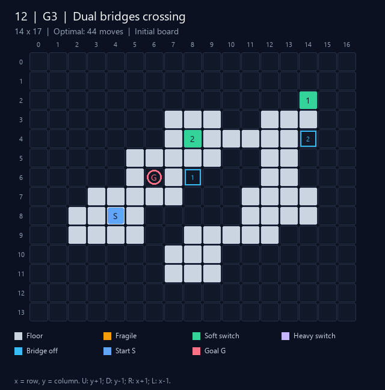
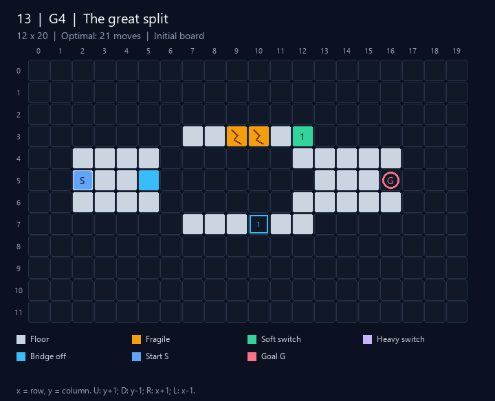
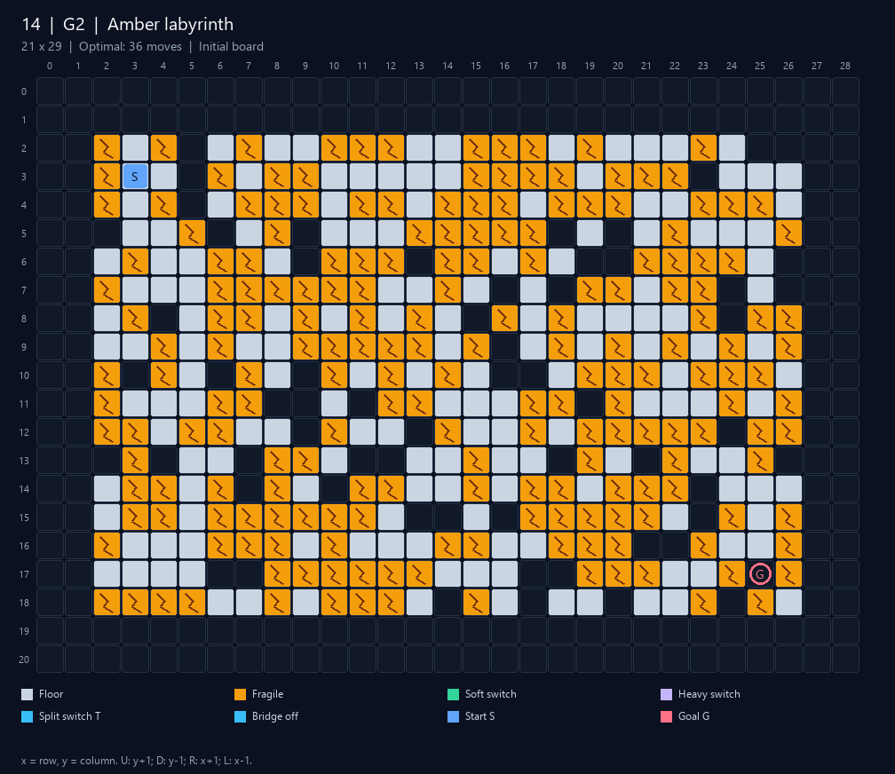

# Màn khó bổ sung theo review của Kiên

Đáp ứng mục 6 của [report3.md](report3.md): thêm màn có 4–6 công tắc và
nhiều ô dễ vỡ để bộ thực nghiệm có độ phân hóa rõ hơn. Các màn dùng đúng
luật `.data` v1 hiện tại; danh mục và file phát lại nằm trong `code/data/`.

## Kết quả kiểm chứng

| Màn | Lưới | Công tắc thường/nặng | Ô dễ vỡ | Tối ưu | Node BFS/A* h=0 mở rộng | Cấu hình cầu đã gặp |
|---:|---|---|---:|---:|---:|---:|
| 12 — 4-switch vault | 17×35 | 2/2 | 0 | 44 | 6.663 | 16 |
| 13 — 6-switch vault | 21×49 | 3/3 | 0 | 66 | 47.675 | 64 |
| 14 — Amber labyrinth | 21×29 | 0/0 | 200 | 36 | 687 | 1 |

Mốc bộ cũ: màn 9 mở rộng 1.393 node với A* `h=0`. Màn 12 và 13 nâng số node
tương ứng khoảng 4,8 lần và 34,2 lần. Đây là số lượng node theo thứ tự hành
động hiện tại, không phải kết quả đo thời gian chính thức. `nodes_expanded`
không tính trạng thái đích; khi dùng chi phí 1 và `h=0`, BFS chuẩn trong test
và A* có cùng độ dài tối ưu và các số đếm trên.

## Vì sao các cơ chế là bắt buộc?

**Màn 12 và 13:** các công tắc đặt trong phòng xuất phát, mỗi công tắc điều
khiển riêng một ô cầu trên hành lang duy nhất tới đích. Phải thu thập đúng
cấu hình cầu trước khi rời phòng; đứng nhầm trên công tắc có thể đóng lại
cầu. Cả công tắc thường và nặng đều tham gia vào lời giải. Bỏ riêng từng
công tắc, để cầu của nó đóng, thì BFS xác nhận vô nghiệm. Do các công tắc
độc lập, cùng một vị trí/tư thế có thể xuất hiện với nhiều `bridge_mask`.
BFS tới đích đầu tiên đã gặp đủ 16 và 64 cấu hình cầu tương ứng.

**Màn 14:** có 200 ô cam và các hốc trống. Lời giải tối ưu dài 36 bước, đi
qua 28 ô cam khác nhau ở tư thế nằm. Nếu thay ô cam bằng sàn thường mà giữ
nguyên các hốc và vị trí đầu/đích, tối ưu giảm còn 25 bước. Màn này kiểm tra
ràng buộc tư thế và có thể dùng để minh họa hàm chi phí phạt ô cam khi TV3
hoàn thành mô hình chi phí.







Các hình là sơ đồ lưới ban đầu được dựng từ file `.data`, không phải ảnh
chụp game 3D. Công tắc và ô cầu cùng số là một cặp điều khiển.

## Chạy lại và nghiệm thu

Từ thư mục gốc repository:

```bash
python -m pytest tests/test_levels.py tests/test_hard_levels.py -q
python main.py code/data/12.data --algo astar --heuristic zero
python main.py code/data/13.data --algo astar --heuristic zero
python main.py code/data/14.data --algo astar --heuristic zero
```

Sau khi build game, đứng trong `code/`:

```bash
./a.out 12 --play data/solutions/12.txt
./a.out 13 --play data/solutions/13.txt
./a.out 14 --play data/solutions/14.txt
```

Windows native thay `./a.out` bằng `./a.exe` hoặc `./Bloxorz.exe`.
Kết quả nghiệm thu cần là `WON` với 44, 66 và 36 bước tương ứng. Ba màn mới
đã kiểm chứng mô phỏng Python và BFS/A*; lượt phát lại C++ cần nhóm thực
hiện trên bản game đã build. Màn 1–11 giữ nguyên dữ liệu cũ đã review.

Khi TV5 hoàn thành Manhattan và TV3 hoàn thành UCS/chi phí, chạy cùng bộ màn
với từng thuật toán/heuristic. Với chi phí 1, so sánh độ dài và node; với
chi phí không đồng nhất, đối chiếu chi phí A* với UCS. Đo thời gian lặp nhiều
lần và đo bộ nhớ ở lượt riêng theo kế hoạch Experiments của nhóm. Mức giảm
node của Manhattan cần được đo thực tế sau khi cài heuristic.

## Bằng chứng trong test

- `test_levels.py`: kiểm tra file, catalog, lời giải tối ưu, cầu bắt buộc,
  ảnh, viền 2 ô trống và tác dụng của ô cam.
- `test_hard_levels.py`: chạy BFS độc lập, đối chiếu lời giải A* `h=0`, kiểm
  tra đủ cấu hình cầu và ngưỡng tối thiểu 5.000/40.000 node; màn ô cam phải
  thực sự đi qua ít nhất 20 ô cam khác nhau.
- Toàn bộ bộ test: **104 passed, 14 skipped** trên nhánh này; phần SKIP vẫn
  chờ BFS/DFS/UCS và Manhattan được cài.

## Nguồn và phụ lục AI

Ba màn 12–14 được thiết kế cho dự án với hỗ trợ ChatGPT/Codex theo yêu cầu
**“Làm thêm màn khó theo góp ý của Kiên”**. Cần ghi công cụ và prompt này
vào phụ lục sử dụng AI chung của nhóm. Quy tắc của game nền không thay đổi.
