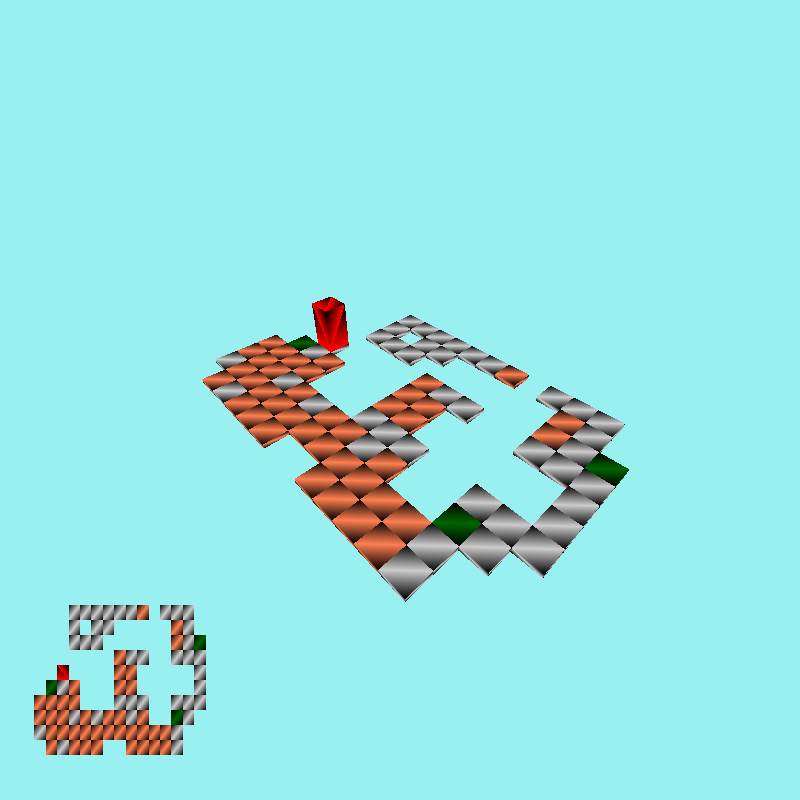
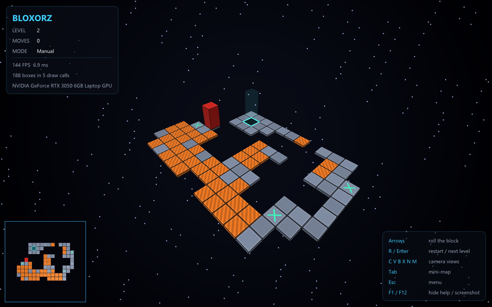
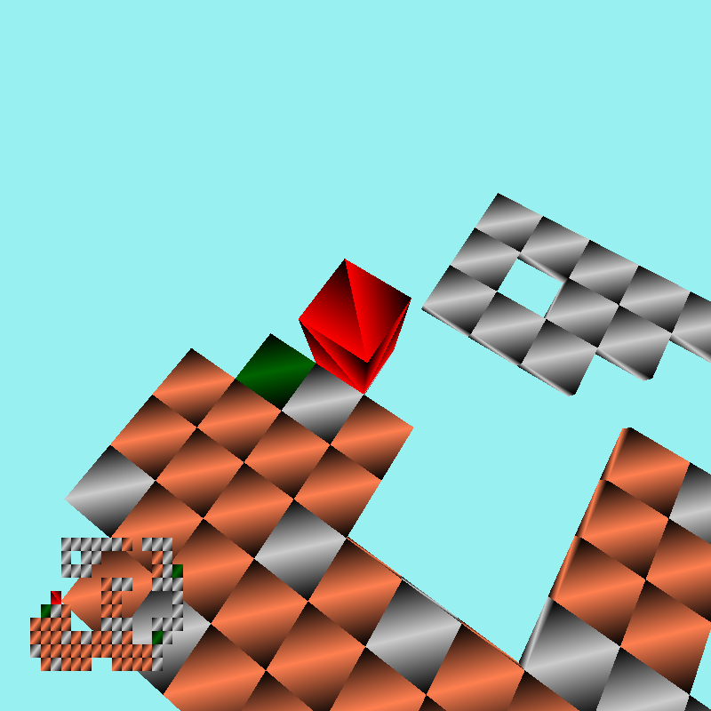
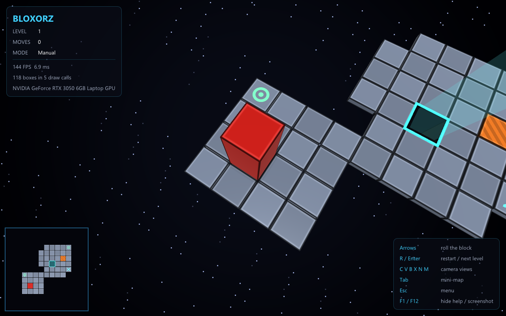
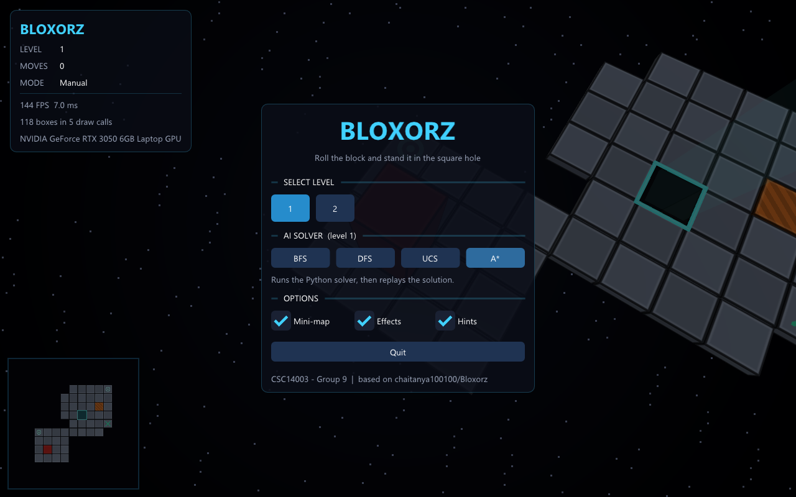
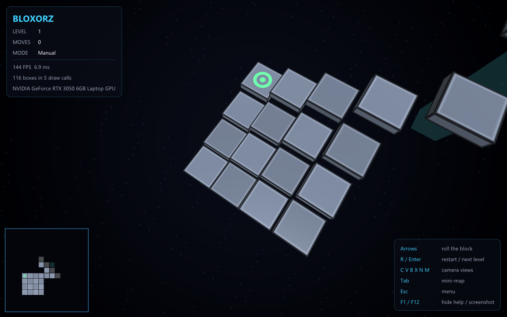
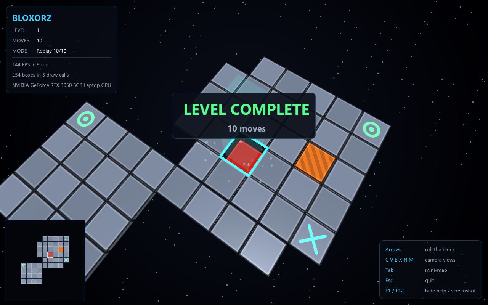
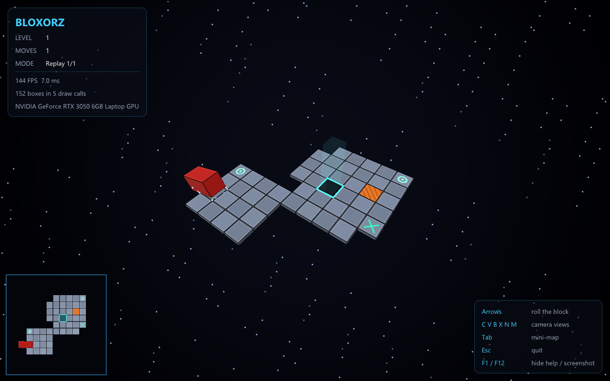
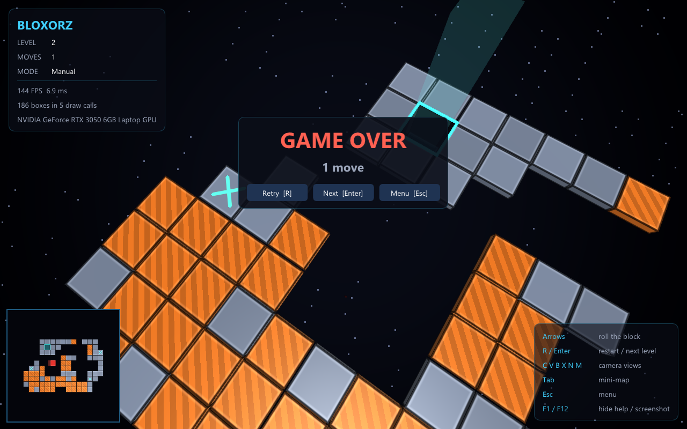

# Report 2: Nâng cấp GUI và đóng gói game (nhóm 9)

> Báo cáo nội bộ cho cả nhóm, đặc biệt là người phụ trách GUI (TV2). Đây là kết quả thực hiện [implementation_plan_GUI_upgrade.md](implementation_plan_GUI_upgrade.md).
> Cập nhật 22/10/2026. Nhánh làm việc: `feature/gui-upgrade` (chưa commit).

## 1. Tóm tắt

| Mục tiêu | Kết quả |
|---|---|
| Hết lag | Bản **Windows native** chạy **144 FPS** (bằng tần số màn hình) trên GPU rời. Animation tính theo **thời gian thật**: phát lại 68 nước ở màn 2 mất 34.4 s trên WSL và 35.1 s trên native. Bản gốc lệch nhau 12 s giữa hai môi trường. |
| Giao diện đẹp hơn | Nền đen có sao, ánh sáng Blinn-Phong, viền và gờ cho mọi khối, mỗi loại ô có hình riêng, ô đích phát sáng, bóng đổ, MSAA 4×. |
| Hiệu ứng | Ô rơi xuống khi mở màn, bụi khi khối chạm sàn, cầu trồi lên hoặc rơi khi bật/tắt, khối chìm vào lỗ kèm pháo sáng khi thắng, khối lật và rơi (ô cam vỡ theo) khi thua. |
| Menu và HUD | Dear ImGui: chọn màn, Restart, sang màn tiếp, nút **Solve BFS/DFS/UCS/A\*** chạy **ở luồng nền**, bảng thông số, bảng kết thúc, thông báo lỗi solver. |
| Đóng gói | `make dist` tạo `Bloxorz.exe`: link tĩnh (không cần DLL), không mở console, có icon. Kèm `data/`, `solver/`, `licenses/`, nén thành `dist/Bloxorz-win64.zip` (1.2 MB). Chạy được ở thư mục có dấu tiếng Việt. Có cả gói Linux. |
| Không đổi luật | Khối code chuyển trạng thái và `Game::check` được chép **nguyên văn**. Lời giải màn 1 / màn 2 vẫn thắng đúng 10 / 68 bước trên WSL, native dev và native release. `pytest`: 36 passed, 10 skipped (giống trước). |

## 2. Trước và sau

| Bản gốc | Bản mới |
|---|---|
|  |  |
|  |  |

Bản gốc có ba vấn đề hình ảnh:
- Mỗi tam giác có một đỉnh tô **màu đen**, nên mọi mặt đều có vệt gradient đen.
- Không có ánh sáng, nền xanh da trời, ô đích không được vẽ (chỉ là một lỗ trống).
- Bản đồ nhỏ đè thẳng lên cảnh, không có khung.

| Menu chính | Hiệu ứng mở màn | Solver chạy nền |
|---|---|---|
|  |  |  |

| Thắng | Khối rơi khi thua | Bảng thua | Solver chưa cài |
|---|---|---|---|
|  |  |  |  |

Tất cả ảnh đều do game tự chụp (`--shot` hoặc phím F12) từ bản native, ở cửa sổ 1280×800.

## 3. Việc đã làm theo từng giai đoạn

### Phase A: Build Windows native và đo FPS

- Cài **MSYS2 MinGW64** (`winget install MSYS2.MSYS2`, rồi `pacman -S make zip mingw-w64-x86_64-{gcc,glfw,glm}`). Dùng GCC 16.2 và GLFW 3.4 bản tĩnh. Bản MinGW cũ ở `D:\bin` (GCC 6.3, 32-bit) **không dùng được**.
- FPS và thời gian mỗi frame hiện trên **tiêu đề cửa sổ** và **HUD**. Chế độ `--play/--solve` in thêm `Frames : N, average FPS : X` khi thoát.
- **Laptop có 2 GPU**: exe export `NvOptimusEnablement` và `AmdPowerXpressRequestHighPerformance` để driver chọn GPU rời. Trên máy thử, game tự chuyển từ *Intel UHD 770* sang *RTX 3050 Laptop*. HUD hiện tên GPU đang dùng.

### Phase B: Mượt và không phụ thuộc FPS

| File | Thay đổi |
|---|---|
| `main.cpp` | Vòng lặp tách hai bước: **cập nhật** (`update_game(now, dt)`), rồi **vẽ** (`render_frame`). `dt` bị kẹp ≤ 0.05 s để tránh nhảy cóc khi kéo cửa sổ. Bật MSAA 4×. |
| `superblock.cpp` | `update(float dt)`: `done_rotation += roll_speed*dt` (450°/s, khoảng 0.2 s mỗi lần lăn) và kẹp ở 90°. Bản gốc cộng 5° **mỗi frame**. Góc **hiển thị** có easing (nhanh dần rồi chậm dần); luật vẫn chỉ dùng `done_rotation`. |
| `camera.cpp` | Camera theo khối: `eye += (1 - e^{-3.2·dt})·(r - eye)`, thay cho `eye += 0.05·(r - eye)` mỗi frame. Camera trực thăng và chuột nhân bước di chuyển với `dt·60`. |
| `controls.cpp` | Góc nhìn 90° → 75° (đỡ méo ở mép). Phép chiếu song song giữ đúng tỉ lệ (`ortho_fit`). Không chia cho 0 khi thu nhỏ cửa sổ. |
| `main.cpp` | Phím **Tab** bật/tắt bản đồ nhỏ. Bản đồ nhỏ giờ là hình vuông, có viền và nền riêng (scissor). |

Sửa thêm một **lỗi của bản gốc**: lúc vẽ bản đồ nhỏ, `camera.change_view()` đặt lại `proj_type = 1` mỗi frame, nên phím **Space** (đổi phép chiếu) gần như không có tác dụng. Bản đồ nhỏ giờ dùng ma trận riêng, và Space hoạt động đúng.

### Phase C: Bộ vẽ và giao diện mới

- **`render.h/.cpp`**: một mesh hộp đơn vị [0,1]³ duy nhất dùng chung cho ô, khối, khung đích, bóng và hạt.
  - `draw_box()` chỉ ghi hộp vào lô; `flush()` gửi cả lô lên GPU và vẽ bằng **một** lệnh `glDrawArraysInstanced`.
  - Màn 2 trước đây cần **166 lệnh vẽ** mỗi frame (82 ô + khối, nhân 2 cho bản đồ nhỏ, mỗi lệnh kèm một lần gửi uniform). Giờ chỉ còn **5 lệnh** cho khoảng 190 hộp (nền + 2 lượt × 2 khung nhìn).
  - Bật/tắt cầu **không còn** cấp phát VAO/VBO giữa lúc chơi.
- **`shaders.h`**: shader viết thẳng trong code (raw string C++11), nên không còn cần file `Sample_GL.vert/.frag` đi kèm (đã xóa).
  - *Shader hộp*: Blinn-Phong, ánh sáng môi trường theo hướng pháp tuyến, rim light, **viền tối + gờ sáng** tính theo khoảng cách tới mép mặt (độ dày viền đều theo đơn vị thế giới), hoa văn theo loại ô, phát sáng, sương mù theo khoảng cách hòa vào nền tối.
  - *Shader nền*: gradient tối có vignette và sao lấp lánh. Vẽ bằng một tam giác phủ màn hình, không cần buffer.
- **Bảng màu** (`colors.cpp`) và **hình từng loại ô** (`Floor::tile_style`):

| Ô | Hình mới |
|---|---|
| Sàn (1) | Xám thép ánh xanh, xen kẽ đậm/nhạt kiểu bàn cờ để dễ đếm ô, có khe nhỏ giữa các ô |
| Ô cam (2) | Cam, sọc chéo |
| Công tắc thường (3) | Vòng tròn xanh lá phát sáng, nhấp nháy |
| Công tắc nặng (4) | Dấu X xanh ngọc phát sáng |
| Ô cầu | Xám ánh vàng (tự nhận ra từ danh sách công tắc trong file `.data`) |
| **Ô đích** (trước đây không vẽ) | Lỗ vuông có thành tối, khung cyan nhấp nháy và cột sáng mờ nhìn được từ xa |
| Khối | Đỏ sẫm có viền, kèm **bóng mềm** tính từ hình chiếu thật của khối (đúng cả khi đang lăn) |

### Phase D: Hiệu ứng (`effects.h/.cpp`, `tile.cpp`, `superblock.cpp`)

Tất cả hiệu ứng chỉ là hình ảnh, chạy theo `dt` và **không đọc hay ghi trạng thái luật**. Có thể tắt bằng ô **Effects** trong menu (dành cho máy yếu).

| Hiệu ứng | Cách làm |
|---|---|
| Mở màn (khoảng 1.2 s) | Các ô rơi xuống theo sóng chéo (trễ theo `i+j`), sau đó khối rơi xuống và nảy. Phím bị khóa trong lúc này; phát lại `--play` chỉ bắt đầu khi hiệu ứng xong. |
| Lăn | Easing + 18 hạt bụi bay ra quanh chân khối mỗi lần chạm sàn |
| Cầu bật | Ô trồi lên từ dưới và nảy về kích thước thật (0.35 s) |
| Cầu tắt / ô cam vỡ | Ô biến thành "ghost": vừa rơi, vừa xoay, vừa mờ dần (1.2 s). `tiles[a][b] = NULL` xảy ra **đúng lúc như cũ** |
| Thắng | Khối chìm vào lỗ, 140 hạt sáng bắn lên, bảng **LEVEL COMPLETE** |
| Thua | Khối lật về phía không có sàn rồi rơi; nếu đang đứng trên ô cam thì ô vỡ rơi theo; bảng **GAME OVER** |

### Phase E: Menu, HUD và hai chế độ chạy

- Thêm **Dear ImGui v1.91.9** (MIT) vào `code/third_party/imgui/` (core + backend GLFW/OpenGL3). Font lấy từ hệ điều hành lúc chạy (Segoe UI hoặc DejaVu Sans); nếu không có thì dùng font mặc định của ImGui.
- **`hud.cpp`**: bảng thông số (màn, số bước, chế độ Manual / Replay i/n / Solving, FPS, số hộp / lệnh vẽ, GPU), bảng phím, thông báo solver, bảng kết thúc (Retry [R], Next [Enter], Menu [Esc]) và menu chính (chọn màn, Resume, Solve, tùy chọn Mini-map / Effects / Hints, Quit).
- **`app.h`**: trạng thái và thao tác cấp ứng dụng (`app_start_level`, `app_restart`, `app_next_level`, `app_solve`, …) dùng chung cho phím tắt và nút bấm.
- **Hai chế độ chạy**:

| | Chế độ kiểm chứng (`--play` / `--solve`) | Chế độ game (không tham số, double-click) |
|---|---|---|
| Hành vi | Như bản cũ: tự phát lại, in `WON` / `GAME OVER` + `Steps`, giữ màn hình **2 s** (cũ: 1.5 s) rồi thoát | Mở menu, không tự thoát, có Restart / Next / chọn màn |
| Mã thoát | 0 thắng, 1 thua | 0 |
| Esc | Thoát | Mở/đóng menu |

- **Solve chạy nền**: `app_solve()` gọi `run_solver()` trong một `std::thread` tách rời; vòng lặp chính chỉ đọc kết quả qua `std::atomic`. Cửa sổ vẫn chạy khoảng 122–144 FPS khi Python đang giải. Giải xong thì màn được nạp lại và lời giải tự phát sau hiệu ứng mở màn. Nếu lỗi (solver chưa cài, không có Python, không có lời giải…), thông báo hiện ngay trong game và output đầy đủ nằm ở `solver_log.txt`.
- **Chơi lại không rò bộ nhớ**: `Game::initialize()` giờ đặt lại `gameover`, `won`, `number_of_steps`. `Floor::initialize()` gọi `Floor::clear()` để giải phóng lưới cũ. Bản gốc chỉ cấp phát mà không giải phóng, và hàm hủy dùng `delete` thay vì `delete[]`. Bỏ `Game::done()` (hàm này gọi hàm hủy thủ công, có thể giải phóng hai lần) và `Game::increase_level()` (không dùng tới).
- Phím mới: **R** (chơi lại), **Enter** (sang màn tiếp / chơi lại khi thua), **Tab**, **F1** (ẩn bảng phím), **F12** (chụp màn hình `screenshot_*.png`).

### Phase F: Đóng gói

| Vấn đề | Cách giải quyết |
|---|---|
| Exe cần DLL của MinGW/GLFW | `make release`: `-static -static-libgcc -static-libstdc++`. `ldd Bloxorz.exe` chỉ còn DLL hệ thống của Windows. |
| Cửa sổ console đen | `-mwindows`. Khi chạy từ terminal với `--play` / `--solve`, game gắn vào console của terminal (`AttachConsole`), trừ khi stdout đã được chuyển hướng. |
| Icon, thông tin phiên bản | `bloxorz.rc` (icon tên `GLFW_ICON` để GLFW dùng luôn cho cửa sổ). Icon sinh bằng `assets/make_icon.py`, chỉ dùng thư viện chuẩn Python. |
| Mở từ shortcut / thư mục khác | Nếu thư mục hiện tại không có `data/`, game chuyển về thư mục chứa exe (`GetModuleFileNameW`; Linux: `/proc/self/exe`). File `--play` được đọc **trước** khi đổi thư mục. |
| Đường dẫn có dấu (`Cơ sở AI`, `Thử nghiệm đóng gói`) | `argv` của MinGW theo bảng mã ANSI nên làm hỏng ký tự có dấu. Game đọc lại dòng lệnh bằng `CommandLineToArgvW` → UTF-8, và mở file qua `utf8_fopen` (`_wfopen`). |
| Gọi solver Python | Tìm `solver/main.py` cạnh exe (bản đóng gói), không có thì dùng `../main.py` (repo). Trình thông dịch: `$BLOXORZ_PYTHON` → `python` → `py -3`. Đặt `PYTHONIOENCODING=utf-8` vì output solver có tiếng Việt. Trên Windows gọi qua `CreateProcessW` + `CREATE_NO_WINDOW` nên không nháy console. |
| Build WSL và MSYS2 chung thư mục | Object để riêng ở `build/linux/` và `build/win64/`; gói ở `dist/<nền tảng>/Bloxorz/`. |

Nội dung gói (`make dist`): `Bloxorz.exe`, `data/*.data`, `solver/main.py` + `solver/ai/`, `README.txt` (cách chơi, phím, cài Python cho nút Solve) và `licenses/` (THIRD_PARTY_NOTICES, giấy phép ImGui).

## 4. Đảm bảo không đổi luật

- Khối chuyển `ix/iy/along` trong `SuperBlock::update` và lời gọi `game.check_after_step()` được **chép tự động nguyên văn** từ file cũ (bằng script), chỉ thêm `land_dust()` sau đó. Công thức xoay hình trong `draw` cũng được giữ, chỉ thay biến góc bằng góc đã easing.
- `Game::check`, `Game::check_after_step`, cách đọc `.data`, `has_tile` và quy tắc bật/tắt cầu giữ nguyên. Việc bật/tắt cầu được gom vào `Floor::toggle()` nhưng logic giống hệt; phần thêm vào chỉ ghi thời điểm để vẽ hiệu ứng.
- Thứ tự mỗi frame giữ như bản gốc: camera → autoplay → lăn khối → `check()`.
- Không đụng `ai/`, `tests/`, `main.py`, `code/data/`.

Kết quả kiểm chứng (bản build cuối):

| Phép thử | WSL (`a.out`) | Native dev (`a.exe`) | Native release (`Bloxorz.exe`) |
|---|---|---|---|
| `1 --play` lời giải 10 bước | WON, 10, mã 0 | WON, 10, mã 0 | WON, 10, mã 0 |
| `2 --play` lời giải 68 bước | WON, 68, mã 0 | WON, 68, mã 0 | WON, 68, mã 0 |
| `1 --play` "L" (rơi) | GAME OVER, 1, mã 1 | GAME OVER, 1, mã 1 | GAME OVER, 1, mã 1 |
| `python -m pytest -q` | 36 passed, 10 skipped | | |

Kiểm thử chế độ game bằng thao tác chuột và phím thật (script PowerShell gửi input vào cửa sổ):
- Bấm **BFS** trong menu → solver chạy nền → tự phát lại → thắng → **Enter** sang màn 2.
- Đi tay bằng mũi tên → **Esc** mở menu (hiện nút Resume khi ván đang dở) → Esc đóng menu.
- Bấm **A\*** khi solver chưa cài → hiện thông báo "not implemented yet".

Để thử đường "giải thành công" mà không cài thuật toán trong repo (quy tắc của nhóm), script dùng một **solver giả đặt ngoài repo**, chỉ trả về lời giải đã biết.

Kiểm thử gói: giải nén `Bloxorz-win64.zip` vào thư mục `…\Thử nghiệm đóng gói\`, chạy với thư mục làm việc là `C:\`. Kết quả:
- Menu hiện bình thường; ảnh chụp lưu được vào thư mục `ảnh\`.
- `Bloxorz.exe 1 --play "…\lời giải 1.txt"` in đủ output và trả mã 0.
- Nút Solve gọi đúng `solver/main.py` của gói.

Gói Linux: giải nén vào `/tmp`, chạy từ `/` → WON, mã 0.

## 5. Số liệu hiệu năng

Máy thử: Windows 11, Intel UHD 770 + NVIDIA RTX 3050 6GB Laptop, màn hình 144 Hz; WSLg dùng `llvmpipe` (vẽ bằng CPU).

**FPS khi không giới hạn** (`--no-vsync`, màn 2, đứng yên 6 s, trung bình 3 lần):

| Bản | Môi trường / GPU | Cửa sổ | FPS |
|---|---|---|---|
| Gốc | Native / Intel UHD 770 | 800×800, không MSAA | ~1990 |
| Mới | Native / Intel UHD 770 (tắt gợi ý GPU rời) | 1280×800, MSAA 4× | ~405 |
| Mới | Native / RTX 3050 (mặc định) | 1280×800, MSAA 4× | ~1290–1560 |
| Gốc | WSLg / llvmpipe | 800×800 | ~340 |
| Mới | WSLg / llvmpipe | 1280×800 | ~70–77 |

**FPS khi chơi thật** (bật vsync): native mới **144** (chạm trần màn hình); WSLg gốc **57**, WSLg mới **~40**.

**Thời gian phát lại 68 nước ở màn 2**:

| | WSLg | Native | Chênh lệch |
|---|---|---|---|
| Gốc | 39.5 s | 27.3 s | **12.2 s**: tốc độ lăn phụ thuộc FPS (18 frame mỗi lần lăn) |
| Mới | 34.4 s | 35.1 s | **0.7 s**: chỉ còn khác biệt lúc khởi động (bản mới tính cả 1.2 s mở màn và 2 s giữ màn hình) |

Đánh giá thẳng thắn:
- Mỗi frame của bản mới **tốn hơn** bản gốc: cửa sổ nhiều pixel hơn khoảng 60%, MSAA 4×, ánh sáng tính cho từng pixel, nền có shader, thêm HUD.
- Trên GPU thật thì dư rất nhiều: 405 FPS ngay cả trên Intel tích hợp, so với yêu cầu 144.
- Trên WSLg, vì mọi thứ vẽ bằng CPU, FPS giảm từ 57 xuống khoảng 40. Nhờ animation theo thời gian thật, chuyển động vẫn đúng tốc độ, chỉ bớt mịn.
- Muốn chơi mượt thì dùng bản **native / `Bloxorz.exe`**. WSL nên để phát triển và kiểm chứng.
- Instancing giảm mạnh số lệnh vẽ và việc của CPU, nhưng trên Intel giới hạn nằm ở số pixel GPU phải tô, nên FPS gần như không đổi (427 → 405, trong sai số).

## 6. Khác biệt so với kế hoạch

| Kế hoạch | Thực tế | Lý do |
|---|---|---|
| Mesh hộp dùng chung | Có, và thêm **instancing** (5 lệnh vẽ mỗi frame) | Giảm việc của CPU và driver; chỗ để thêm hiệu ứng nhiều hộp sau này |
| Không đề cập | Gợi ý **GPU rời** cho laptop | Phát hiện khi đo: Windows mặc định cho game chạy trên Intel |
| Không đề cập | **Đường dẫn Unicode**, gắn console, `build/<nền tảng>/`, `dist/<nền tảng>/` | Lỗi phát hiện khi thử gói trong thư mục có dấu và khi build hai nền tảng chung thư mục |
| Bloom (tùy chọn) | **Chưa làm** | Không cần cho mục tiêu; để ở hướng nâng cấp |
| Màn mặc định | Chế độ game mở **màn 1** + menu; chế độ CLI vẫn mặc định màn 2 | Hợp với người chơi mới, không ảnh hưởng lệnh kiểm chứng cũ |
| Giữ màn hình 1.5 s | 2.0 s (chỉ ở chế độ CLI) | Đủ thời gian xem hiệu ứng thắng/thua |
| Chữ trên giao diện | **Tiếng Anh** | Font mặc định của ImGui không có dấu tiếng Việt; thông báo console vốn đã bằng tiếng Anh (quy ước nhóm) |
| Thêm | Chụp màn hình PNG (F12, `--shot`), tùy chọn dev `--no-vsync`, `--camera`, `--quit-after`, `--no-menu` | Phục vụ đo đạc, làm báo cáo, quay video và kiểm thử tự động |

## 7. Hạn chế còn lại

1. **WSLg chậm hơn bản gốc** (40 so với 57 FPS khi bật vsync) vì vẽ bằng CPU. Chưa có tùy chọn chất lượng thấp (tắt MSAA, giảm độ phân giải).
2. **Gói Linux chưa tự chứa**: vẫn cần `libglfw3` trên máy đích. Gói Windows thì tự chứa hoàn toàn. Chưa thử trên macOS.
3. **Nút Solve cần Python ≥ 3.10** trên máy người chơi, và 4 thuật toán vẫn đang là TODO (sẽ hiện thông báo "not implemented" cho tới khi nhóm cài xong).
4. **Không hủy được solver**: lỡ chọn DFS trên màn lớn thì phải chờ; thoát game không dừng tiến trình Python đang chạy.
5. Hiệu ứng rơi khi thua là **xấp xỉ** (xoay quanh tâm khối, không xoay quanh mép ô).
6. Ảnh F12 lưu dạng **PNG không nén** (khoảng 3 MB mỗi ảnh). Ảnh trong báo cáo này đã được nén lại riêng.
7. Chưa lưu cài đặt (bản đồ nhỏ, hiệu ứng, vị trí cửa sổ) giữa các lần chạy.
8. `Bloxorz.exe` chưa ký số nên Windows SmartScreen có thể cảnh báo khi chạy lần đầu.

## 8. Hướng nâng cấp có thể

Sắp theo mức độ ưu tiên cho đồ án. "Công" là ước lượng thô theo người-ngày.

### 8.1. Phục vụ trực tiếp yêu cầu của đề (nên làm trước)

| Hướng | Mô tả | Công | Gợi ý người làm |
|---|---|---|---|
| **Panel số liệu solver** | Thêm `main.py --stats-out stats.json` (thời gian, bộ nhớ đỉnh, số node mở rộng, độ dài lời giải), rồi hiện trong HUD sau mỗi lần Solve. Đề bắt buộc đo 4 chỉ số này và cần quay lên video. | 1 | TV2 + TV5 |
| **Hủy solver + giới hạn thời gian** | Nút Cancel (giữ handle tiến trình, `TerminateProcess` / `kill`) và tùy chọn timeout trong `BaseSolver` (S3-10). | 0.5 | TV2, TV3 |
| **Vẽ split block** (S2-04) | `render.draw_box` đã sẵn: hai cube 1×1×1, tô sáng cube đang điều khiển, Space để đổi cube. Gom luật split vào `SuperBlock` mà không đụng phần vẽ. | 2 | TV1 + TV2 |
| **≥ 10 màn + ảnh xem trước** | Menu đã tự quét `data/*.data`. Có thể thêm tên màn, độ khó, ảnh thu nhỏ (vẽ bản đồ nhỏ vào FBO) và đánh dấu màn đã thắng. | 1 | TV4 |
| **So sánh 4 thuật toán ngay trong game** | Chạy cả 4 solver nền rồi hiện bảng so sánh, hoặc biểu đồ cột bằng `ImGui::PlotHistogram`. Rất hợp phần thực nghiệm của báo cáo. | 1 | TV5 |
| **Hiển thị quá trình tìm kiếm** | Solver xuất thứ tự các trạng thái đã mở rộng; game tô màu ô theo số lần được thăm (heatmap) hoặc phát lại "làn sóng" BFS so với A\*. Minh họa trực quan cho vấn đáp về heuristic. | 2 | TV5 + TV2 |
| **Nút Gợi ý (Hint)** | Giải từ trạng thái hiện tại rồi tô sáng nước tiếp theo. Cần truyền trạng thái hiện tại (vị trí, tư thế, `bridge_mask`) sang `main.py`. | 1 | TV3 |

### 8.2. Trải nghiệm chơi

- **Undo (Z)**: lưu lịch sử `(ix, iy, along, cầu)`. Nên làm **sau** khi gom trạng thái luật vào một struct riêng (xem 8.5).
- Đếm thời gian, lưu số bước tốt nhất từng màn, xếp sao so với số bước tối ưu (lấy từ BFS).
- **Âm thanh** bằng miniaudio (MIT, một file header): tiếng lăn, công tắc, cầu, rơi, thắng, nhạc nền.
- Giao diện **tiếng Việt**: đóng gói font có dấu (ví dụ *Be Vietnam Pro*, giấy phép OFL) và nạp dải ký tự `GetGlyphRangesVietnamese()`.
- Lưu cài đặt ra file `.ini`; **F11** để bật toàn màn hình; hỗ trợ tay cầm (GLFW gamepad); đổi phím; hướng dẫn chơi lần đầu.
- Camera xoay quanh bằng chuột phải + cuộn để zoom ở mọi chế độ camera; khi đổi camera thì chuyển mượt thay vì nhảy.

### 8.3. Đồ họa

- **Bóng đổ thật** bằng shadow map (bóng mềm hiện tại chỉ là một hình chữ nhật mờ dưới khối).
- Hậu xử lý: **bloom** cho ô đích và hạt sáng, SSAO nhẹ, tone mapping. Cần render vào FBO trước.
- **Mức chất lượng** Low / Medium / High: tắt MSAA, giảm độ phân giải render, tắt nền sao. Rất có ích cho WSLg và máy yếu.
- Mặt ô có vân hoặc normal map, khối có cạnh bo tròn (thay hộp bằng mesh bevel).
- Rung camera nhẹ khi khối rơi; khung đích "hút" khối khi thắng.

### 8.4. Đóng gói và phát hành

- **Solver không cần Python**: đóng gói `main.py` + `ai/` thành `solver.exe` bằng PyInstaller. `run_solver` đã tìm `solver/…` cạnh exe, chỉ cần thêm nhánh gọi `solver/solver.exe`.
- **Trình cài đặt** bằng Inno Setup hoặc NSIS (shortcut Start Menu, gỡ cài đặt), ký số exe để SmartScreen không cảnh báo.
- **CI** bằng GitHub Actions: build Windows (MSYS2) và Linux mỗi lần push, chạy `pytest` + kiểm chứng `--play` (Linux có thể chạy không màn hình bằng `xvfb-run`), đính kèm file zip vào mỗi bản phát hành.
- Linux: AppImage hoặc link tĩnh GLFW để gói tự chứa; macOS: `.app` bundle.
- Lưu ảnh F12 có nén (stb_image_write, public domain).
- **Chơi trên trình duyệt** bằng Emscripten: shader GLSL 330 đổi sang GLSL ES 3.0 / WebGL2 khá dễ vì chỉ có 2 shader; solver chạy bằng Pyodide hoặc viết lại bằng JS. Gửi giảng viên một đường link thay vì file zip.

### 8.5. Kỹ thuật và chất lượng code

- **Tách trạng thái luật khỏi phần vẽ**: một `struct GameState { ix, iy, along, bridge_mask }` cùng hàm `step()` thuần, không phụ thuộc OpenGL. Từ đó:
  - viết **test C++ không cần màn hình**;
  - **so khớp luật C++ ↔ Python tự động** (task S3-05) trên mọi màn và mọi lời giải;
  - làm Undo dễ dàng.
- Gom các biến toàn cục (`stage`, `superblock`, `game`, `camera`, …) vào một lớp `App`.
- Chuyển sang CMake để mở được bằng Visual Studio / CLion (makefile hiện tại vẫn giữ cho WSL).
- Thêm `.clang-format`; bật `-Wall -Wextra` riêng cho code của nhóm (code gốc còn nhiều cảnh báo).

## 9. Hướng dẫn nhanh cho nhóm

```bash
# Windows native (khuyên dùng để chơi/quay video): mở "MSYS2 MinGW x64"
cd "/d/study_file/Cơ sở AI/Lab/CSAI_Group9_Lab01/code"
make && ./a.exe                       # bản dev (có console để xem log)
make dist                             # ../dist/Bloxorz-win64.zip gửi cho người khác

# WSL (phát triển/kiểm chứng luật như trước)
make && ./a.out 1 --play sol1.txt     # WON, Steps : 10

# Tùy chọn hữu ích khi quay video / làm báo cáo
./a.exe 2 --camera b --no-menu        # vào thẳng màn 2, camera tháp
./a.exe 2 --no-vsync --quit-after 6   # đo FPS tối đa
./a.exe 1 --shot 2.0 anh.png          # tự chụp màn hình ở giây thứ 2
```

Muốn sửa giao diện:

| Muốn đổi | Sửa ở |
|---|---|
| Màu | `code/colors.cpp` (các hằng `FLOOR_COLOR`, `BLOCK_COLOR`, …) |
| Hoa văn, ánh sáng, viền | `code/shaders.h` (`BOX_FRAG`) và `Floor::tile_style()` trong `tile.cpp` |
| Hiệu ứng | `code/effects.cpp` (hạt, mở màn) và `SuperBlock::draw` (chìm / rơi) |
| Menu, HUD | `code/hud.cpp`; thao tác dùng chung nằm trong `app.h` / `main.cpp` |
| Tốc độ lăn / tốc độ phát lại | `roll_speed` (`superblock.cpp`) / `autoplay_delay` (`autoplay.cpp`) |

**Nhớ**: phần hình ảnh sửa thoải mái; phần **luật** (`game.cpp`, khối chuyển trạng thái trong `superblock.cpp`, đọc file / bật tắt cầu trong `tile.cpp`) vẫn phải sửa **cùng lúc với `ai/problem.py`** và kiểm chứng bằng `--play`.

## 10. Phụ lục: file thay đổi

- **Mới**: `code/app.h`, `render.h/.cpp`, `shaders.h`, `effects.h/.cpp`, `hud.h/.cpp`, `screenshot.h/.cpp`, `bloxorz.rc`, `assets/` (icon, `make_icon.py`, `README_dist.txt`), `third_party/imgui/` (16 file), `Docs/images/gui_upgrade/` (11 ảnh, 2.4 MB), `Docs/report2.md`.
- **Sửa**: `code/main.cpp`, `superblock.*`, `tile.*`, `camera.*`, `colors.*`, `controls.*`, `game.*`, `autoplay.*`, `noedit.*`, `headers.h`, `makefile`; `README.md`, `Docs/play.md`, `THIRD_PARTY_NOTICES.md`, `.gitignore`.
- **Xóa**: `code/block.h/.cpp` (thay bằng `render.*`), `code/Sample_GL.vert/.frag` (shader đã nhúng vào code).
- Quy mô (không tính ImGui): khoảng **2400 dòng thêm, 690 dòng xóa** trong `code/`.
- Bên thứ ba mới: Dear ImGui v1.91.9 (MIT), đã ghi trong `THIRD_PARTY_NOTICES.md`.
