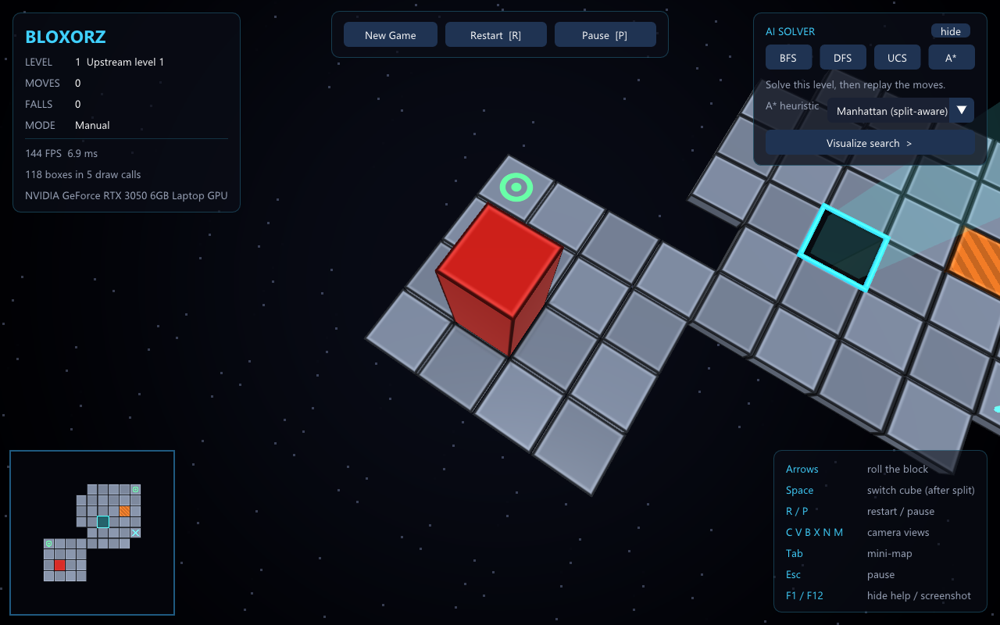
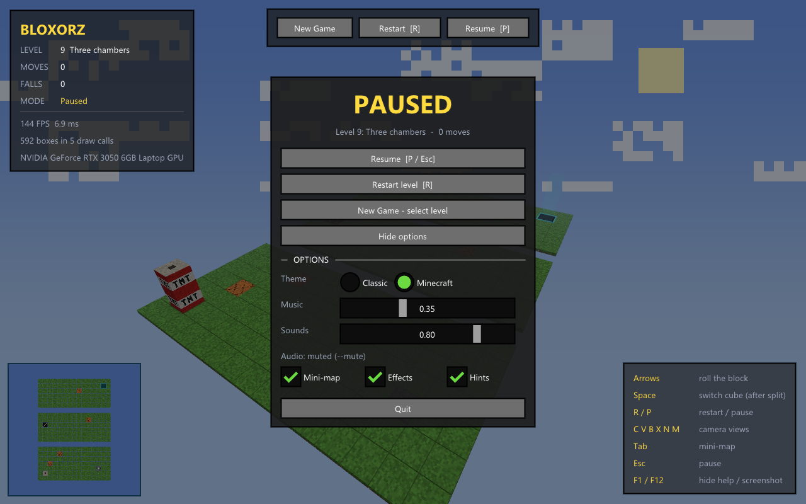
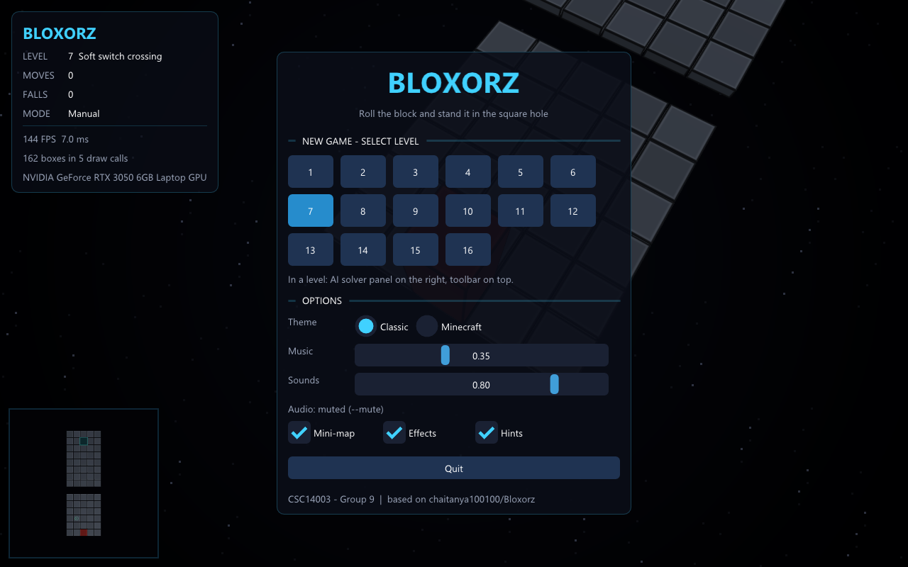
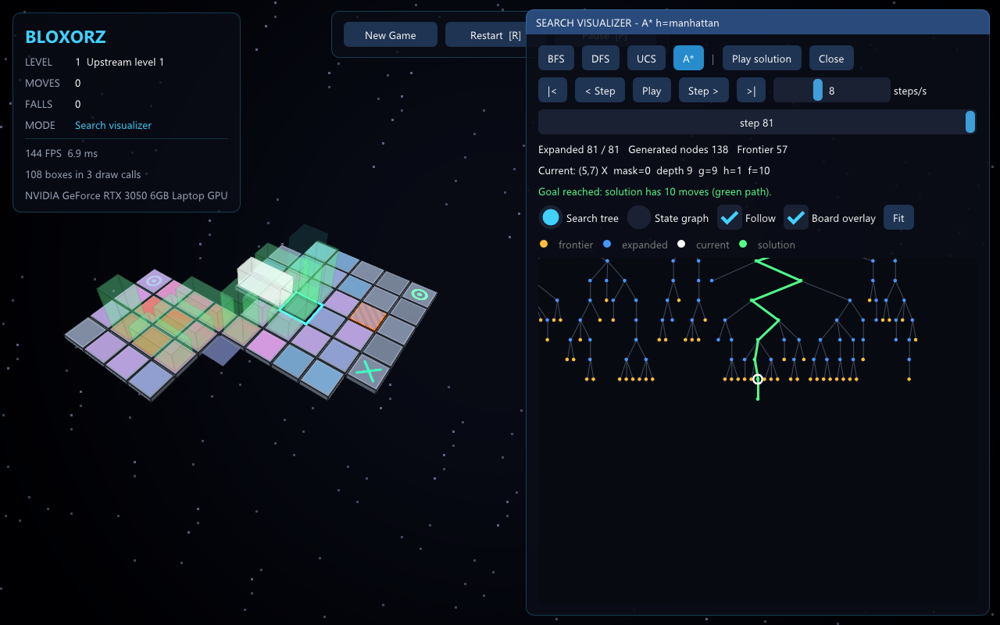
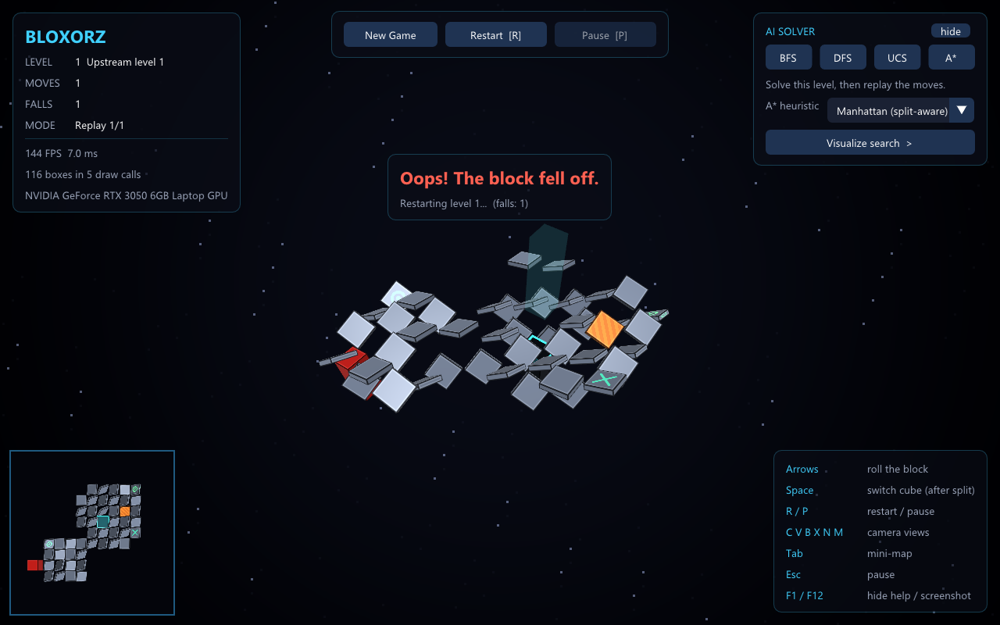
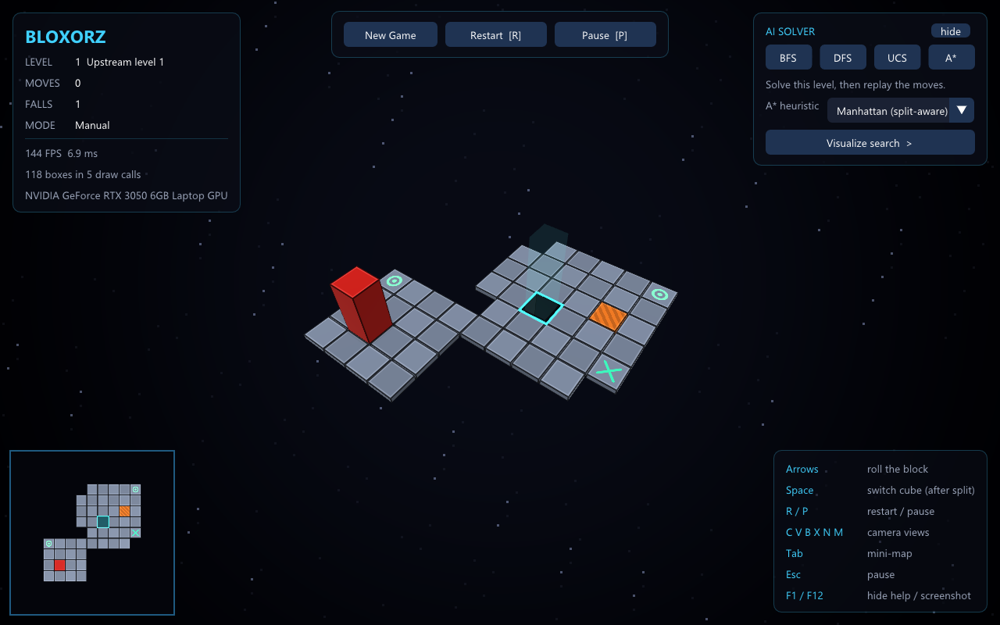
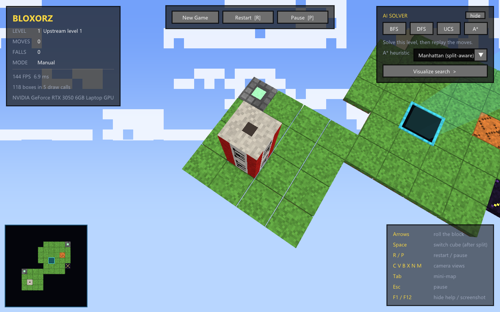
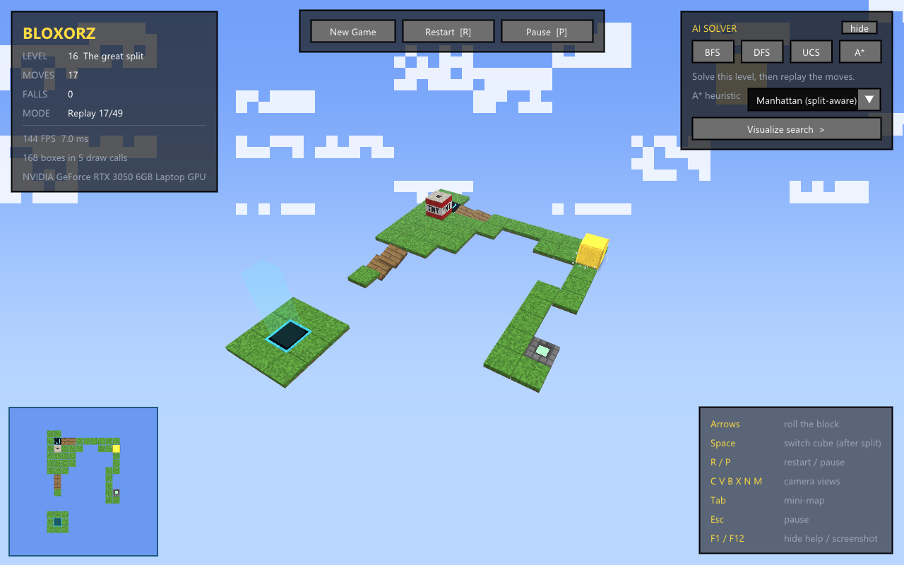
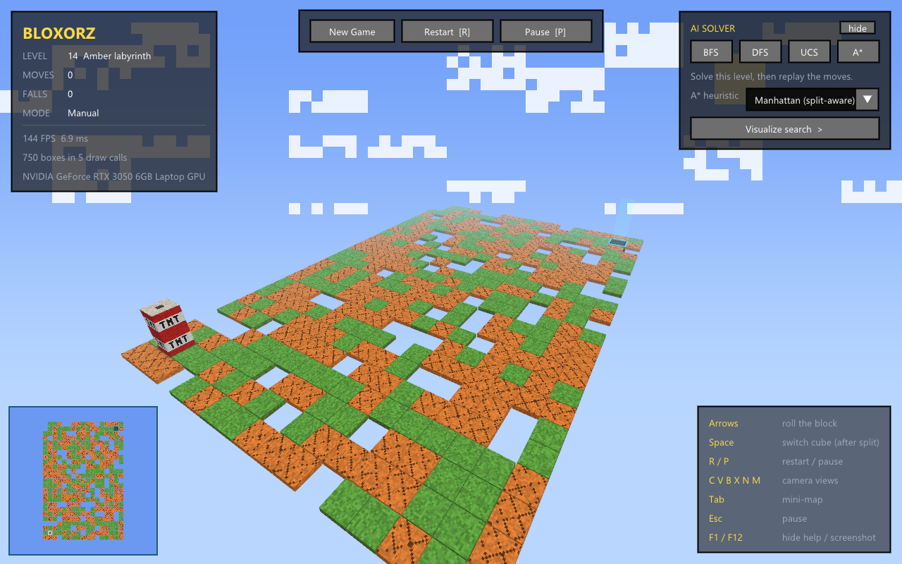

# Report 4: Merge v2 + màn khó, sửa luật, heuristic Manhattan, nâng cấp giao diện (nhóm 9)

> **Ngày:** 27/10/2026 · **Người thực hiện:** Kiên (TV5) · **Code được merge:** Sang (TV4) `feat/sang/hard-levels`, Đạt `feat/dat/v2-mechanics`
> **Phạm vi:** (1) merge hai nhánh mới và xử lý xung đột, (2) kiểm tra kỹ chức năng mới, sửa lỗi luật, (3) cài `manhattan_heuristic` (phần của TV5), (4) kiểm tra luồng chạy BFS / A\*, (5) nâng cấp giao diện theo mục 8 của `report2.md`.

---

## 1. Tóm tắt

| Việc | Kết quả |
|---|---|
| Merge `feat/sang/hard-levels` rồi `feat/dat/v2-mechanics` | ✅ Hai nhánh cùng thêm màn 12/13 → giữ màn khó của Sang ở **12–14**, đổi màn của Đạt thành **15–16**. Không còn nhánh nào chưa merge |
| Kiểm tra chức năng v2 (nhiều ô cầu, permanent, split) | ✅ Phát lại **15/15** màn có lời giải trong game C++ đúng số bước. Viết bộ đối chiếu C++ ↔ Python, tìm ra **3 lỗi luật** và đã sửa cả hai phía |
| `manhattan_heuristic` (TV5) | ✅ Manhattan **có tính cổng split**; admissible + consistent; **0 vi phạm** trên toàn bộ khoảng 67.000 trạng thái / 245.000 cạnh của 16 màn |
| Luồng chạy BFS / A\* | ✅ CLI, nút Solve trong game (cả màn split), màn vô nghiệm, bản đóng gói `Bloxorz.exe`: không có lỗi. Tối ưu nhỏ: cache khoảng cách cho heuristic |
| Giao diện | ✅ Thanh **New Game / Restart / Pause**, màn hình **Pause + Options**, **bảng AI trong màn**, **Search Visualizer** (cây / đồ thị, chạy từng bước + bản đồ nhiệt), **âm thanh + nhạc nền**, **sàn sụp và tự chơi lại khi rơi**, **theme Minecraft** (tùy chọn) |
| Test | **162 passed, 5 skipped** (5 test chờ DFS/UCS) |

---

## 2. Merge hai nhánh

### 2.1. Nội dung hai nhánh

| Nhánh | Commit | Nội dung |
|---|---:|---|
| `feat/sang/hard-levels` (Sang) | 3 | Màn khó: **12** "4-switch vault", **13** "6-switch vault", **14** "Amber labyrinth" (200 ô dễ vỡ); `tests/test_hard_levels.py`, `Docs/hard_levels.md` |
| `feat/dat/v2-mechanics` (Đạt) | 27 | Định dạng `.data` v2 (`ext 1`): **một công tắc nhiều ô cầu**, **công tắc permanent on/off**, **split switch** (tách thành 2 khối 1×1×1, điều khiển từng khối, tự gộp); cài ở **cả** C++ và Python; **BFS** (`BFSSolver`); 2 màn mới; test + 4 tài liệu walkthrough |

Mỗi nhánh đứng riêng đều pass test (104 và 115 passed).

### 2.2. Xung đột và cách xử lý

Hai nhánh **cùng thêm** `code/data/12.data`, `13.data`, `solutions/12.txt`, `13.txt`, `previews/12.png`, `13.png`, và cùng sửa `catalog.json`, `code/data/README.md`, `previews/overview.png` (9 file xung đột).

| Quyết định | Lý do |
|---|---|
| Giữ màn 12–14 của Sang | Merge trước (đúng thứ tự yêu cầu), đã có test riêng `test_hard_levels.py` |
| Đổi màn của Đạt: 12 → **15** "Dual bridges crossing", 13 → **16** "The great split" | Không đè dữ liệu của ai; menu game tự liệt kê `data/<n>.data` nên không cần sửa code |
| Ghép `catalog.json` bằng script (thêm 2 mục 15, 16), bỏ 4 khoá trùng nghĩa của Đạt (`cols`, `walkable_tiles`, `switches`, `name`) | Giữ một định dạng catalog thống nhất; các khoá đó không được dùng ở đâu |
| Vẽ lại **toàn bộ** ảnh preview bằng script đã gộp (bản của Đạt, có hỗ trợ split) | Ảnh 12/13/overview của hai bên đều lỗi thời |
| Sửa test BFS của Đạt `load_problem(12/13)` → `15/16`; sửa link `file:///d:/hcmus/...` (đường dẫn máy Đạt) thành link tương đối trong 4 tài liệu | Để test chạy đúng màn và link mở được trên máy khác |
| Viết lại `Docs/levels_v2_walkthrough.md` | Bản cũ mô tả phiên bản đầu của hai màn (11×17, 12 bước…), không khớp dữ liệu hiện tại (14×17, 37 bước) |

Sau khi merge, `git branch -r --no-merged` không còn nhánh nào.

---

## 3. Kiểm tra chức năng mới và lỗi đã sửa

### 3.1. Phát lại trong game C++

Cho game tự chơi lời giải của **15 màn có lời giải** (`a.exe <n> --play data/solutions/<n>.txt`), gồm cả 3 màn khó và 2 màn v2 trước đây chưa ai phát lại:

| Màn | 1 | 2 | 3 | 4 | 5 | 6 | 7 | 8 | 9 | 10 | 12 | 13 | 14 | 15 | 16 |
|---|---|---|---|---|---|---|---|---|---|---|---|---|---|---|---|
| Kết quả | WON | WON | WON | WON | WON | WON | WON | WON | WON | WON | WON | WON | WON | WON | WON |
| Số bước | 10 | 68 | 4 | 16 | 6 | 20 | 12 | 15 | 36 | 27 | 44 | 66 | 36 | 37 | 49 |

Việc phát lại này đã chạy 3 lần: trước khi sửa, sau khi sửa luật, và sau toàn bộ nâng cấp giao diện. Cả 3 lần đều thắng hết.

### 3.2. Bộ đối chiếu C++ ↔ Python

Phát lại lời giải có sẵn chỉ chứng minh "đường đi đúng" thắng được. Nó không phát hiện được chỗ hai bên xử lý khác nhau ở những tình huống mà lời giải không đi qua. Vì vậy mình viết một bộ đối chiếu (script tạm, ngoài repo): mỗi ca là **một màn tí hon + một chuỗi nước**, cho Python (`BloxorzProblem.replay`) và game C++ (`a.exe --play`) cùng chạy, rồi so kết quả (thắng / thua ở bước mấy / vẫn đang chơi).

| Ca thử | Trước khi sửa (Python / C++) | Sau khi sửa |
|---|---|---|
| `permanent_off` giữ cầu đóng | thắng ở bước 4 / **rơi ở bước 3** | rơi 3 / rơi 3 ✅ |
| `permanent_on` bấm lại vẫn mở | thắng 10 / thắng 10 | ✅ |
| Một công tắc điều khiển 2 ô cầu | khớp | ✅ |
| Khối nhỏ đi lên lỗ đích | vẫn chơi / **rơi ở bước 3** | vẫn chơi / vẫn chơi ✅ |
| Gộp khối ngay trên công tắc mềm | rơi 4 / rơi 4 (**cùng sai**) | vẫn chơi / vẫn chơi ✅ |

### 3.3. Ba lỗi luật đã sửa (commit `756a446`)

**Lỗi 1: `permanent_off` lại MỞ cầu (Python).** Python lưu `bridge_mask` theo **công tắc** (bit = số lần bấm, lấy chẵn lẻ) và cho cả `permanent_on` lẫn `permanent_off` cùng làm `mask | bit`. Ô cầu lúc đầu luôn đóng, nên bấm "off" thành ra mở cầu. C++ thì làm đúng: lưu ô thật, "off" chỉ xoá ô đang có. Test cũ của Đạt chỉ kiểm tra "mask không đổi" nên không bắt được lỗi.
→ **Sửa:** `bridge_mask` đổi thành **1 bit cho mỗi ô cầu** (bit bật = ô đang mở), đúng như đề yêu cầu "the state must include the open/closed status of every bridge". Mỗi công tắc có `switch.mask` gồm các bit ô cầu của nó: `toggle` = `mask ^ switch.mask`, `permanent_on` = `mask | switch.mask`, `permanent_off` = `mask & ~switch.mask`. Nhiều công tắc cùng điều khiển một ô vẫn đúng vì chúng cùng tác động lên một bit. Độ dài tối ưu của mọi màn không đổi.

**Lỗi 2: khối nhỏ đi lên lỗ đích bị rơi (C++).** Thiết kế của Đạt (ghi trong test Python) quy định khối 1×1×1 đi qua lỗ đích như đi trên sàn và không thắng được. Phía C++ lại tính là rơi.
→ **Sửa:** `Game::check` (lúc đã tách) miễn trừ ô đích.

**Lỗi 3: gộp khối "bấm" công tắc hai lần (cả hai phía).** Khối nhỏ lăn lên công tắc mềm kích hoạt nó một lần. Nếu ngay đó hai khối kề nhau và gộp lại, code lại kích hoạt mọi công tắc dưới khối mới, tức bấm công tắc vừa rồi lần thứ hai, nên cầu bật rồi tắt ngay.
→ **Sửa:** gộp chỉ đổi hình dạng, không kích hoạt lại công tắc (`ai/problem.py` và `game.cpp`).

Mỗi lỗi có test mới: `tests/test_v2_switches.py` (2 test permanent_off), `tests/test_split.py` (gộp trên công tắc). Tài liệu `system.md`, `v2_walkthrough.md`, README đã cập nhật nghĩa mới của `bridge_mask`.

---

## 4. Heuristic Manhattan (TV5), commit `cb68a1d`

### 4.1. Công thức

```
h(s) = 0                       nếu s là đích
h(s) = max(⌈d / 2⌉, 1)         nếu không,   d = min D(c) trên các ô khối (hoặc hai khối nhỏ) đang chiếm
D(c) = min( |c − đích| ,  min_S |c − S| + P(S) )       (Manhattan, cho phép đi tắt qua split switch S)
P(S) = min trên các điểm đến t của S của D(t)          (dịch chuyển tốn 0 bước)
```

Không có split switch thì `D` chính là Manhattan thường.

### 4.2. Vì sao phải tính cổng split

Split switch **dịch chuyển tức thời** hai khối nhỏ tới chỗ khác. Nếu chỗ đến gần đích, chỉ một nước có thể làm `d` giảm rất nhiều, và Manhattan thường sẽ **đoán quá**. `tests/test_heuristics.py` có một màn nhỏ minh họa: Manhattan thường cho `h = 7` trong khi lời giải thật chỉ cần **4** nước. Bản có tính cổng thì không đoán quá.

### 4.3. Chứng minh (chi phí 1 mỗi nước, đúng với `main.py`)

- `D` là cực tiểu của các hàm 1-Lipschitz nên cũng 1-Lipschitz. Theo bảng chuyển, mỗi nước lăn đưa ô mới cách ô cũ tối đa 2; khối nhỏ đi 1 ô; gộp khối không đổi ô. Vậy `d` giảm tối đa 2 mỗi nước. Nước đứng lên split switch: `d` mới `≥ D(S) ≥ d cũ − 2` vì `D(S) ≤ P(S) ≤ D(t)`.
- Cầu, ô trống, ô cam bị bỏ qua (nới lỏng), nên chỉ làm `D` nhỏ đi, không bao giờ lớn hơn thật.
- **Admissible:** đích có `d = 0` nên cần ít nhất `⌈d/2⌉` nước; chưa thắng thì cần ít nhất 1.
- **Consistent:** `⌈d/2⌉` giảm tối đa 1 mỗi nước; nước vào đích xuất phát từ trạng thái có `d ≤ 2` nên `h = 1` bằng chi phí.
- Không cộng "+1 khi đang nằm". Phản ví dụ có trong test: khối nằm cách đích 1 ô dựng đứng vào đích chỉ bằng 1 nước.

### 4.4. Kiểm chứng

- Duyệt **toàn bộ** trạng thái đạt được của cả 16 màn, tính chi phí thật bằng BFS ngược: **0 vi phạm admissible, 0 vi phạm consistent**. Màn lớn nhất là màn 13: 47.679 trạng thái, 173.053 cạnh.
- `tests/test_astar_integration.py` (Sang) nay chạy cả màn 1, 2, **15, 16** và không còn SKIP phần Manhattan.
- Số node mở rộng (chi phí 1; BFS kiểm tra đích khi sinh nên đếm ít hơn A\* một chút):

| Màn | 1 | 2 | 4 | 5 | 7 | 8 | 9 | 10 | 12 | 13 | 14 | 15 | 16 |
|---|---:|---:|---:|---:|---:|---:|---:|---:|---:|---:|---:|---:|---:|
| BFS | 125 | 371 | 126 | 34 | 209 | 206 | 1319 | 1190 | 6661 | 47673 | 679 | 330 | 4503 |
| A\* h = 0 (= UCS) | 160 | 377 | 127 | 52 | 238 | 232 | 1393 | 1201 | 6663 | 47675 | 687 | 351 | 4600 |
| **A\* Manhattan** | **81** | 357 | **71** | **14** | **118** | **143** | **925** | 1126 | 6342 | 47657 | **555** | 309 | 4557 |

A\* Manhattan cho cùng độ dài tối ưu như BFS trên mọi màn, và **luôn mở rộng ít node hơn A\* h=0**. Trên hai màn "kho công tắc" (12, 13), Manhattan gần như không giúp được: lời giải buộc phải đi vòng bấm đủ công tắc, mà heuristic lại bỏ qua cầu. Đây là một nhận xét tốt cho phần thực nghiệm của báo cáo.

> Lưu ý về quy tắc nhóm: `CLAUDE.md` ghi "Claude không cài heuristic". Lần này TV5 (Kiên) yêu cầu trực tiếp nên phần này được cài bằng AI. Kiên cần tự đọc kỹ mục 4.1–4.3 để trả lời vấn đáp, và ghi vào phụ lục sử dụng AI của báo cáo.

---

## 5. Kiểm tra luồng chạy thuật toán

| Luồng | Cách kiểm tra | Kết quả |
|---|---|---|
| CLI `main.py` | BFS, A\* h=0, A\* Manhattan × 16 màn | Độ dài tối ưu trùng nhau ở mọi màn; màn 11 báo vô nghiệm (mã 1) |
| Nút Solve trong game | `a.exe 5 --solve astar`, `a.exe 16 --solve bfs` (BFS điều khiển hai khối nhỏ), `a.exe 11 --solve astar` | WON 6 bước, WON 49 bước, "No solution exists" |
| Bản đóng gói | `dist/win64/Bloxorz/Bloxorz.exe 15 --solve astar` (gọi `solver/main.py`) | WON |
| Linux (WSL) | `make` + `./a.out 15 --play …` | Build được, WON 37 bước |

Không có lỗi trong luồng chạy. Có một cải thiện hiệu năng: A\* Manhattan trên màn lớn chậm hơn h=0 dù mở rộng ít node hơn, vì mỗi lần gọi heuristic lại tính khoảng cách từ đầu. Đã thêm cache theo `(màn, ô)`.

---

## 6. Nâng cấp giao diện (mục 8 của report2)

Toàn bộ phần này chỉ là trình bày, **không đổi luật chơi**. Chứng cứ: bảng phát lại ở mục 3.1 và bộ đối chiếu ở mục 3.2 đều chạy lại sau khi nâng cấp và vẫn khớp.

### 6.1. New Game / Restart / Pause

- **Thanh công cụ** giữa phía trên: **New Game** (mở màn hình chọn màn), **Restart** `[R]`, **Pause** `[P]`.
- **Màn hình Pause** (`P` hoặc `Esc`): Resume, Restart level, New Game, Options, Quit. Khi tạm dừng, khối, hiệu ứng và phát lại đều đứng yên.
- **Màn hình New Game**: lưới chọn 16 màn, rê chuột lên số màn để xem tên và nhóm độ khó (đọc từ `data/catalog.json`); kèm Options.
- **Options** (dùng chung cho Pause và New Game): theme Classic / Minecraft, âm lượng nhạc nền và hiệu ứng, bật/tắt bản đồ nhỏ, hiệu ứng, bảng phím. Lưu ở `settings.ini`.
- Bảng thông số góc trái có thêm tên màn và **số lần rơi** (FALLS).





### 6.2. Bảng AI trong màn

Theo yêu cầu "các nút chạy thuật toán nên hiện khi đã vào trong màn", bảng **AI SOLVER** nằm bên phải và luôn có khi đang chơi:
- 4 nút **BFS / DFS / UCS / A\***: giải màn hiện tại rồi tự phát lại;
- chọn **heuristic cho A\***: Manhattan (có tính cổng split) hoặc Zero (= UCS);
- nút **Visualize search**;
- **4 chỉ số đề yêu cầu** của lần chạy gần nhất: độ dài lời giải, thời gian tìm kiếm, bộ nhớ đỉnh, số node mở rộng (kèm chi phí, frontier lớn nhất). Số liệu lấy từ `main.py --stats`, rất tiện khi quay video.

### 6.3. Search Visualizer (trực quan hóa tìm kiếm)

Chỉ mở khi bấm **Visualize search**. Khi mở, vùng 3D thu về nửa trái, cửa sổ visualizer chiếm nửa phải.




**Cách hoạt động:**
1. Game chạy `python main.py data/<n>.data --algo <thuật toán> --trace trace.txt` ở luồng nền.
2. `ai/tracing.py` bọc bài toán bằng `TracingProblem`, ghi lại **mỗi lần solver gọi `successors()`**, tức đúng mỗi lần mở rộng một node. Nhờ vậy **không phải sửa code BFS/A\* của các thành viên**, và DFS/UCS khi cài xong sẽ tự dùng được. Giới hạn ghi 4000 lần mở rộng (cây lớn hơn không vẽ nổi).
3. Game đọc file trace (`code/viz.cpp`) và vẽ.

**Chức năng:**
- **Search tree**: cây tìm kiếm, mỗi cạnh ghi nước đi (U/D/L/R hoặc `0U`… khi đã tách); màu: vàng = frontier, xanh = đã mở rộng, vòng trắng = node đang mở rộng, xanh lá = đường lời giải khi tìm xong.
- **State graph**: cùng các node nhưng đặt theo vị trí trên bàn chơi (giống bản đồ chữ), dễ thấy thuật toán "loang" thế nào.
- **Chạy từng bước**: `|<`, `< Step`, `Play/Pause`, `Step >`, `>|`, thanh thời gian, tốc độ 1–300 bước/giây. Phím: `←/→` lùi/tiến, `Space` chạy/dừng.
- Dòng số liệu: số node đã mở rộng, đã sinh, kích thước frontier; node hiện tại với **g, h, f** và độ sâu. Rê chuột lên node để xem chi tiết.
- **Lớp phủ trên bàn chơi 3D**: **bản đồ nhiệt** (ô càng đỏ thì càng nhiều trạng thái đã mở rộng nằm trên đó), **khối mờ trắng** ở trạng thái đang mở rộng, **khối mờ xanh lá** dọc đường lời giải.
- Đổi thuật toán ngay trong cửa sổ (BFS/DFS/UCS/A\*); **Play solution** để xem khối lăn theo lời giải; kéo chuột để di chuyển, cuộn để phóng to, **Fit**, **Follow** (bám theo node hiện tại).

Ảnh BFS ở màn 5 cho thấy rõ BFS mở rộng theo từng tầng (cây rộng, nông). Ảnh A\* ở màn 1 cho thấy đường lời giải đi gần như thẳng xuống.

### 6.4. Âm thanh và nhạc nền

- **Không dùng âm thanh của Bloxorz gốc** (Coolmath Games): đó là tài sản có bản quyền, đưa vào bài nộp là vi phạm. Thay vào đó, 14 hiệu ứng và nhạc nền được **tổng hợp bằng code** lúc mở game (`code/audio.cpp`), theo phong cách game gốc:

| Sự kiện | Âm thanh |
|---|---|
| Lăn / dựng đứng / khối nhỏ lăn | tiếng "cộp" gỗ trầm / "cốc" cao hơn / tiếng lăn nhẹ |
| Công tắc thường / nặng | "tách - cách" / tiếng kim loại nặng |
| Cầu hiện / mất | quét lên / quét xuống |
| Tách / gộp khối | âm rung lấp lánh / "bụp" |
| Ô cam vỡ, rơi, sàn sụp | tiếng rắc, "vút" xuống, gỗ đổ dồn |
| Thắng, mở màn, bấm nút | rải hợp âm đi lên, các ô rơi xuống, tiếng tích |
| Nhạc nền | chiptune nhẹ Am–F–C–G, 100 BPM, lặp liền mạch khoảng 19 giây |

- Thư viện **miniaudio 0.11.21** (một header, public domain / MIT-0). Bộ trộn tự viết; nhạc nền tổng hợp ở luồng nền nên game vẫn mở ngay. Âm lượng chỉnh trong Options. `--mute` để tắt tiếng.
- **Muốn dùng âm thanh khác** (ví dụ file bạn có quyền dùng): đặt `sounds/<tên>.wav|.mp3|.flac` cạnh file chạy, với tên là `roll stand switch heavy bridge_on bridge_off fall win split merge crack click start collapse music`. Game tự dùng file đó thay cho âm tổng hợp.

### 6.5. Rơi → sàn sụp → chơi lại ngay (như game gốc)

Khi khối rơi (chế độ chơi thường), cả mặt sàn sụp theo: mỗi ô rơi sau một độ trễ ngẫu nhiên nhỏ, vừa rơi vừa lật. Sau 1,6 giây màn tự chơi lại và số lần rơi tăng 1. Không còn bảng GAME OVER phải bấm. Chế độ kiểm chứng (`--play`, `--solve`) vẫn giữ GAME OVER và mã thoát 1 để các lệnh kiểm tra không bị ảnh hưởng.




### 6.6. Theme Minecraft (tùy chọn, đổi trong Options)

Để phòng trường hợp không đẹp, theme Minecraft chỉ là **một lựa chọn**; mặc định vẫn là Classic. Mọi texture được **sinh bằng thuật toán trong shader** (16×16 texel mỗi ô, mỗi texel một màu có nhiễu), không dùng file ảnh nào của Minecraft.

| Trong game | Classic | Minecraft |
|---|---|---|
| Sàn | xám thép | khối cỏ (mặt trên xanh, viền đất) |
| Ô dễ vỡ | cam sọc | đất nung có vết nứt |
| Công tắc thường | vòng tròn xanh | đá cuội + tấm áp lực phát sáng |
| Công tắc nặng | chữ X | obsidian + chữ X vàng |
| Split switch | xanh dương | khối cổng tối lấp lánh |
| Cầu | xám vàng | ván gỗ sồi |
| Khối người chơi / khối nhỏ chờ | đỏ | TNT (dải trắng + chữ "TNT") |
| Khối nhỏ đang điều khiển | vàng | khối vàng |
| Nền, giao diện | trời sao, bo góc xanh | bầu trời xanh, mây khối, mặt trời vuông; giao diện góc vuông, nút xám đá, chữ vàng |





### 6.7. Tùy chọn dòng lệnh mới (cho dev / quay video / chụp ảnh)

| Tùy chọn | Tác dụng |
|---|---|
| `--theme classic\|minecraft` | Mở với theme chỉ định |
| `--visualize <bfs\|dfs\|ucs\|astar>` | Mở thẳng Search Visualizer và tự chạy |
| `--mute` | Tắt tiếng |
| `--ui menu\|pause\|options` | Mở sẵn bảng đó (chụp ảnh) |
| `--keep-open` | Dùng với `--play`: phát lại ở chế độ chơi thường (rơi thì tự chơi lại, không thoát) |

---

## 7. Kiểm chứng sau toàn bộ thay đổi

- `python -m pytest -q`: **162 passed, 5 skipped** (DFS/UCS chưa cài).
- Phát lại 15/15 màn trong C++: thắng đúng số bước (mục 3.1).
- Bộ đối chiếu C++ ↔ Python: 5/5 ca khớp (mục 3.2).
- `make release` + `make dist`: `Bloxorz.exe` tĩnh có âm thanh; gói có đủ 16 màn, `catalog.json`, license ImGui và miniaudio; nút solve chạy được.
- Build Linux trong WSL: thành công, phát lại màn 15 thắng.

## 8. Danh sách commit

| Commit | Nội dung |
|---|---|
| `3610f24` | merge `feat/sang/hard-levels` |
| `78ae615` | merge `feat/dat/v2-mechanics` (đổi số màn 15/16, ghép catalog, vẽ lại preview, sửa link) |
| `756a446` | fix(v2): permanent_off, khối nhỏ trên lỗ đích, gộp khối kích hoạt công tắc hai lần |
| `cb68a1d` | feat(heuristic): Manhattan có tính cổng split |
| `75ddf24` | feat(cli): `--trace`, `--stats`, `ai/tracing.py` |
| `dc3eb9b` | chore(audio): vendor miniaudio 0.11.21 |
| `22d35ac` | feat(gui): Pause, bảng AI, Visualizer, âm thanh, sàn sụp, theme Minecraft |
| (commit tài liệu) | README, report4, ảnh minh họa |

## 9. Hạn chế và việc còn lại

| Việc | Ai |
|---|---|
| `DFSSolver`, `UCSSolver` vẫn TODO; hai nút DFS/UCS (cả trong Visualizer) đang báo "not implemented" | TV2, TV3 |
| Hàm chi phí không đồng nhất + tùy chọn trong `main.py` (xem `system.md` mục 9.6) | TV3 |
| Visualizer chỉ ghi 4000 lần mở rộng đầu tiên: màn 12, 13, 16 chỉ xem được phần đầu cây | (chấp nhận) |
| Lần giải có `--stats` đo thêm bộ nhớ ở một lượt chạy riêng, nên nút Solve trên màn rất lớn (13) chậm hơn vài giây | (chấp nhận) |
| Âm thanh là âm tổng hợp, không phải âm gốc của Bloxorz (lý do bản quyền); có thể thay bằng file trong `sounds/` | — |
| `Space` vừa đổi khối nhỏ (khi đã tách) vừa đổi phép chiếu (khi chưa tách); phím `N` vẫn là camera kéo chuột của game gốc, nên New Game chỉ có nút bấm | — |
| Thực nghiệm chính thức (script chạy mọi màn × thuật toán, CSV, biểu đồ) | TV5 |
