# Report 5: Camera mới, đồ họa bóng bẩy, theme Original, màn hình chính mới (nhóm 9)

> **Ngày:** 28/10/2026 · **Người thực hiện:** Kiên (TV5) · **Commit code:** `59987b5`
> **Phạm vi:** tiếp tục mục 8.3 "Đồ họa" của [report2.md](report2.md) và phần giao diện của [report4.md](report4.md): (1) sửa camera C (lắc khi lăn), M và N (không xoay được), cho B zoom được; (2) làm đồ họa đẹp và bóng bẩy hơn; (3) thêm **theme Original** giống Bloxorz gốc; (4) thiết kế lại **màn hình chính** cho chuyên nghiệp, giống game thật.
> Không đổi luật chơi hay code AI: phần Python giữ nguyên, các test và lời giải cũ vẫn đúng.

---

## 1. Tóm tắt

| Việc | Kết quả |
|---|---|
| Camera C bị lắc khi khối lăn | ✅ Tìm ra nguyên nhân (mục 2.1). Camera giờ **chỉ trượt theo khối**, hướng nhìn giữ nguyên nên không còn lắc |
| Camera M, N "bị hư" | ✅ Viết lại thành camera **xoay quanh** (orbit): N kéo chuột để xoay quanh màn, M xoay theo vị trí con trỏ |
| Camera B quá xa, không zoom được | ✅ Khoảng cách mặc định tính theo kích thước màn, **lăn chuột để zoom** |
| Chỉnh góc nhìn bằng chuột | ✅ Ở mọi góc nhìn 3D: **kéo chuột để xoay, lăn chuột để zoom**. Đổi góc nhìn thì trượt mượt khoảng 0,6 giây |
| Đồ họa bóng bẩy | ✅ **Bóng đổ thật** (shadow map), **cạnh vát bắt sáng**, **phản chiếu bầu trời** trên khối, **bloom** (vùng sáng tỏa quầng). FPS gần như không đổi trên máy có GPU |
| Theme Original | ✅ Trời đỏ cam có khói, ô đá xám bạc, khối sắt gỉ, công tắc kim loại nổi **O / X / ( )**, lỗ đích tối, chữ HUD trắng viền đen. Vẽ hoàn toàn bằng shader |
| Màn hình chính | ✅ Logo khối nổi, menu điều khiển bằng chuột hoặc phím. Năm trang: **Play, Select Stage** (thẻ màn + bản đồ xem trước), **Options** (chọn theme bằng thẻ hình), **How to Play** (chú giải ô), **Credits**. Lưu **kỷ lục** số bước từng màn |
| Kiểm chứng | 15/15 màn tự phát lại vẫn **WON** đúng số bước · pytest **162 passed, 5 skipped** · build Windows, `make dist`, WSL (Linux) đều qua |

**Trước và sau** (cùng màn 8; trên: bản cũ; dưới: bản mới, theme Classic và Original):

| Trước | Sau |
|---|---|
| 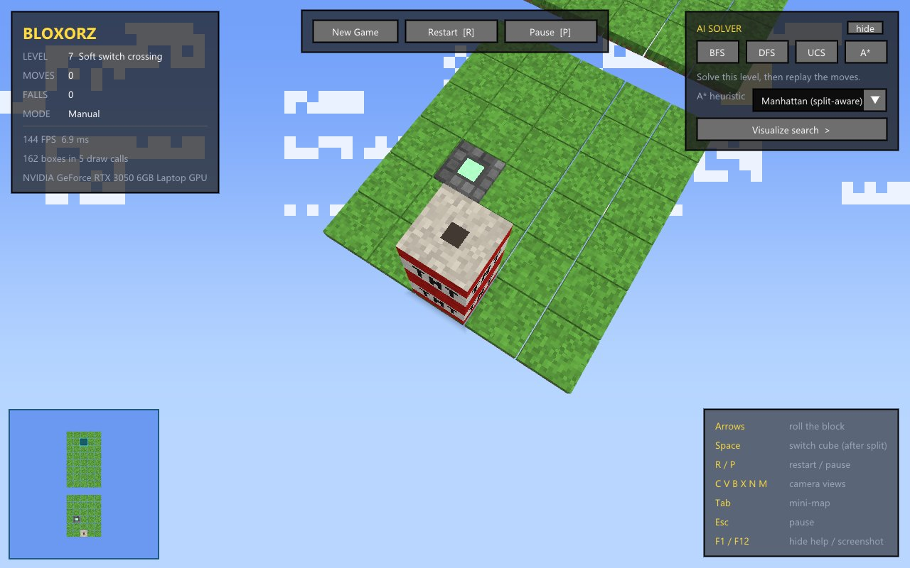 | 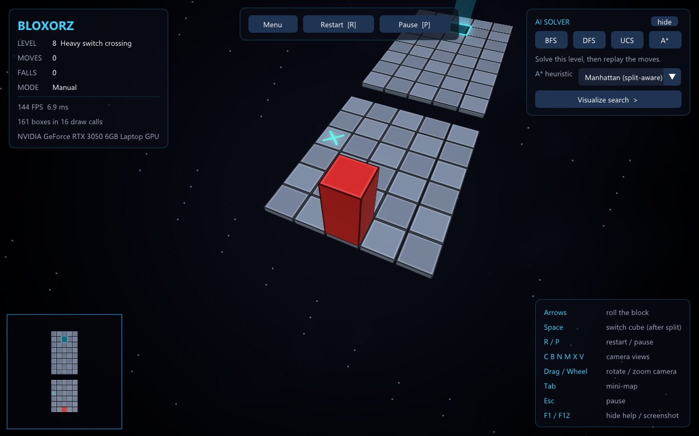 |
| 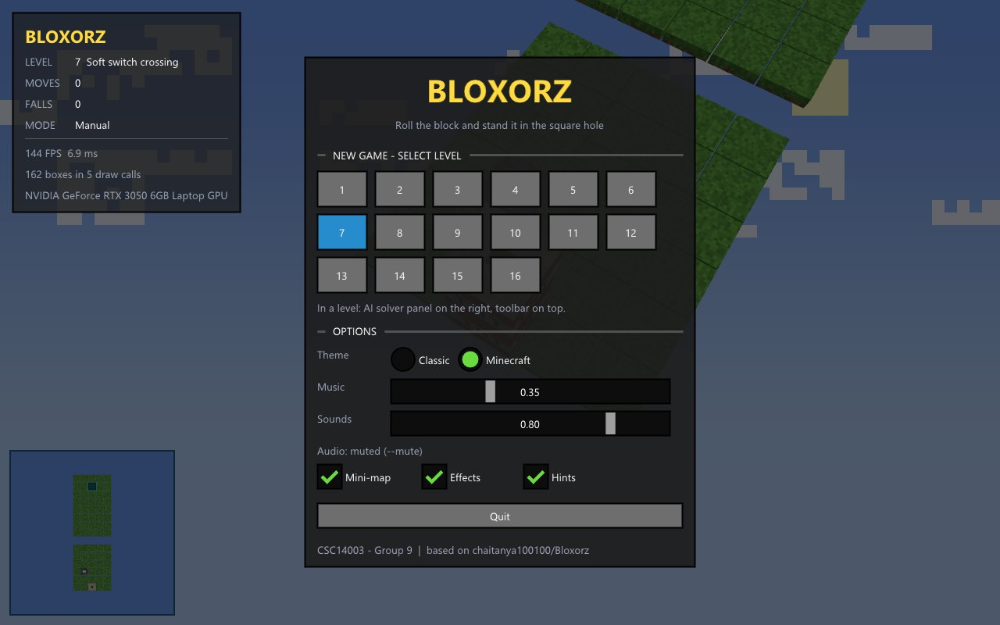 | 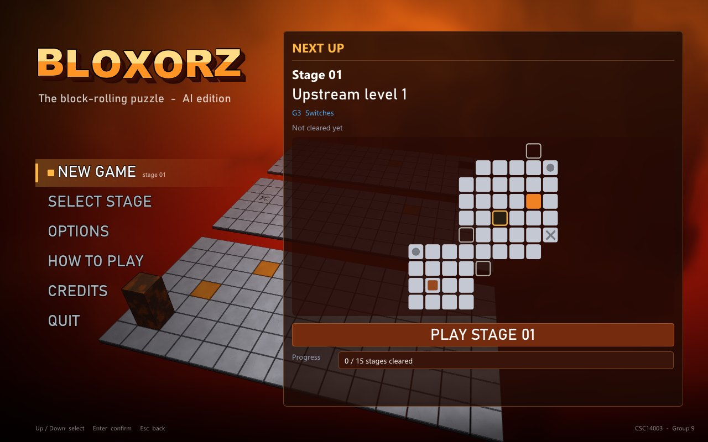 |

---

## 2. Camera

### 2.1. Vì sao camera C bị lắc, M và N không dùng được

Code camera cũ (`camera.cpp`) có ba vấn đề:

| Góc nhìn | Code cũ | Hậu quả |
|---|---|---|
| **C** (bám khối) | Mỗi frame: vị trí mắt `eye` trượt dần về phía sau khối (làm mượt), nhưng **hướng nhìn** `dir = normalize(khối - eye)` thì quay **ngay lập tức** về vị trí khối | Khối vừa lăn là camera quay đầu theo, sau đó `eye` đuổi kịp thì quay về. Mỗi bước lăn camera lắc một lần, chơi lâu thấy chóng mặt |
| **N** (kéo chuột) | Kéo chuột chỉ đổi **hướng nhìn** tại chỗ, mắt đứng yên ở vị trí cũ | "Ngoảnh đầu nhìn quanh" chứ không xoay quanh khối, rất khó dùng |
| **M** (theo chuột) | Hướng nhìn **trôi liên tục** về phía con trỏ, kể cả khi chuột đứng yên lệch tâm | Camera tự quay mãi, không dừng được |

Ngoài ra **B** đặt mắt cố định ở `(phải − 2, dưới, 10)` nên màn nhỏ trông rất xa và không zoom được.

### 2.2. Thiết kế mới: camera xoay quanh (orbit)

Mỗi góc nhìn gồm một **điểm nhìn** và ba số: **yaw** (góc ngang), **pitch** (góc ngẩng, kẹp trong 8°–88°) và **dist** (khoảng cách). Vị trí mắt:

```
eye = điểm_nhìn + dist · (cos pitch · cos yaw,  cos pitch · sin yaw,  sin pitch)
```

Trục "lên" luôn là +z nên camera **không bao giờ nghiêng**.

Chống lắc cho C:
- Điểm nhìn là **tâm khối chiếu xuống sàn** (bỏ độ cao). Khối lăn theo cung tròn nhưng điểm nhìn không nhấp nhô theo.
- Điểm nhìn được **làm mượt theo hàm mũ**: `target += (1 − e^(−7·dt))·(khối − target)`. Cách này độc lập FPS, khối lăn xong khoảng 0,15 giây thì camera tới nơi.
- Mắt và điểm nhìn **cùng dịch một lượng**, nên hướng nhìn giữ nguyên. Camera chỉ **tịnh tiến**, không quay.

| Phím | Góc nhìn | Điều khiển |
|---|---|---|
| **C** | Bám khối (mặc định) | Kéo chuột để xoay góc, lăn chuột để zoom; góc chỉnh xong được giữ |
| **B** | Toàn màn từ trên cao | Khoảng cách mặc định tính theo **kích thước thật** của màn (bỏ lề trống). Lăn chuột để zoom, kéo để xoay |
| **N** | Xoay tự do quanh màn | Kéo chuột trái để xoay; **kéo chuột phải** hoặc `W A S D` để dời điểm nhìn; `T G` để zoom |
| **M** | Theo con trỏ | Con trỏ đi từ mép trái sang mép phải là quay đủ một vòng; trên/dưới là nhìn từ trên xuống / nhìn ngang. Không cần bấm. Con trỏ nằm trên bảng HUD thì camera đứng yên |
| **X** | Bay tự do | `W A S D` di chuyển, `T G` tiến/lùi theo hướng nhìn, `I J K L` hoặc kéo chuột để xoay |
| **V** | Nhìn thẳng từ trên (song song) | Lăn chuột để zoom |

Chi tiết khác:
- **Chuyển góc nhìn mượt:** vị trí mắt và điểm nhìn trượt khoảng 0,6 giây thay vì nhảy. Khi đang kéo hoặc zoom vẫn có làm mượt nhẹ (khoảng 50 ms) cho đỡ giật.
- **Màn hình chính:** camera tự quay chậm (5°/giây) quanh màn, làm nền cho menu.
- **Nhận chuột:** đọc vị trí con trỏ mỗi frame khi đang giữ nút, nên không phụ thuộc callback di chuột. Bấm lên bảng ImGui thì camera không nhận; nhả chuột thì camera luôn nhận, nên không bị kẹt chế độ kéo.

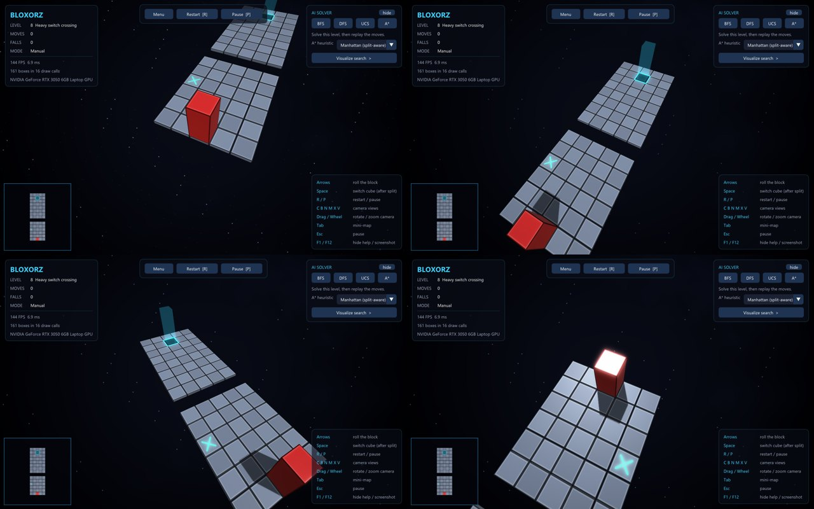

**File:** `code/camera.h`, `code/camera.cpp` (viết lại), `code/controls.cpp` (chuột, lăn chuột, zoom cho phép chiếu song song).

---

## 3. Đồ họa

### 3.1. Bóng đổ thật (shadow map)

Trước đây "bóng" chỉ là một hình chữ nhật mờ dưới khối. Giờ là bóng thật của **mọi vật**: khối, các ô đang sụp, cầu đang trồi lên.

1. **Lượt 1:** vẽ lô hộp đục một lần **nhìn từ nguồn sáng** vào texture độ sâu 2048×2048. Phép chiếu là trực giao, bao trọn màn chơi (theo khung bao các ô thật).
2. **Lượt 2:** vẽ cảnh bình thường. Mỗi điểm so độ sâu của mình với texture, lấy 3×3 mẫu có lọc tuyến tính (PCF) nên mép bóng mềm.
3. Chống "mụn bóng" (vệt sọc do sai số độ sâu): `glPolygonOffset` ở lượt 1, cộng dời điểm lấy mẫu dọc pháp tuyến 0,025 ở lượt 2.

Hai lượt dùng **chung một lô instance** đã gửi lên GPU, nên chỉ thêm một lệnh vẽ (`Renderer::flush_opaque`). Bản đồ nhỏ không vẽ bóng đổ, vẫn dùng bóng mềm cũ.

### 3.2. Cạnh vát, phản chiếu, độ bóng

- **Cạnh vát:** trong dải 0,05 đơn vị sát mép mỗi hộp, pháp tuyến được nghiêng dần ra ngoài. Cạnh vì thế bắt sáng như được bo tròn mà không cần thêm đỉnh.
- **Phản chiếu bầu trời:** tia phản xạ lấy màu bầu trời của theme, mạnh dần ở góc nhìn xiên (hiệu ứng Fresnel). Khối đỏ Classic trông như sơn bóng; khối sắt gỉ Original có ánh cam của trời.
- **Độ bóng theo vật liệu:** khối bóng mạnh, sàn bóng nhẹ (đã giảm để không chói khi nhìn ngược sáng).

### 3.3. Bloom và hậu kỳ

Cảnh được vẽ vào một framebuffer **HDR 16-bit có MSAA 4×**, sau đó:

1. Gộp mẫu MSAA, rồi lọc phần sáng hơn ngưỡng ("đầu gối" mềm 0,8 → 1,35) ở 1/2 độ phân giải.
2. Làm nhòe Gauss 9 mẫu, tách ngang/dọc, ở hai tầng 1/2 và 1/4 độ phân giải để có quầng rộng.
3. Ghép lại với cảnh. Thay vì cắt cứng ở 1,0, dùng "vai mềm": vùng tối và trung tính giữ nguyên màu cũ, chỗ phát sáng không bị cháy trắng. Thêm vignette nhẹ.

Những chỗ phát sáng như khung đích, công tắc, khối nhỏ đang chọn và hạt khi thắng giờ tỏa quầng.

### 3.4. Hiệu năng

Đo bằng `--no-vsync`, màn 10 (20×30, màn lớn nhất), camera B:

| Máy | Bật bóng đổ + bloom | Tắt cả hai |
|---|---|---|
| RTX 3050 Laptop (Windows) | **157 FPS** (Original), 158 FPS (Classic) | 160 FPS |
| WSLg, vẽ bằng CPU (llvmpipe) | 14 FPS | 29–43 FPS |

Vì vậy game **tự nhận ra driver vẽ bằng CPU** (tên GPU chứa `llvmpipe`, `softpipe`, `SwiftShader`, `Software`) và mặc định tắt hai hiệu ứng, trừ khi người chơi đã tự bật trong Options. Có thể tắt bằng tay trong Options hoặc bằng cờ `--no-shadows`, `--no-bloom`.

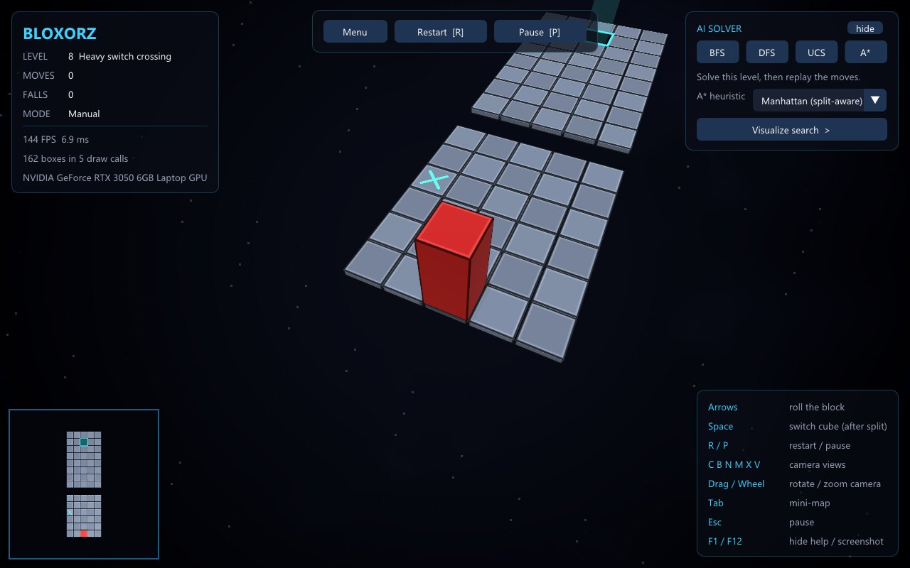

**File:** `code/render.h`, `code/render.cpp` (shadow map, framebuffer hậu kỳ), `code/shaders.h` (shader hộp, nền, 3 shader hậu kỳ).

---

## 4. Theme Original (giống Bloxorz gốc)

### 4.1. Tài liệu tham khảo

- Ảnh chụp game gốc do nhóm cung cấp: `Docs/images/gui_upgrade/Original Bloxorz theme.jpg`.
- Mô tả cơ chế và hình dạng ô từ các trang hướng dẫn:
  - công tắc mềm hình **tròn** (chạm kiểu gì cũng kích hoạt);
  - công tắc nặng hình **chữ X** (phải đứng thẳng);
  - ô tách khối hình **( )**;
  - ô cầu **nháy đỏ / xanh** khi bật tắt;
  - ô cam vỡ khi khối đứng thẳng.

  Nguồn: [yujene/bloxorzguide](https://github.com/yujene/bloxorzguide), [Coolmath Games](https://www.coolmathgames.com/0-bloxorz), [Flash Gaming Wiki](https://flashgaming.fandom.com/wiki/Bloxorz).
- Bloxorz gốc do Damien Clarke làm năm 2007. **Không dùng bất kỳ hình ảnh, âm thanh hay font nào của game gốc.** Mọi thứ trong theme đều sinh bằng shader, để tránh vấn đề bản quyền khi nộp bài.

### 4.2. Cách dựng từng thành phần

| Thành phần | Game gốc | Cách làm |
|---|---|---|
| Bầu trời | Đỏ cam, khói đen cuộn | Gradient đỏ sẫm → đỏ → cam, thêm quầng sáng. Khói là nhiễu fbm "uốn miền" (dùng nhiễu làm lệch tọa độ của chính nó), trôi rất chậm |
| Ô sàn | Đá xám bạc, mặt bên tối | Xám ánh lạnh, vân đá bằng nhiễu fbm theo tọa độ thế giới (mỗi ô một vân khác). Mặt bên tối dần xuống đáy. Có độ bóng nhẹ |
| Ô cam | Cam đất | Cùng vân đá, màu cam; mặt bên cam sẫm |
| Công tắc O / X / ( ) | Hoa văn kim loại **nổi** trên ô | Hàm độ cao của hoa văn (tròn, chữ X, hai cung). Pháp tuyến tính từ đạo hàm số nên hoa văn **bắt sáng như nổi thật**, có bóng tự đổ ngược hướng nắng |
| Khối | Sắt gỉ nâu sẫm | Kim loại nâu, mảng gỉ cam và vết bẩn bằng nhiễu theo tọa độ mặt (vân dính theo khối khi lăn). Phản chiếu trời |
| Lỗ đích | Ô trống tối | Thành sắt tối, đáy tối, **không** phát sáng và không có cột sáng |
| Ánh sáng | Nắng chiều | Nắng xiên hơn hai theme kia nên bóng dài; ánh sáng môi trường ấm nhẹ; sương mù màu đỏ trời |
| HUD | Chữ khối trắng viền đen ("Moves", "Passcode") | Chữ Arial Black trắng viền đen đặt thẳng trên cảnh: `Stage 07`, `Moves`, `Falls`. Bảng nâu đỏ trong suốt, nút cam đất |

| Nhìn toàn màn (B) | Tách khối (màn 16) |
|---|---|
| 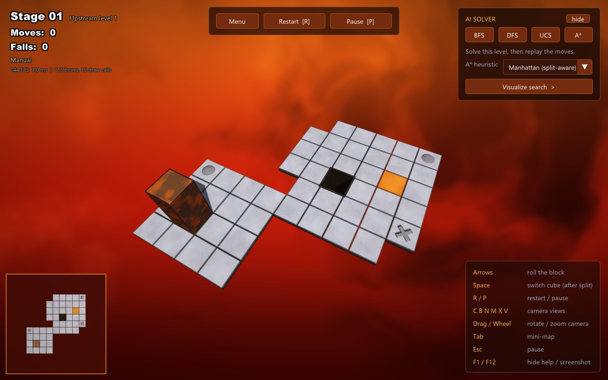 | 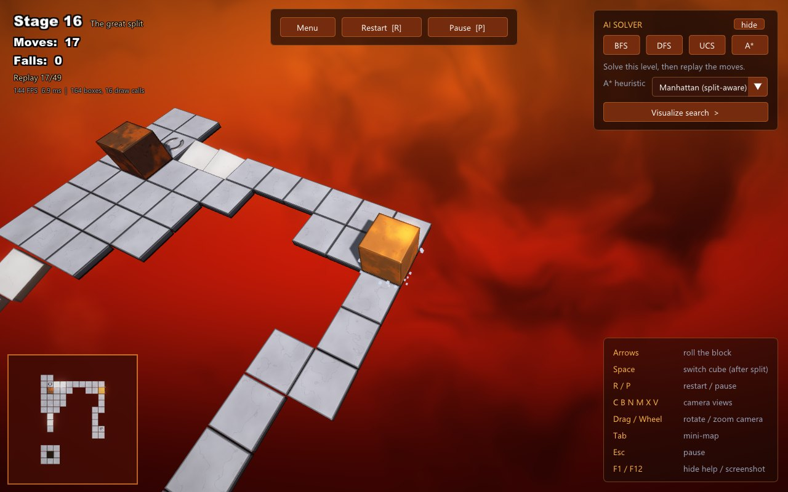 |

### 4.3. So sánh ba theme

| Classic | Original | Minecraft |
|---|---|---|
|  | 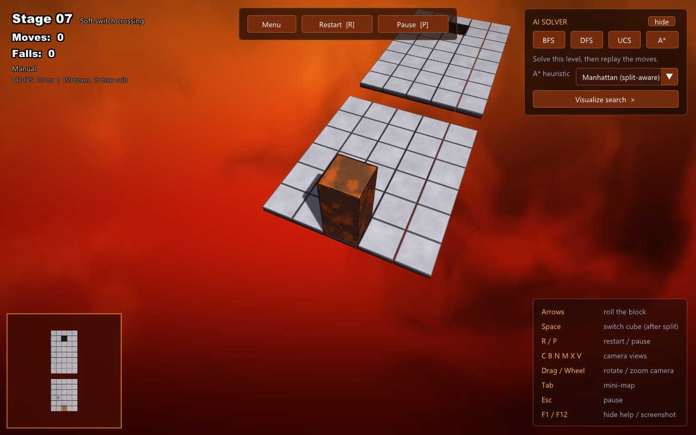 | 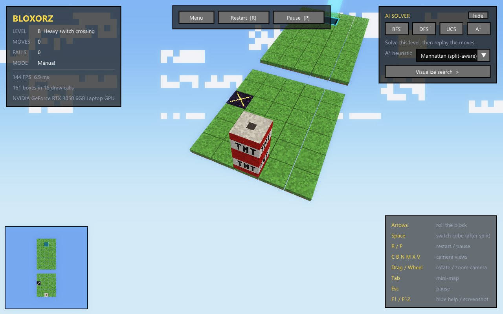 |

Theme Minecraft giữ nguyên texture điểm ảnh và đổ bóng phẳng của report4, chỉ thêm bóng đổ thật và bloom nhẹ.

---

## 5. Màn hình chính mới

### 5.1. Bố cục

- **Phía sau:** chính màn chơi đang nạp, camera tự quay chậm; dải tối bên trái và dưới để chữ dễ đọc.
- **Logo "BLOXORZ":** chữ khối nổi. Chín lớp tối lệch xuống phải tạo độ dày, nửa trên sáng hơn như mặt vát. Từng chữ rơi xuống khi mở menu rồi nhấp nhô nhẹ.
- **Menu bên trái:** Continue (chỉ hiện khi đang dở ván), New Game / Play, Select Stage, Options, How to Play, Credits, Quit.
  - Điều khiển bằng chuột hoặc **↑ ↓ + Enter**.
  - Mục đang chọn có thanh màu nhấn, khối nhỏ trượt vào, chữ dịch sang phải.
  - Các mục trượt vào lần lượt khi mở menu.
- **Bên phải:** nội dung của trang đang chọn. `Esc` ở trang con về trang đầu; ở trang đầu thì quay lại ván đang chơi.

| Trang đầu (Classic) | Select Stage (Original) |
|---|---|
| 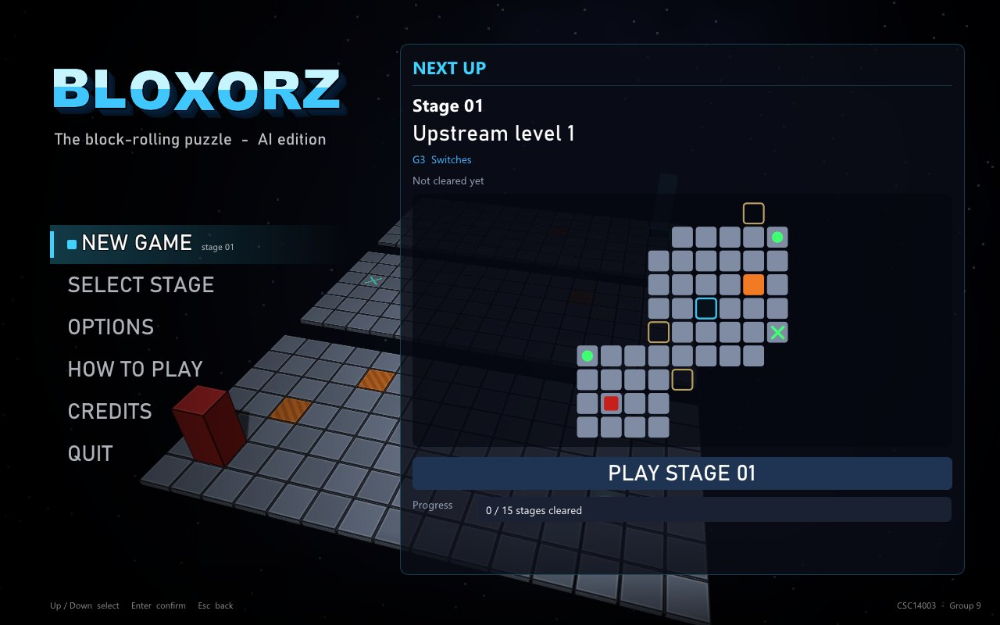 | 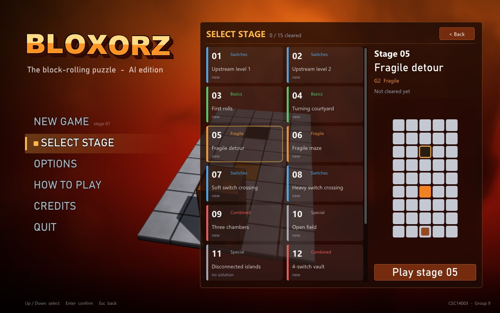 |
| **Options** | **How to Play** |
| 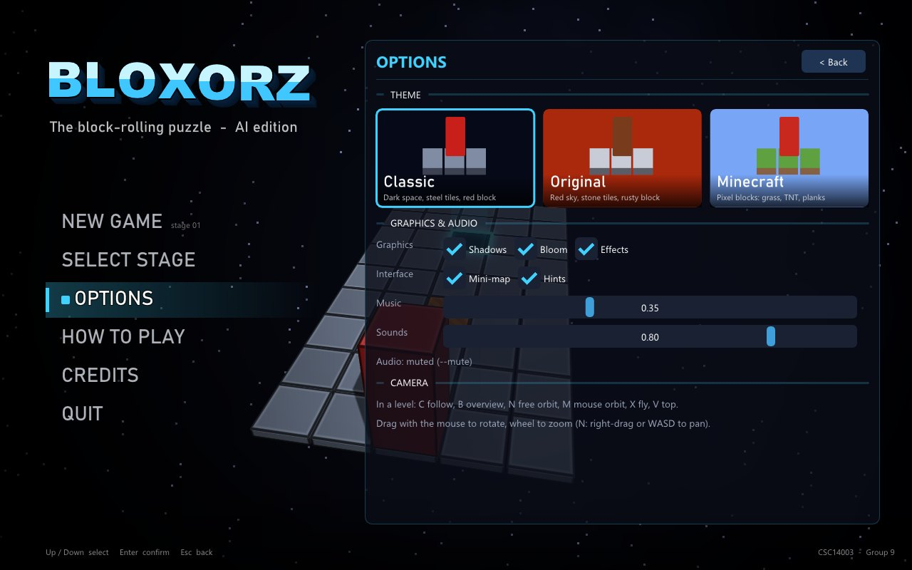 | 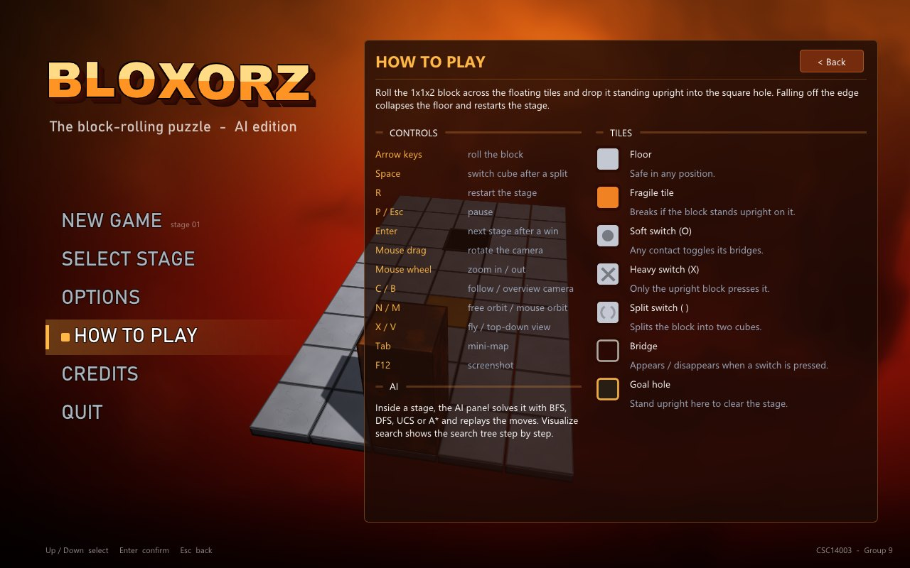 |

### 5.2. Các trang

| Trang | Nội dung |
|---|---|
| **Next up** (trang đầu) | Màn chưa qua tiếp theo: tên, nhóm độ khó, **bản đồ xem trước**, nút **PLAY STAGE N**, thanh tiến độ "x / 15 stages cleared" |
| **Select Stage** | Mỗi màn một thẻ: số màn, nhóm (màu riêng G1–G6), tên, "cleared" / "new" / "no solution", kỷ lục số bước. Rê chuột lên thẻ thì khung bên phải hiện bản đồ màn đó |
| **Options** | Chọn theme bằng **thẻ hình minh họa**, bật/tắt bóng đổ, bloom, hiệu ứng, bản đồ nhỏ, gợi ý, âm lượng nhạc và hiệu ứng, ghi chú về camera |
| **How to Play** | Mục tiêu, bảng phím, **chú giải từng loại ô** (vẽ bằng cùng bộ màu với bản đồ xem trước) |
| **Credits** | Môn học, nhóm, nguồn gốc engine, ghi chú theme Original là tưởng nhớ game gốc, thư viện |

Bản đồ xem trước đọc trực tiếp file `data/<n>.data` (cả phần mở rộng v2) mà không đụng tới màn đang chơi. Nó vẽ đủ ô thường, ô cam, công tắc O/X, ô ( ), ô cầu đóng (viền) và mở, lỗ đích, vị trí bắt đầu.

### 5.3. Thay đổi trong màn chơi

- **Tên màn khi bắt đầu:** "STAGE 07" và tên màn hiện lớn giữa màn hình khoảng 2,4 giây, như đoạn giới thiệu màn của game gốc. Chữ nằm sau các bảng HUD và ẩn khi tạm dừng.
- **Kỷ lục:** tự chơi thắng (không tính solver phát lại) thì lưu số bước ít nhất vào `settings.ini` (`best <màn> <số bước>`). Bảng thắng hiện "Best: … – new record!".
- Nút **New Game** trên thanh công cụ đổi thành **Menu** (về màn hình chính). Pause có thêm Options đầy đủ (3 theme, bóng đổ, bloom).
- Ô cầu **nháy xanh** khi mở và **nháy đỏ** khi đóng, ở mọi theme.

| Tên màn khi bắt đầu | Pause + Options |
|---|---|
| 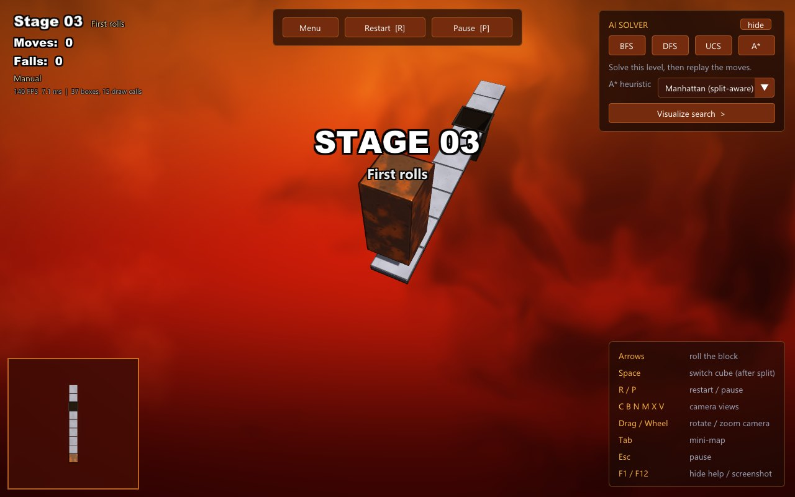 | 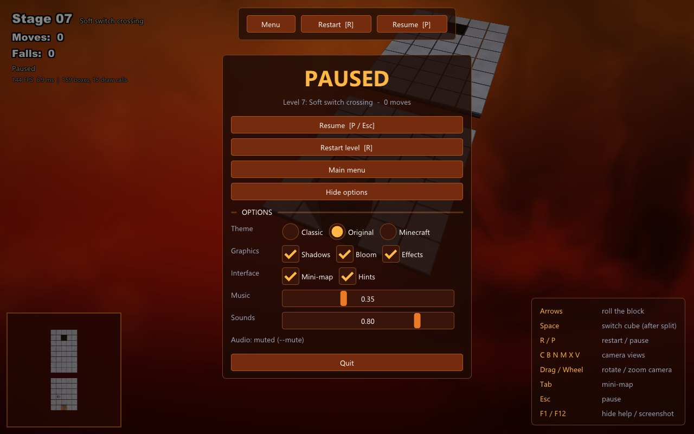 |

**File:** `code/hud.h`, `code/hud.cpp` (gần như viết lại), `code/main.cpp` (cài đặt, kỷ lục, khung hậu kỳ, camera ở menu), `code/tile.cpp` (lỗ đích theme Original, cầu nháy), `code/app.h`.

---

## 6. Tùy chọn dòng lệnh mới

| Cờ | Ý nghĩa |
|---|---|
| `--theme original` | Mở với theme Original (còn `classic`, `minecraft`) |
| `--no-shadows`, `--no-bloom` | Tắt bóng đổ thật / bloom |
| `--ui levels\|settings\|howto\|credits` | Mở thẳng trang đó của màn hình chính (để chụp ảnh) |

Các cờ cũ (`--camera`, `--shot`, `--quit-after`, `--mute`, `--keep-open`, `--visualize`…) giữ nguyên. Hướng dẫn chạy và bảng phím đầy đủ: [play.md](play.md).

---

## 7. Kiểm chứng

| Kiểm tra | Kết quả |
|---|---|
| Phát lại lời giải trong game C++ (`--play`, render mới có bóng đổ + bloom) | **15/15** màn có lời giải đều WON đúng số bước, mã thoát 0 |
| `python -m pytest -q` | **162 passed, 5 skipped** (5 test chờ DFS/UCS, không đổi) |
| Build Windows (`make`, `make dist`) | ✅ không lỗi, không cảnh báo |
| Build Linux trong WSL (`make`) + chạy trên WSLg | ✅ hình đúng; tự tắt hiệu ứng nặng, khoảng 43 FPS |
| Ảnh chụp tự động | Ba theme × trong màn / menu / các trang con / bốn góc camera / Pause; sửa lỗi chữ tên màn đè lên bảng Pause phát hiện qua ảnh |

---

## 8. Danh sách commit

| Commit | Nội dung |
|---|---|
| `59987b5` | `feat(gui)`: camera orbit, bóng đổ + bloom, theme Original, màn hình chính mới (12 file, +2017 / −514 dòng) |
| (commit kế tiếp) | `docs`: report5, ảnh `Docs/images/report5/`, ảnh tham khảo theme gốc, cập nhật `play.md` và README |

---

## 9. Hạn chế và việc còn lại

- **Kéo/lăn chuột chưa được thử bằng tay:** người làm chỉ kiểm tra camera qua ảnh chụp tự động. Độ nhạy hiện tại: 0,3°/pixel ngang, 0,25°/pixel dọc, mỗi nấc lăn zoom 12%. Nếu nhóm thấy chưa vừa tay thì chỉnh trong `Camera::apply_drag` và `Camera::scroll`.
- **Đổi góc nhìn camera ở menu:** khi đóng menu, góc nhìn rộng của camera đổi từ 60° về 75° ngay lập tức (vị trí mắt thì vẫn trượt mượt). Hiện tượng này trùng lúc hiệu ứng mở màn nên khó thấy.
- **Theme Original khác game gốc ở vài điểm:** game gốc có camera cố định và font bitmap riêng; ở đây dùng Arial Black. Màu sắc được chỉnh theo một ảnh chụp, có thể còn lệch nhẹ.
- **Tiến độ không tính màn 11:** màn này cố ý vô nghiệm nên không bao giờ "qua". Kỷ lục chỉ tính khi tự chơi.
- **Máy vẽ bằng CPU:** theme Original chậm hơn Classic khoảng 30% vì nền khói dùng nhiều lớp nhiễu.
