# Report 7: Bảng so sánh thuật toán trong game, theme Minecraft "có shader", bóng đổ rõ ở góc nhìn mặc định (nhóm 9)

> **Ngày:** 30/10/2026 · **Người thực hiện:** Kiên (TV5)
> **Phạm vi:** (1) đổi phụ đề màn hình chính; (2) làm lại theme Minecraft cho giống Minecraft chạy gói shader; (3) chỉnh hướng sáng để thấy rõ bóng đổ ở các góc nhìn mặc định; (4) thêm **chức năng so sánh 4 thuật toán tìm kiếm cho từng màn** (mục "So sánh 4 thuật toán ngay trong game" ở [report2.md](report2.md) §8); (5) viết lại `README.md` thành README giới thiệu repo.
> Không đổi luật chơi, không đổi solver Python: mọi lời giải cũ vẫn đúng.

---

## 1. Tóm tắt

| Việc | Kết quả |
|---|---|
| Phụ đề màn hình chính | ✅ "The block-rolling puzzle - **AI Search Algorithms implement edition**". Tự tách 2 dòng khi cửa sổ hẹp để không đè bảng bên phải |
| Bóng đổ không thấy ở góc nhìn mặc định | ✅ Tìm ra nguyên nhân: nắng chiếu **cùng hướng với camera**, bóng nấp sau khối (mục 3). Nắng giờ chiếu chéo từ phía sau bên trái camera, bóng đổ sang phải màn hình ở C / B / X / N |
| Theme Minecraft | ✅ Làm lại toàn bộ: texture 16x16 theo bảng màu gốc, **nổi khối từng texel**, nắng ấm + trời xanh, bóng đổ thật, AO ở chân khối, **ô sàn thành khối đầy** (đảo nổi), **trời 3D + biển phản chiếu + mặt trời vuông + mây khối**, ô đích là **cổng Nether**, tone mapping ACES |
| So sánh 4 thuật toán | ✅ Nút **Compare all 4 algorithms** trong bảng AI / phím **Q**: chạy BFS, DFS, UCS, A\* ở luồng nền; bảng 9 chỉ số, biểu đồ cột, **Replay** từng thuật toán, **Save CSV** |
| README | ✅ Viết lại thành README giới thiệu repo: tính năng, ảnh, cài đặt từng hệ điều hành, cách chạy, cấu trúc, test. Bỏ phần phân công và trạng thái tiến độ (vẫn còn trong `Docs/`) |
| Kiểm chứng | pytest **357 passed, 1 skipped** · **15/15** màn tự phát lại vẫn **WON** · `make`, `make dist`, build WSL đều qua · theme Minecraft mới ~1150 FPS (không vsync, màn 13) |

---

## 2. Phụ đề màn hình chính

| Trước | Sau |
|---|---|
| 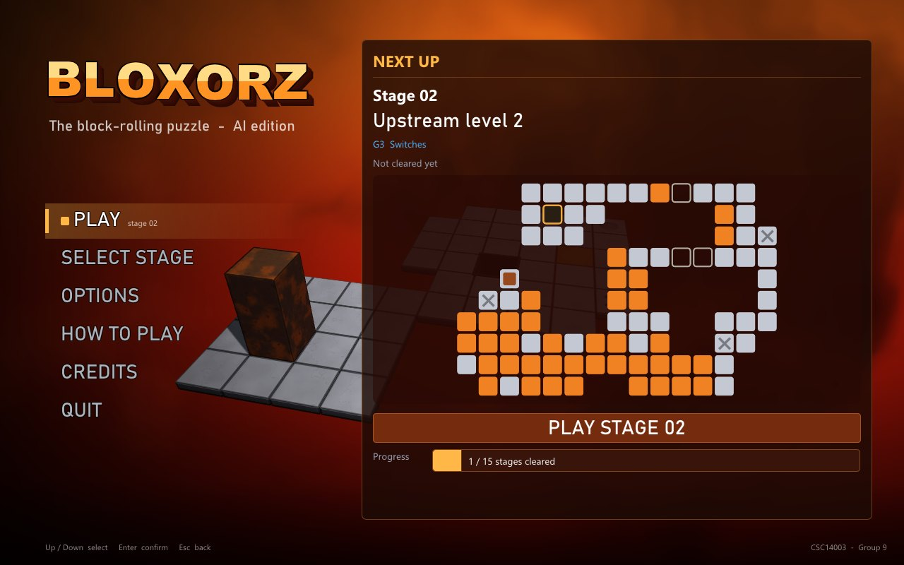 | 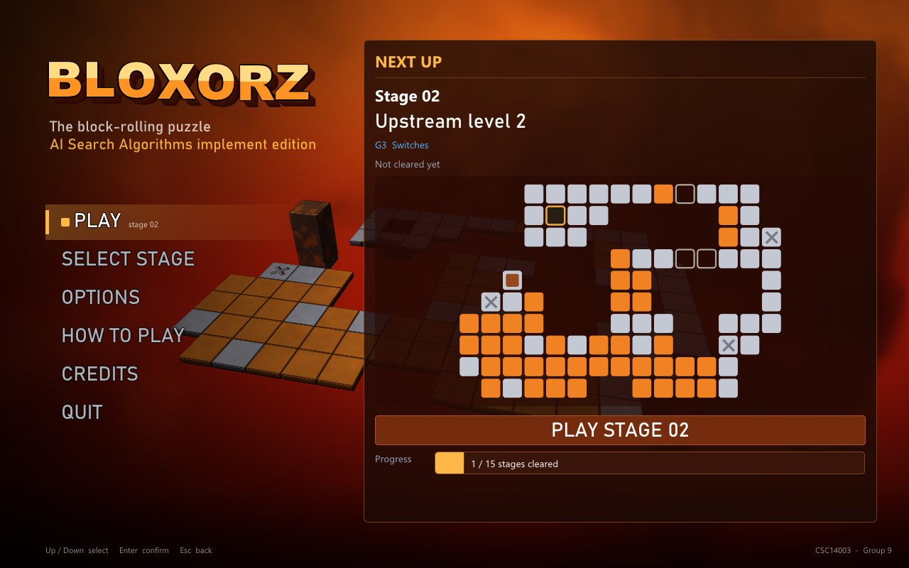 |

Phụ đề cũ "The block-rolling puzzle - AI edition" thành **"The block-rolling puzzle - AI Search Algorithms implement edition"**. Câu mới dài gấp đôi. Ở cửa sổ 1280 px, khoảng trống trước bảng nội dung bên phải chỉ còn khoảng 430 px, nên `main_menu()` (`code/hud.cpp`) đo chiều rộng chữ:

- đủ chỗ (màn hình rộng, ví dụ 1920 px): một dòng như cũ;
- không đủ: tách hai dòng, dòng thứ hai "AI Search Algorithms implement edition" tô màu nhấn của theme, thu nhỏ chữ nếu vẫn chật.

---

## 3. Bóng đổ: vì sao không thấy và hướng sáng mới

### 3.1. Nguyên nhân

Bóng đổ thật (shadow map) có từ report5, nhưng ở góc nhìn mặc định gần như không thấy. Lý do nằm ở **phương vị** (góc trên mặt phẳng ngang) của tia sáng so với hướng nhìn:

| | Phương vị |
|---|---|
| Hướng nhìn camera C (bám khối) và B (toàn màn), yaw −65° / −62° | ≈ 115° |
| Tia sáng cũ `(-0.35, 0.55, -1.0)` | ≈ 122° |

Tia sáng gần như **trùng hướng nhìn**: nắng chiếu từ ngay sau lưng camera, nên bóng rơi thẳng ra phía sau khối và bị chính khối che. Camera X (trực thăng) kế thừa hướng của C/B nên cũng vậy.

### 3.2. Hướng sáng mới

`Renderer::light_dir()` (`code/render.cpp`): tia sáng chiếu theo phương vị **≈ 35°**, lệch 55–80° so với hướng nhìn mặc định.

| Theme | Tia sáng | Độ cao mặt trời | Bóng dài (so với chiều cao vật) |
|---|---|---|---|
| Classic | `(0.82, 0.57, −1.00)` | 45° | 1,0× |
| Minecraft | `(0.82, 0.57, −0.88)` | 41° | 1,1× |
| Original | `(0.82, 0.57, −0.80)` | 39° | 1,25× (nắng chiều) |

Hệ quả ở góc nhìn mặc định:
- bóng đổ chéo sang **phải màn hình**;
- mặt trái của khối (−y) được chiếu sáng, mặt phải (+x) tối, nên khối có khối và tương phản rõ hơn.

Camera N (xoay tự do) có yaw mặc định −120°, lệch với hướng nắng mới chỉ khoảng 25° nên bóng lại bị che. Mình đổi yaw mặc định của N thành **−100°** (lệch khoảng 45°). Người chơi vẫn kéo chuột xoay tự do như cũ.

| Trước | Sau |
|---|---|
| 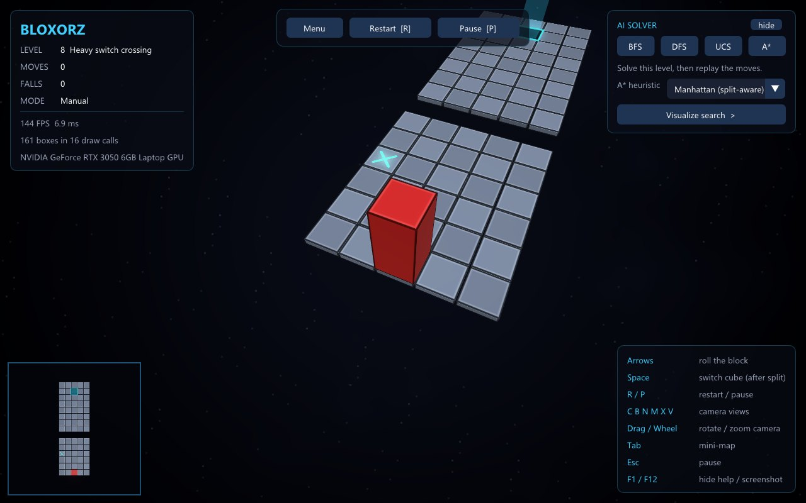 | 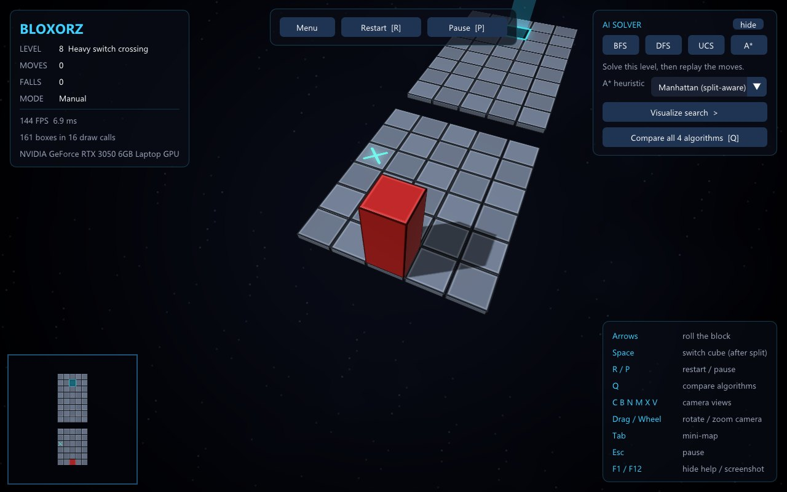 |
| 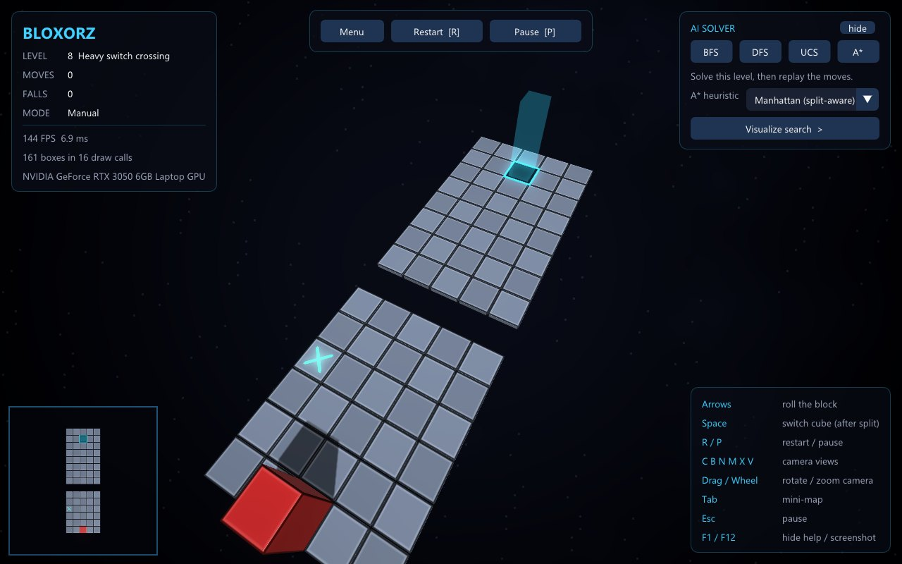 | 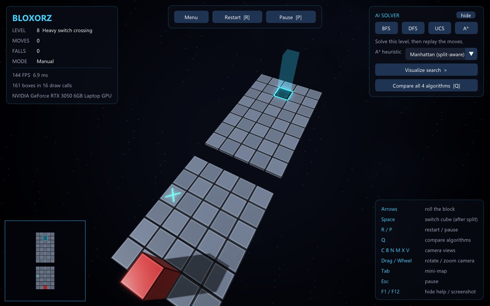 |

Theme Original sau khi đổi:

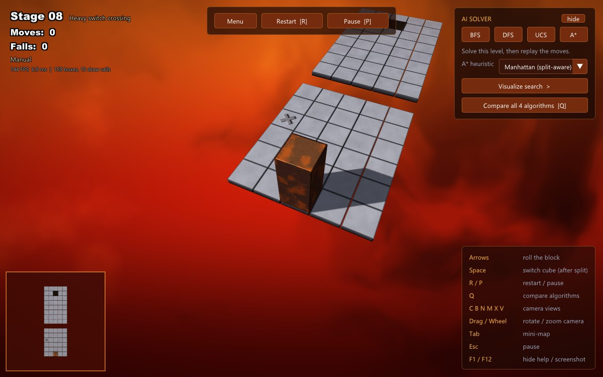

---

## 4. Theme Minecraft làm lại

### 4.1. Tài liệu tham khảo

- **Texture gốc:** khối cỏ dùng texture xám tô màu theo biome. Màu cỏ đồng bằng là **#91BD59**, lấy từ colormap 256x256 theo nhiệt độ/độ ẩm; hông khối cỏ là đất với viền cỏ rủ xuống (Minecraft Wiki: [Grass Block](https://minecraft.fandom.com/wiki/Grass_Block), [OptiFine colormaps](https://optifine.readthedocs.io/colormaps.html)).
- **Gói shader** (BSL và các gói tương tự): nắng tạo bóng mềm, ambient occlusion, bloom giữ nguồn sáng rực mà không làm cháy cả cảnh, nước phản chiếu trời ([BSL Shaders](https://www.feed-the-mods.com/bsl-shaders/), [anvilpacks: BSL](https://anvilpacks.com/shaders/bsl-shaders/)).
- **Ảnh tham khảo bạn gửi:** trời xanh có mây, cỏ xanh tươi, khối có texture nổi (normal map), nước phản chiếu, tone màu ấm.

Toàn bộ texture được **vẽ bằng shader** theo bảng màu nhóm tự chọn. Repo không chứa file texture nào của Minecraft.

### 4.2. Trước và sau

| Trước | Sau |
|---|---|
| 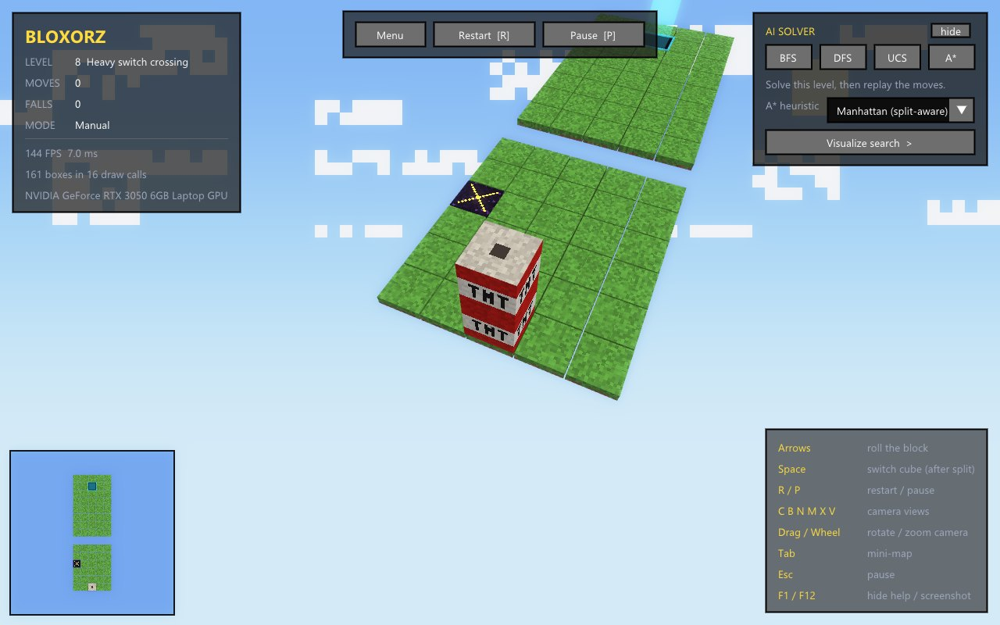 | 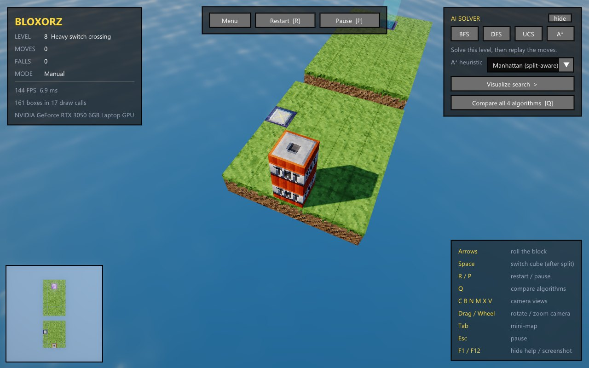 |

| Màn 15 (góc C) | Màn 16 (góc B) |
|---|---|
| 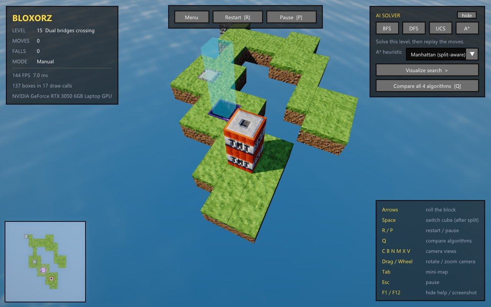 | 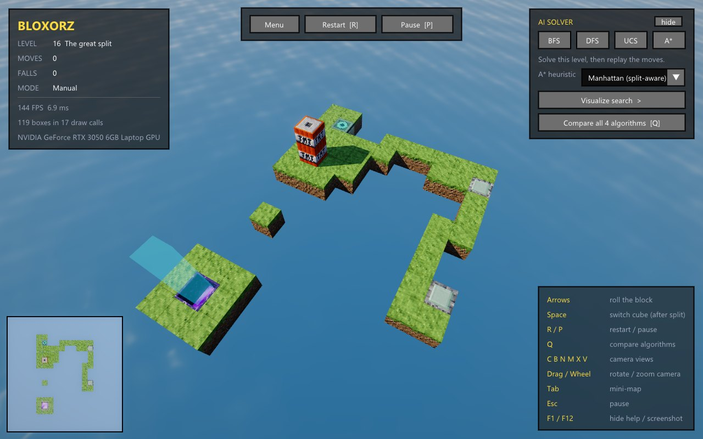 |

Màn 9 ở góc N (bóng dài của TNT, ô đất nung có vết nứt, tấm áp lực, khung cổng End):

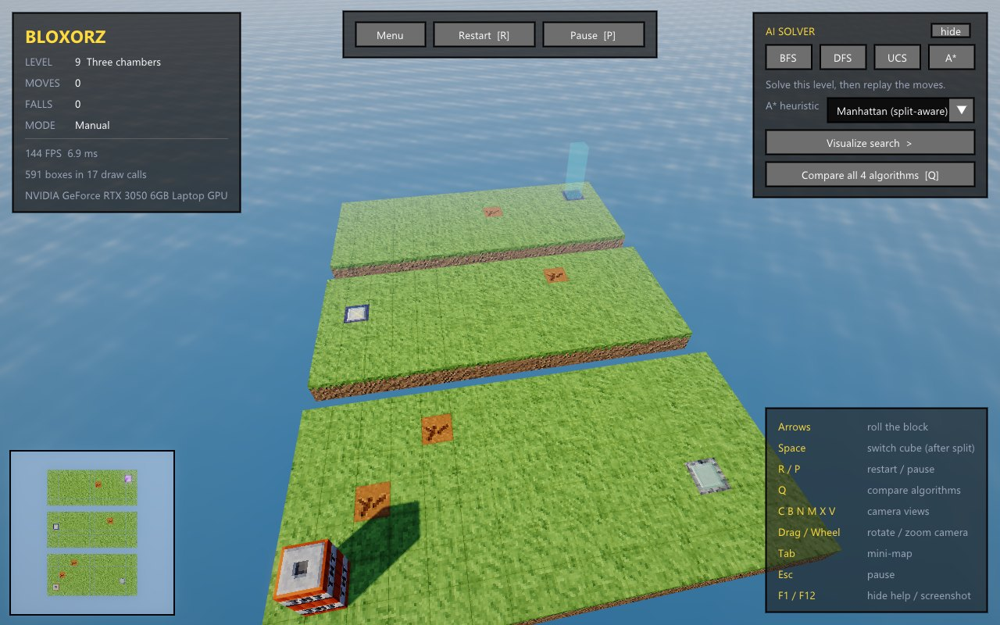

Màn hình chính ở theme Minecraft (trời và biển 3D quay theo camera):

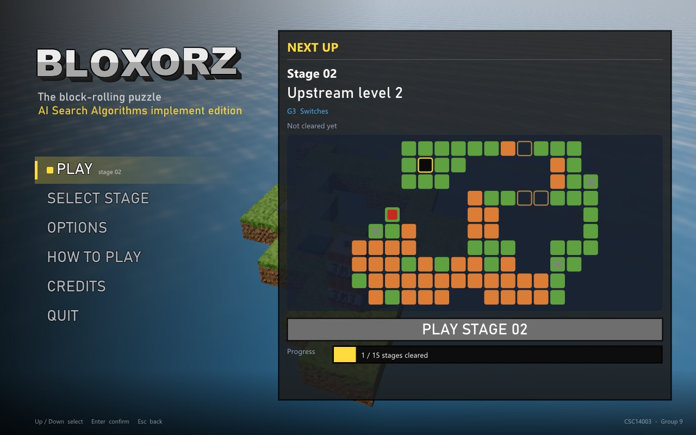

### 4.3. Ô Bloxorz → khối Minecraft

| Ô trong game | Khối Minecraft (mặt trên / hông) |
|---|---|
| Sàn | **Khối cỏ**: cỏ #91BD59 có hoa văn 2x2 / đất có viền cỏ rủ 3–6 texel |
| Ô dễ vỡ (cam) | **Đất nung cam** có vết nứt như lúc đang đập khối |
| Công tắc thường (O) | **Đá cuội** + **tấm áp lực bằng đá** (gờ sáng/tối, nhấp nháy nhẹ) |
| Công tắc nặng (X) | **Obsidian** + **tấm áp lực nặng bằng sắt**, dấu **X** vàng phát sáng |
| Công tắc tách khối ( ) | **Khung cổng End**: hông đá End, mặt trên có **mắt Ender** phát sáng |
| Cầu | **Ván gỗ sồi** (tấm cao 4 texel, mối nối so le) |
| Khối người chơi | **TNT** (dải trắng có chữ TNT, nắp có ngòi) |
| Khối nhỏ đang điều khiển | **Khối vàng** (rất bóng) |
| Lỗ đích | **Cổng Nether**: khung và thành obsidian, đáy xoáy tím chuyển động, cột sáng beacon |

### 4.4. Kỹ thuật

Toàn bộ nằm trong `code/shaders.h`, nhánh `uTheme == 1`:

1. **Texture 16x16 texel mỗi khối:** `mcTexel()` trả màu của **một texel** từ bảng màu rời rạc cộng nhiễu băm (hash) theo texel và theo ô. Mỗi ô sàn (rộng 0,97) được làm tròn thành đúng 16x16 texel. Khối người chơi dùng hạt nhiễu cố định để texture không nhấp nháy khi lăn.
2. **Nổi khối từng texel** (như normal map của gói texture PBR): độ sáng của texel được coi là độ cao. Pháp tuyến nghiêng theo chênh lệch với 4 texel bên cạnh, rồi đổi sang không gian thế giới bằng trục u, v của mặt. Nhờ vậy cỏ, đá cuội, gỗ bắt nắng lổn nhổn theo từng điểm ảnh.
3. **Ánh sáng:**
   - nắng vàng ấm `(1.0, 0.90, 0.74)` nhân bóng đổ thật;
   - ánh sáng môi trường lấy theo trời (xanh ở trên, xám ở dưới), nên bóng mang màu xanh như gói shader;
   - mặt quay lưng với nắng thì tối hẳn;
   - specular theo vật liệu: vàng, obsidian, sắt, mắt Ender bóng; cỏ, gỗ gần như mờ;
   - vật liệu bóng phản chiếu trời theo Fresnel.
4. **AO kiểu "smooth lighting":** hông khối tối dần xuống chân, mặt trên tối nhẹ sát mép.
5. **Ô sàn là khối đầy 1x1x1** (chỉ ở theme này, `tile.cpp`): màn chơi thành đảo khối nổi, hông đất có viền cỏ như khối thật. Khe giữa các khối giảm từ 0,015 xuống 0,004.
6. **Trời 3D** (`Renderer::draw_sky`, `BG_FRAG` với `uSky3D = 1`): dựng tia nhìn cho từng điểm ảnh bằng nghịch đảo ma trận chiếu × nhìn, rồi vẽ:
   - gradient trời và quầng nắng;
   - **mặt trời vuông** đặt đúng hướng nguồn sáng, khớp với bóng đổ, sáng HDR nên bloom tỏa quầng;
   - **lớp mây khối** phẳng ở độ cao 26 trôi chậm;
   - **mặt biển** ở độ cao −7: sóng từ tổng sin và nhiễu, phản chiếu trời theo Fresnel, vệt nắng lấp lánh, sương về phía chân trời.

   Trời đi theo camera (cả phép chiếu song song ở góc V) nên xoay camera thấy trời và biển xoay theo.
7. **Hậu kỳ:** tone mapping **ACES** (đường cong phim), tăng độ bão hòa 1,2, vignette nhẹ; bloom tăng từ 0,45 lên 0,70 cho mặt trời, khối vàng, cổng Nether. Hai theme còn lại giữ "vai mềm" như cũ.

### 4.5. Hiệu năng

Đo bằng `--no-vsync`, màn 13 (màn lớn nhất), góc B, 6 giây, RTX 3050 Laptop, 1280x800:

| Theme | FPS trung bình |
|---|---:|
| Classic | 1138 |
| Original | 913 |
| **Minecraft (mới)** | **1154** |

Nổi khối từng texel tốn thêm 4 lần tính `mcTexel()` mỗi điểm ảnh, nhưng mỗi lần chỉ là vài phép băm. Theme Original vẫn chậm nhất vì dùng nhiễu fbm cho khói và vân đá. Máy dùng driver vẽ bằng CPU (WSLg) vẫn tự tắt bóng đổ và bloom như report5.

---

## 5. Bảng so sánh 4 thuật toán

### 5.1. Cách dùng

Trong màn chơi: nút **Compare all 4 algorithms [Q]** ở cuối bảng AI, hoặc phím **Q**. Lần đầu mở ở một màn, game tự chạy cả 4 thuật toán. Kết quả được giữ theo màn trong lúc chơi; mở lại thì hiện ngay. `Q` / `Esc` / nút **Close** để đóng. Dev: `a.exe 16 --ui compare` mở thẳng bảng (dùng để chụp ảnh).

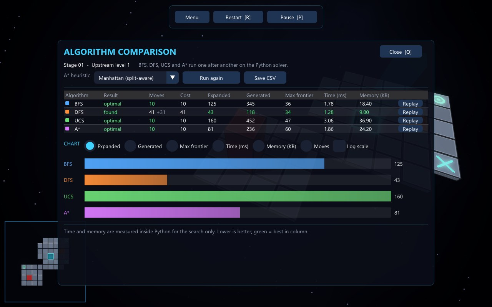

Bảng gồm:

- **Thanh tiến độ** khi đang chạy: thuật toán đang chạy, số đã xong, thời gian đã trôi.
- **Bảng 9 chỉ số:** kết quả (optimal / found / no solution / failed), số bước (DFS ghi thêm `+N` so với tối ưu), chi phí, node mở rộng, node sinh ra, frontier lớn nhất, thời gian (ms), bộ nhớ đỉnh (KB). **Giá trị tốt nhất mỗi cột tô xanh.**
- **Biểu đồ cột** cho chỉ số đang chọn (Expanded / Generated / Max frontier / Time / Memory / Moves), mỗi thuật toán một màu, có tùy chọn **thang log**.
- *(Bản đầu có thêm vài dòng nhận xét tự sinh bên dưới biểu đồ. Phần này đã bỏ (mục 10) vì nhận xét theo luật cố định dễ thành chủ quan; phần giải thích số liệu để trong báo cáo.)*
- **Replay:** khối tự lăn theo lời giải của thuật toán đó.
- **A\* heuristic:** Manhattan hoặc Zero (= UCS), kèm **Run again**.
- **Save CSV:** ghi `compare_stage_<n>.csv` cạnh file chạy (cột `level, algorithm, heuristic, status, length, cost, expanded, generated, max_frontier, time_ms, memory_kb`). File này dán thẳng vào phần thực nghiệm của báo cáo được.

| Màn 16 (split), theme Minecraft | Màn 11 (vô nghiệm), theme Original |
|---|---|
| 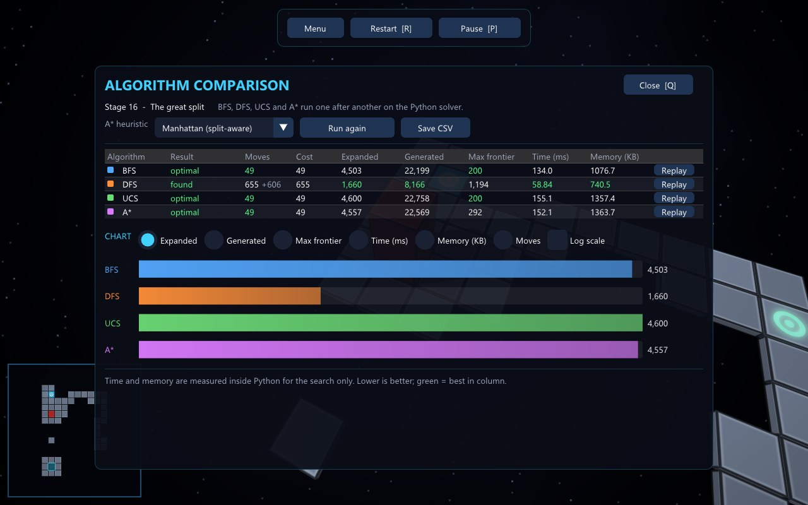 | 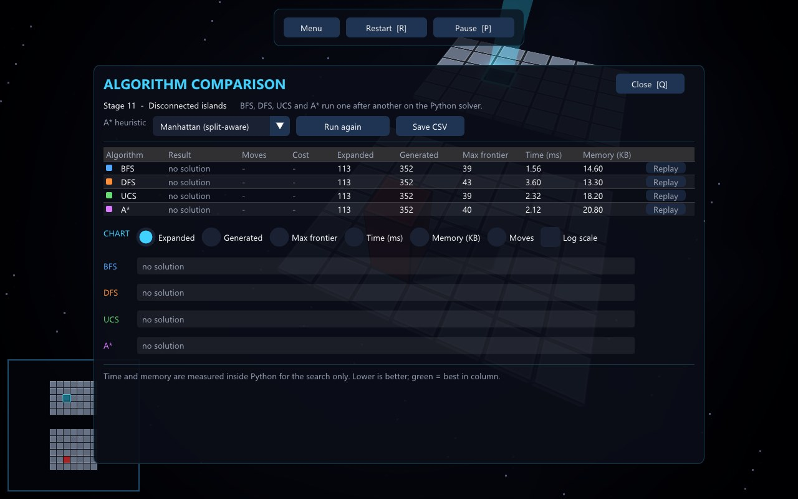 |

Màn khó nhất (13, 47.680 trạng thái): đang chạy và kết quả. Cả 4 thuật toán xong trong khoảng 20 giây, cửa sổ vẫn mượt trong lúc Python chạy.

| Đang chạy | Kết quả |
|---|---|
| 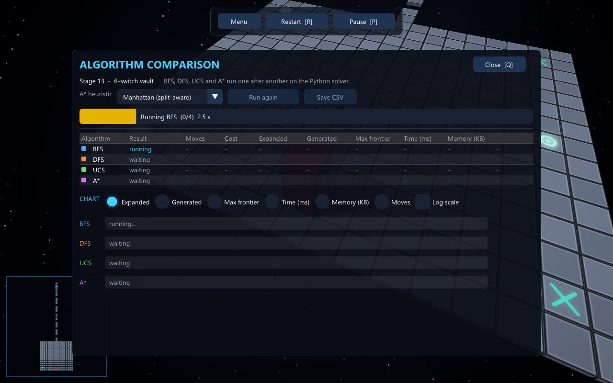 | 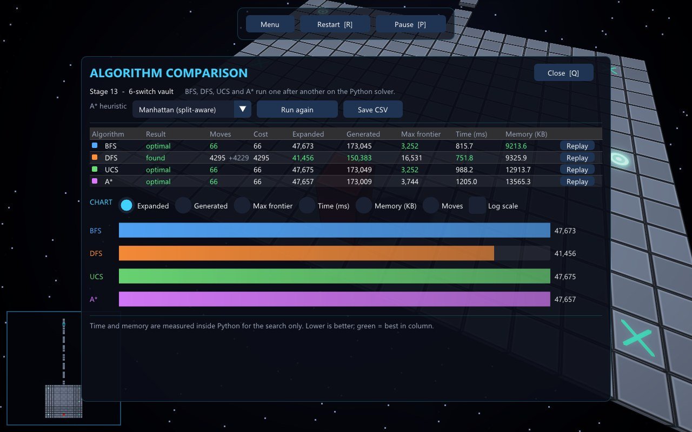 |

Số node của bảng trùng khớp với bảng ở report6 mục 5 (ví dụ màn 13: BFS 47.673, DFS 41.456 / 4.295 bước, UCS 47.675, A\* 47.657), vì cùng gọi solver Python. Thời gian và bộ nhớ thay đổi chút ít giữa các lần đo.

### 5.2. Cách cài đặt

| Thành phần | Nội dung |
|---|---|
| `code/compare.h/.cpp` (mới) | Chạy **tuần tự** 4 lần `main.py data/<n>.data --algo <a> --stats compare_<a>_stats.txt --out compare_<a>.txt` trong **một luồng nền**. Tuần tự để số đo thời gian/bộ nhớ không ảnh hưởng lẫn nhau. Kết quả giữ trong `map<màn, CompareResult>` có mutex; giao diện đọc bản sao mỗi frame. Xuất CSV |
| `code/autoplay.cpp` | Hàm dùng chung `read_solver_stats()` đọc file `--stats` (bảng AI cũ và bảng so sánh cùng dùng) |
| `code/main.cpp` | `app_toggle_compare`, `app_compare_rerun`, `app_replay_compare`. Không cho chạy Solve/Visualize khi đang so sánh và ngược lại, vì hai lần gọi Python cùng lúc sẽ tranh file `solver_log.txt`. Khóa phím lăn khối khi bảng mở. Cờ dev `--ui compare` |
| `code/hud.cpp` | Cửa sổ so sánh (`compare_window`, `compare_chart`), nút trong bảng AI, dòng `Q` trong bảng phím và trang How to Play |
| `code/controls.cpp` | Phím `Q` mở/đóng, `Esc` đóng |
| `.gitignore` | Bỏ qua `code/compare_*.txt`, `code/compare_stage_*.csv` (file game ghi lúc chạy) |

Trang How to Play có thêm phím `Q` và một câu giới thiệu tính năng:

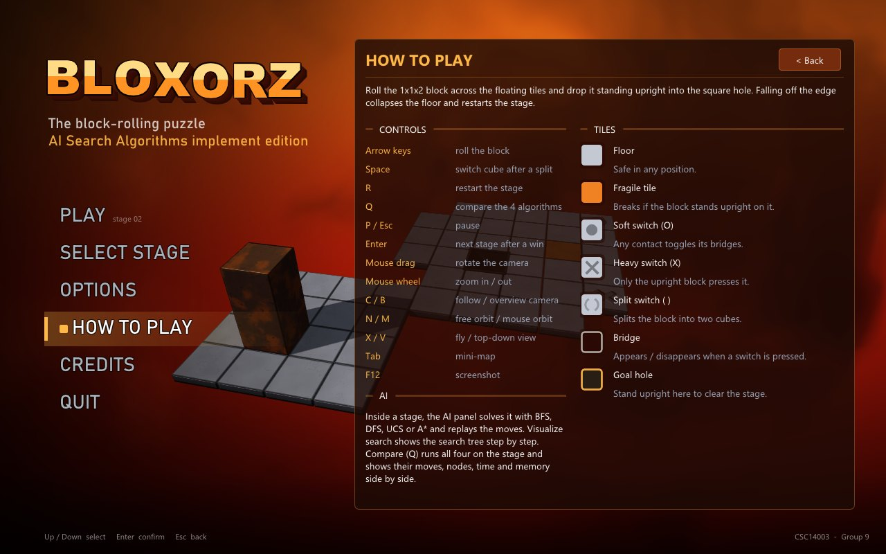

---

## 6. README mới

`README.md` được viết lại thành README giới thiệu repo cho người mới vào:

- giới thiệu ngắn, ảnh chụp, bảng tính năng (game + AI);
- **cài đặt và chạy** cho Windows (MSYS2), Linux/WSL, macOS; bản đóng gói `make dist`;
- cách dùng: game, bảng AI, so sánh thuật toán, solver dòng lệnh, test;
- cấu trúc thư mục, mô hình trạng thái, tài liệu, ghi nguồn.

Bỏ khỏi README: bảng trạng thái từng thành viên và bảng phân công. Các thông tin đó vẫn còn trong `Docs/` ([report1.md](report1.md), [task.md](task.md), các report). Sửa luôn chỗ README cũ ghi "Q thoát": phím này chưa từng được gán, giờ `Q` là bảng so sánh.

---

## 7. Kiểm chứng

| Kiểm tra | Kết quả |
|---|---|
| `python -m pytest -q` | **357 passed, 1 skipped** (không đổi phần Python) |
| 15 màn có lời giải, `a.exe <n> --play data/solutions/<n>.txt --theme minecraft` | **15/15 WON**, mã thoát 0 (ô sàn dày 1 khối không ảnh hưởng luật) |
| Bảng so sánh: màn 1, 11, 13, 16 (`--ui compare`) | Chạy hết 4 thuật toán, số liệu khớp `main.py`, màn 11 hiện "no solution" cho cả 4 |
| `make` (MSYS2), `make dist` | Không lỗi, không cảnh báo; gói `dist/win64` tạo được |
| Build WSL (Linux) | Không lỗi, không cảnh báo |
| FPS | Mục 4.5 |

---

## 8. File đã đổi

| File | Thay đổi |
|---|---|
| `code/shaders.h` | Theme Minecraft mới (`mcTexel`, nổi khối từng texel, ánh sáng, AO), trời/biển 3D trong `BG_FRAG`, tone mapping ACES, `skyColor` cho theme 1 |
| `code/render.h/.cpp` | Hướng sáng mới, `draw_sky()`, vật liệu `MAT_PORTAL`, bloom Minecraft 0,70 |
| `code/tile.cpp` | Ô sàn khối đầy + khe mảnh ở theme Minecraft, cổng Nether ở lỗ đích |
| `code/camera.cpp` | Yaw mặc định camera N: −120° → −100° |
| `code/compare.h/.cpp` | Mới: chạy và lưu kết quả so sánh, xuất CSV |
| `code/hud.cpp` | Phụ đề menu mới, cửa sổ so sánh, nút trong bảng AI, phím `Q` trong bảng phím / How to Play |
| `code/main.cpp`, `code/app.h`, `code/controls.cpp`, `code/autoplay.h/.cpp` | Nối chức năng so sánh, phím `Q`, `--ui compare`, `read_solver_stats()` |
| `README.md`, `Docs/play.md`, `.gitignore` | README mới; hướng dẫn chơi thêm bảng so sánh, theme Minecraft, phím `Q` |
| `Docs/report7.md`, `Docs/images/report7/` | Báo cáo này và 19 ảnh |

## 9. Hạn chế và việc còn lại

- **Hàm chi phí không đồng nhất (TV3)** vẫn chưa có, nên trong bảng so sánh UCS luôn cho cùng độ dài với BFS. Khi có hàm chi phí, bảng sẽ cho thấy khác biệt thật (report6 mục 6.1).
- Bảng so sánh gọi Python 4 lần nối tiếp. Màn lớn (13) mất khoảng 20 giây, chủ yếu là thời gian tìm kiếm thật cộng với đo bộ nhớ bằng `tracemalloc`.
- Replay lời giải DFS ở màn lớn rất dài (màn 13: 4.295 bước). Bấm `R` để dừng.
- Texture Minecraft vẽ bằng shader nên không có mipmap: ở xa (góc B của màn lớn) texel nhỏ hơn điểm ảnh, mặt cỏ hơi lấm tấm (MSAA chỉ khử răng cưa ở mép hình, không làm mịn bên trong texture). Nếu cần có thể làm mờ dần hoa văn theo khoảng cách.

---

## 10. Cập nhật sau report7

| Việc | Nguyên nhân / cách làm |
|---|---|
| **Ô đen nhấp nháy ở đáy màn hình (theme Minecraft)** | Công thức Fresnel `pow(1 - dot(...), k)`: ở đáy màn hình tia nhìn chúi gần thẳng xuống mặt biển, sai số làm `dot` nhỉnh hơn 1, cơ số âm nên `pow` ra NaN ở một điểm ảnh; các lượt làm nhòe của bloom thổi nó thành ô vuông đen khoảng 85 px, nhấp nháy theo sóng. Sửa: kẹp cơ số về [0, 1] ở cả 4 chỗ, và chặn NaN/Inf ở bước lọc sáng của bloom và bước ghép cuối (`code/shaders.h`) |
| **Bỏ phần nhận xét tự sinh** trong bảng so sánh | Nhận xét là các câu mẫu điền số theo luật cố định (ngưỡng 5%...), dễ thành chủ quan. Bảng, biểu đồ, Replay và CSV giữ nguyên (`code/hud.cpp`). Ảnh 10, 11, 12, 14 đã chụp lại |
| **Theme Original: khối như bị giật và đổi mặt khi lăn** | Hai nguyên nhân. (1) Lăn xong, khối được vẽ lại bằng phép xoay chuẩn cố định theo tư thế (`along`), không theo đúng hướng vừa lăn tới: cùng hình nhưng các mặt bị tráo chỗ ngay khi kết thúc lần lăn. Theme Classic một màu nên không thấy, Original mỗi mặt có vân gỉ riêng nên thấy rõ. (2) Vân gỉ lấy độ lệch theo mặt *trong thế giới* (trên / bên), nên đổi đột ngột giữa lúc lăn khi một mặt chuyển từ trên sang bên |
| Cách sửa (1) | `code/superblock.cpp`: `face_sym` là một trong 4 phép đối xứng xoay của hộp 2×1×1, ghi hướng thật so với tư thế chuẩn. Mỗi lần lăn xong cộng dồn phần chênh `inverse(khung chuẩn mới) × khung cuối lần lăn` (làm tròn về −1/0/1). Khối nhỏ sau khi tách có `cube_rot` cộng dồn từng phép xoay 90°. Phần dựng ma trận lăn tách thành hàm `block_frame()` dùng chung cho vẽ và tính `face_sym`. Chỉ áp dụng ở theme Original, nên Classic và Minecraft (chữ TNT luôn nằm ngang) giữ nguyên |
| Cách sửa (2) | `code/shaders.h`: vân gỉ lấy độ lệch theo pháp tuyến *của khối* (có dấu, 6 mặt 6 vân khác nhau), nên đi theo mặt khi lăn |
| Kiểm chứng | Tạm in phần chênh ở mỗi lần lăn khi phát lại lời giải màn 1, 5, 14, 15, 16 (theme Original): 98/98 lần lăn có sai số 0 và hộp luôn giữ kích thước (2, 1, 1). Cả 5 màn vẫn thắng. Build không lỗi, không cảnh báo |

