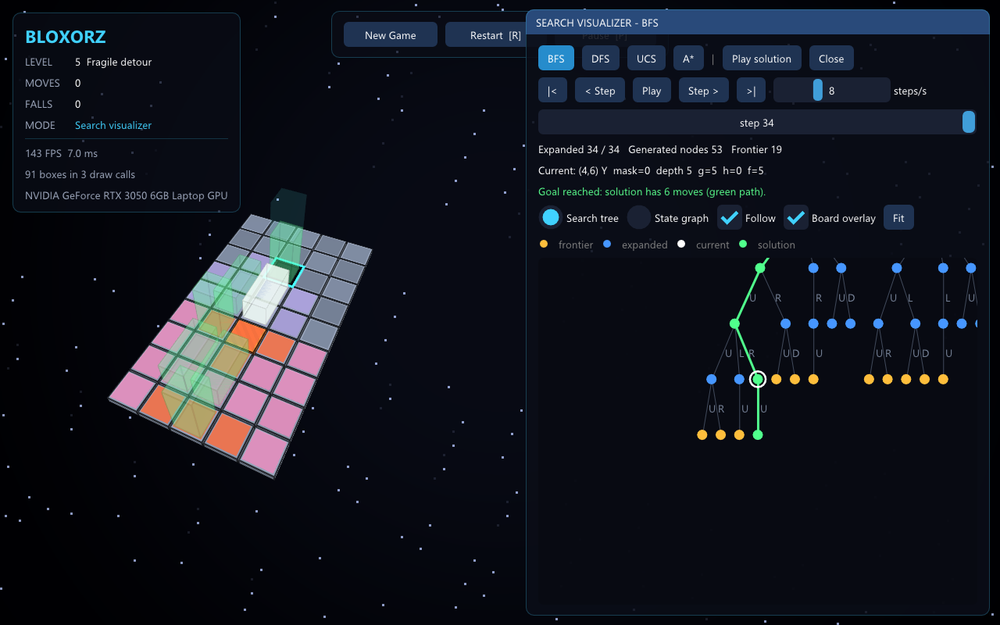

# Bloxorz: AI Search Algorithms


Game giải đố **Bloxorz** 3D (C++/OpenGL) kết hợp bộ giải bằng **các thuật toán tìm kiếm** (Python): **BFS, DFS, UCS, A\***. Lăn khối 1×1×2 qua các ô lơ lửng và thả nó **đứng thẳng** vào lỗ vuông. Tự chơi, hoặc để AI giải rồi xem khối tự lăn theo lời giải, xem cây tìm kiếm chạy từng bước, và so sánh 4 thuật toán ngay trong game.

Đồ án Project 1, môn **CSC14003 – Cơ sở Trí tuệ Nhân tạo**, Khoa CNTT, Trường ĐH Khoa học Tự nhiên – ĐHQG-HCM, nhóm 9.

| Màn hình chính (theme Minecraft) | So sánh 4 thuật toán |
|---|---|
|  |  |
| **Theme Original** (kiểu game gốc) | **Theme Minecraft** |
|  |  |

---

## Mục lục

- [Tính năng](#tính-năng)
- [Bắt đầu nhanh](#bắt-đầu-nhanh)
- [Cài đặt](#cài-đặt)
- [Build và chạy game](#build-và-chạy-game)
- [Điều khiển](#điều-khiển)
- [Chơi cùng AI](#chơi-cùng-ai)
- [Solver dòng lệnh](#solver-dòng-lệnh)
- [Đóng gói bản chơi](#đóng-gói-bản-chơi)
- [Chạy test](#chạy-test)
- [Cấu trúc repo](#cấu-trúc-repo)
- [Mô hình bài toán](#mô-hình-bài-toán)
- [Tài liệu](#tài-liệu)
- [Ghi nguồn](#ghi-nguồn)

## Tính năng

**Game 3D** (`code/`, C++11 + OpenGL 3.3)

- 16 màn chơi (15 có lời giải, 1 cố ý vô nghiệm): ô dễ vỡ, công tắc thường / nặng, cầu bật–tắt, cầu permanent, **công tắc tách khối** (split) thành hai khối nhỏ.
- Ba theme vẽ hoàn toàn bằng shader:
  - **Classic**: không gian tối.
  - **Original**: trời đỏ cam có khói, công tắc kim loại nổi, như Bloxorz gốc.
  - **Minecraft**: khối cỏ, TNT, cổng Nether, đảo khối nổi trên biển phản chiếu trời, giống Minecraft chạy gói shader.
- Đồ họa: bóng đổ thật (shadow map), bloom HDR, tone mapping, instanced rendering (cả cảnh chỉ khoảng 16 lệnh vẽ).
- Camera: bám khối không rung, toàn cảnh, xoay tự do, bay, nhìn từ trên xuống; kéo chuột để xoay, lăn chuột để zoom.
- Màn hình chính có chọn màn (bản đồ xem trước, kỷ lục số bước), Options, How to Play.
- Âm thanh và nhạc nền tổng hợp bằng code. Rơi khỏi sàn thì sàn sụp rồi tự chơi lại.

**AI** (`ai/`, Python, chỉ dùng thư viện chuẩn)

- Mô phỏng chính xác luật của game (đối chiếu từng nước với bản C++), kể cả cầu và split.
- **BFS, DFS, UCS, A\*** với **heuristic Manhattan có tính cổng split**, đã chứng minh và kiểm chứng admissible + consistent trên toàn bộ không gian trạng thái của 16 màn.
- Đo 4 chỉ số theo đề: thời gian, bộ nhớ đỉnh, số node mở rộng, độ dài lời giải (kèm node sinh ra, frontier lớn nhất).
- Ghi vết tìm kiếm cho **Search Visualizer** trong game.

**Trong game, AI chạy ở luồng nền** (cửa sổ không bị treo):

- **Solve**: chạy một thuật toán rồi khối tự lăn theo lời giải.
- **Visualize search**: cây tìm kiếm chạy từng bước kèm g / h / f và bản đồ nhiệt trên bàn chơi.
- **Compare all 4 algorithms** (`Q`): bảng 9 chỉ số, biểu đồ cột, phát lại lời giải của từng thuật toán, xuất CSV.

## Bắt đầu nhanh

```bash
git clone https://github.com/24122039Kien/CSAI_Group9_Lab01.git
cd CSAI_Group9_Lab01
pip install -r requirements.txt          # chỉ cần cho test; phần AI không phụ thuộc gì

cd code
make                                     # tạo a.exe (Windows) hoặc a.out (Linux/macOS)
./a.exe                                  # Linux/macOS: ./a.out
```

Cần cài trình biên dịch và thư viện trước, xem [Cài đặt](#cài-đặt). Game **phải chạy trong thư mục `code/`**, vì nó đọc `data/` theo đường dẫn tương đối.

## Cài đặt

Yêu cầu chung: **Python ≥ 3.10** (để AI giải trong game và chạy solver), trình biên dịch C++11, GLFW 3, GLM, OpenGL 3.3.

### Windows (khuyên dùng để chơi, chạy bằng GPU thật)

1. Cài [MSYS2](https://www.msys2.org) (`winget install MSYS2.MSYS2`), mặc định vào `C:\msys64`.
2. Mở **MSYS2 MinGW x64** và cài:
   ```bash
   pacman -S --needed make zip mingw-w64-x86_64-gcc mingw-w64-x86_64-glfw mingw-w64-x86_64-glm
   ```
3. Build ngay trong shell MSYS2, hoặc trong terminal của VS Code sau khi đưa MSYS2 lên **đầu** PATH:
   ```powershell
   $env:PATH = "C:\msys64\mingw64\bin;C:\msys64\usr\bin;" + $env:PATH
   ```
   Nếu máy có sẵn một bộ `g++` khác (MinGW cũ), nó sẽ bị dùng nhầm và build lỗi. `(Get-Command g++).Source` phải trỏ vào `C:\msys64\mingw64\bin`.
4. Cài Python từ [python.org](https://www.python.org), nhớ tích **Add python.exe to PATH**.

Hướng dẫn từng bước cho VS Code (cấu hình terminal, lỗi thường gặp): [Docs/play.md](Docs/play.md).

### Linux / WSL

```bash
sudo apt update
sudo apt install -y g++ make libglfw3-dev libglm-dev libgl-dev python3 python3-pip
```

Trên WSLg, OpenGL được vẽ bằng CPU (`llvmpipe`). Game tự tắt bóng đổ và bloom để giữ FPS; muốn bật lại thì vào Options. Cảnh báo `MESA` / `libEGL` lúc chạy là vô hại.

### macOS

```bash
brew install glfw glm
```

## Build và chạy game

```bash
cd code
make                # object trong build/<platform>/, file chạy: a.exe hoặc a.out
```

| Lệnh | Tác dụng |
|---|---|
| `./a.exe` | Mở màn hình chính: Play, Select Stage, Options, How to Play, Credits |
| `./a.exe 5` | Vào thẳng màn 5 |
| `./a.exe 15 --solve astar` | Gọi solver Python (`bfs`, `dfs`, `ucs`, `astar`) rồi khối tự lăn tới đích |
| `./a.exe 1 --play data/solutions/1.txt` | Phát lại một file lời giải (`U D L R`, split dùng `0U`, `1R`...) |
| `./a.exe 5 --visualize bfs` | Mở thẳng Search Visualizer |
| `./a.exe 16 --ui compare` | Mở thẳng bảng so sánh 4 thuật toán |
| `./a.exe 1 --theme minecraft` | Chọn theme `classic`, `original` hoặc `minecraft` (đổi được trong Options) |
| `./a.exe 1 --no-shadows --no-bloom` | Tắt hiệu ứng cho máy yếu |
| `./a.exe --help` | Tất cả tùy chọn (`--mute`, `--camera`, `--shot`, `--no-vsync`, `--keep-open`...) |

Với `--play` / `--solve`, game in `WON` hoặc `GAME OVER` cùng số bước rồi tự thoát (mã thoát 0 = thắng). Trình thông dịch Python đổi được bằng biến môi trường `BLOXORZ_PYTHON` (mặc định `python3`; Windows: `python`, rồi `py -3`). Cài đặt và kỷ lục được lưu ở `code/settings.ini`.

## Điều khiển

| Phím | Tác dụng |
|---|---|
| `↑ ↓ ← →` | Lăn khối |
| `Space` | Sau khi tách: đổi khối nhỏ đang điều khiển |
| `R` | Chơi lại màn |
| `Q` | Mở / đóng bảng so sánh 4 thuật toán |
| `P` / `Esc` | Tạm dừng (`Esc` cũng đóng menu, Visualizer, bảng so sánh) |
| `Enter` | Sang màn tiếp sau khi thắng |
| `C` `B` `N` `M` `X` `V` | Camera: bám khối, toàn cảnh, xoay tự do, theo chuột, bay, từ trên xuống |
| Kéo chuột / lăn chuột | Xoay / zoom camera |
| `Tab` · `F1` · `F12` | Bản đồ nhỏ · ẩn bảng phím · chụp màn hình |

## Chơi cùng AI

Trong màn chơi, **bảng AI** ở góc phải có:

- **BFS / DFS / UCS / A\***: giải màn hiện tại rồi phát lại lời giải. Bảng hiện 4 chỉ số của lần chạy gần nhất.
- **A\* heuristic**: Manhattan (có tính cổng split) hoặc Zero (khi đó A\* chính là UCS).
- **Visualize search**: cây tìm kiếm hoặc đồ thị trạng thái chạy từng bước (`←` / `→`, `Space`), kèm bản đồ nhiệt các ô đã duyệt.
- **Compare all 4 algorithms** (`Q`):
  - chạy lần lượt cả 4 thuật toán;
  - bảng số bước, chi phí, node mở rộng / sinh ra, frontier lớn nhất, thời gian, bộ nhớ; giá trị tốt nhất mỗi cột tô xanh;
  - biểu đồ cột (có thang log);
  - nút **Replay** cho từng thuật toán;
  - **Save CSV** ghi `compare_stage_<n>.csv` để dùng cho phần thực nghiệm.



## Solver dòng lệnh

Chạy ở thư mục gốc repo:

```bash
python main.py code/data/1.data --algo bfs                   # số bước, node mở rộng, frontier, thời gian
python main.py code/data/2.data --algo astar --out sol.txt   # ghi lời giải ra file
python main.py code/data/1.data --algo astar --heuristic zero
python main.py code/data/13.data --compare --memory          # bảng so sánh cả 4 thuật toán + bộ nhớ đỉnh
python main.py code/data/5.data --algo bfs --trace trace.txt --stats stats.txt   # vết tìm kiếm + chỉ số (game dùng)
```

Mã thoát: `0` có lời giải · `1` vô nghiệm · `2` thuật toán chưa cài · `3` lời giải sai luật · `4` lỗi đọc màn.

## Đóng gói bản chơi

```bash
cd code
make release        # Windows: Bloxorz.exe link tĩnh, không mở console, có icon
make dist           # ../dist/<platform>/Bloxorz/ (game + data + solver Python + licenses) và file zip
```

Giải nén bản đóng gói ở đâu cũng chạy được. Chơi không cần cài gì; các nút AI cần Python ≥ 3.10.

## Chạy test

```bash
python -m pytest -q          # 357 passed, 1 skipped
```

| Nhóm test | Kiểm tra |
|---|---|
| `test_problem.py`, `test_v2_switches.py`, `test_split.py` | Luật game: lăn, rơi, ô dễ vỡ, công tắc, cầu, split, các ca từng lệch giữa C++ và Python |
| `test_levels.py`, `test_hard_levels.py` | Cả bộ màn: lời giải và độ dài tối ưu, màn vô nghiệm, độ lớn không gian trạng thái |
| `test_bfs_solver.py`, `test_dfs_solver.py`, `test_ucs_solver.py`, `test_astar_*.py`, `test_solvers.py` | Từng thuật toán: tối ưu, chống lặp, trường hợp biên, bộ đếm |
| `test_heuristics.py` | Heuristic Manhattan, phản ví dụ, cổng split |
| `test_search_audit.py` | Kiểm chứng chéo cả 4 solver với đáp án tính độc lập trên toàn bộ đồ thị trạng thái; heuristic admissible + consistent trên mọi trạng thái |
| `test_tracing.py` | Vết tìm kiếm cho Visualizer |

Kiểm tra game C++ với lời giải có sẵn: `cd code && ./a.exe 13 --play data/solutions/13.txt` sẽ in `WON`.

## Cấu trúc repo

```
.
├── main.py                 # CLI chạy solver (--algo, --compare, --stats, --trace)
├── ai/
│   ├── level.py            # đọc file màn .data (cùng định dạng với game C++)
│   ├── state.py            # State(x, y, orientation, bridge_mask, cubes)
│   ├── problem.py          # BloxorzProblem: luật game, successors, chi phí
│   ├── heuristics.py       # heuristic Manhattan có tính cổng split
│   ├── tracing.py          # ghi vết tìm kiếm cho Search Visualizer
│   └── solvers/            # base_solver + bfs / dfs / ucs / astar
├── tests/                  # pytest
├── code/                   # game C++/OpenGL
│   ├── data/               # 16 màn, catalog.json, solutions/
│   ├── shaders.h           # toàn bộ shader (3 theme, bóng đổ, bloom)
│   ├── compare.cpp         # bảng so sánh thuật toán
│   ├── hud.cpp             # giao diện Dear ImGui
│   └── third_party/        # Dear ImGui, miniaudio
└── Docs/                   # đề bài, giải thích hệ thống, hướng dẫn, báo cáo
```

## Mô hình bài toán

- **Tọa độ** (giống game C++): `x` là chỉ số dòng trong file `.data`, `y` là chỉ số cột. `R: x+1`, `L: x−1`, `U: y+1`, `D: y−1`.
- **Tư thế:** `Z` đứng tại `(x,y)` · `X` nằm trên `(x,y),(x+1,y)` · `Y` nằm trên `(x,y),(x,y+1)`.
- **Trạng thái:** `(x, y, orientation, bridge_mask, cubes)`. Mỗi ô cầu ứng với 1 bit của `bridge_mask`; `cubes` là vị trí hai khối nhỏ sau khi tách. Cùng vị trí nhưng khác cầu là hai trạng thái khác nhau.
- **Luật:**
  - Thua khi có phần khối không có sàn bên dưới, hoặc khi đứng trên ô dễ vỡ. Thắng khi đứng trên lỗ đích.
  - Công tắc thường kích hoạt khi chạm bất kỳ phần nào; công tắc nặng chỉ kích hoạt khi khối đứng thẳng.
- **Chi phí:** mỗi nước bằng 1 (`unit_cost`). UCS và A\* nhận `cost_fn` tùy ý.

Định dạng file màn và giải thích đầy đủ hệ thống, thuật toán: [Docs/system.md](Docs/system.md), [code/data/README.md](code/data/README.md).

## Tài liệu

| Tài liệu | Nội dung |
|---|---|
| [Docs/system.md](Docs/system.md) | Giải thích toàn bộ hệ thống và các thuật toán (mã giả, chạy tay) |
| [Docs/play.md](Docs/play.md) | Cài đặt và chạy trong VS Code trên Windows, lỗi thường gặp |
| [Docs/bfs_walkthrough.md](Docs/bfs_walkthrough.md), [Docs/ucs_walkthrough.md](Docs/ucs_walkthrough.md), [Docs/astar_walkthrough.md](Docs/astar_walkthrough.md) | Giải thích cài đặt từng thuật toán |
| [Docs/report6.md](Docs/report6.md) | Rà soát 4 thuật toán, bảng số liệu 16 màn, các lưu ý khi so sánh |
| [Docs/report7.md](Docs/report7.md) | Bảng so sánh trong game, theme Minecraft, bóng đổ |
| `Docs/report0.md` … `report5.md` | Quá trình phát triển: phân tích đề, GUI, cơ chế v2, camera và đồ họa |

## Ghi nguồn

- Game C++ gốc: Chaitanya Patel, [chaitanya100100/Bloxorz](https://github.com/chaitanya100100/Bloxorz) @ `c0ccb55`. Repo gốc không có license; nhóm dùng cho mục đích học tập theo sự cho phép của giảng viên phụ trách môn.
- Ý tưởng gameplay: Bloxorz của Damien Clarke (2007). Theme Original là bản vẽ lại bằng shader, không dùng hình ảnh hay âm thanh của game gốc. Theme Minecraft vẽ bằng shader theo bảng màu tự chọn, không dùng texture của Minecraft.
- Thư viện: [Dear ImGui](https://github.com/ocornut/imgui) (MIT), [miniaudio](https://github.com/mackron/miniaudio) (Public Domain / MIT-0), [GLAD](https://github.com/Dav1dde/glad), [GLFW](https://www.glfw.org/) (zlib), [GLM](https://github.com/g-truc/glm) (MIT).

Chi tiết phiên bản và license: [THIRD_PARTY_NOTICES.md](THIRD_PARTY_NOTICES.md).
