# Bộ màn chơi Bloxorz — TV4

Bộ dữ liệu có **11 màn: 10 màn có lời giải và 1 màn vô nghiệm**. Các màn
dùng định dạng `.data` v1 và các luật đang có: sàn, lỗ, ô dễ vỡ, công tắc
thường/nặng và cầu toggle. Màn 1–2 giữ nguyên dữ liệu gốc; màn 3–11 bổ sung
cho kiểm thử và thực nghiệm. Mỗi lời giải được phát lại trong mô phỏng Python
và đối chiếu độ dài với BFS độc lập trong bộ test.

G1: cơ bản; G2: ô dễ vỡ; G3: công tắc/cầu; G5: màn lớn kết hợp; G6: đặc biệt.
G4 (split) và permanent cần phần mở rộng luật của TV1/TV2 trước khi thêm
màn tương ứng. Bộ hiện tại bao phủ các cơ chế v1, chưa thay cho bộ kiểm thử v2.

## Danh mục

| Màn | Nhóm | Tên | Lưới | Ô có sàn | Dễ vỡ | CT thường/nặng | Ô cầu | Tối ưu |
|---:|---|---|---|---:|---:|---|---:|---:|
| [1](1.data) | G3 | Upstream level 1 | 13×13 | 47 | 1 | 2/1 | 3 | 10 |
| [2](2.data) | G3 | Upstream level 2 | 19×14 | 82 | 39 | 0/3 | 3 | 68 |
| [3](3.data) | G1 | First rolls | 7×13 | 8 | 0 | 0/0 | 0 | 4 |
| [4](4.data) | G1 | Turning courtyard | 11×15 | 59 | 0 | 0/0 | 0 | 16 |
| [5](5.data) | G2 | Fragile detour | 9×13 | 44 | 1 | 0/0 | 0 | 6 |
| [6](6.data) | G2 | Fragile maze | 12×16 | 83 | 1 | 0/0 | 0 | 20 |
| [7](7.data) | G3 | Soft switch crossing | 11×19 | 69 | 0 | 1/0 | 1 | 12 |
| [8](8.data) | G3 | Heavy switch crossing | 11×19 | 69 | 0 | 0/1 | 1 | 15 |
| [9](9.data) | G5 | Three chambers | 19×25 | 284 | 4 | 1/1 | 2 | 36 |
| [10](10.data) | G6 | Open field | 20×30 | 415 | 0 | 0/0 | 0 | 27 |
| [11](11.data) | G6 | Disconnected islands | 11×17 | 76 | 0 | 0/0 | 0 | Vô nghiệm |
| [12](12.data) | G3 | Dual bridges crossing | 11×17 | 49 | 0 | 1/1 | 3 | 12 |
| [13](13.data) | G4 | The great split | 12×20 | 36 | 2 | 1/0 | 1 | 21 |

Ô có sàn là số ô khác 0 trong lưới ban đầu, gồm công tắc và ô dễ vỡ; không
gồm lỗ đích hoặc cầu đang tắt. `catalog.json` là danh mục để test và công cụ
thực nghiệm đọc tự động. Chi phí đang dùng là **1 mỗi nước**.

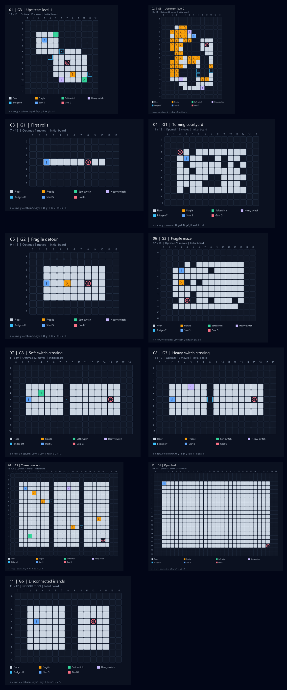

## Cách chơi và phát lại

Game tự liệt kê các file đánh số trong `data/`, nên các màn mới xuất hiện
trong menu New Game/chọn màn mà không cần đổi mã giao diện.
Chạy từ thư mục `code/` sau khi build theo README của dự án:

```bash
./a.out 3                                 # chơi màn 3 trên Linux/WSL
./a.out 7 --play data/solutions/7.txt       # tự phát lại màn công tắc
./a.out 9 --play data/solutions/9.txt       # màn lớn kết hợp
```

Windows native dùng `./a.exe` hoặc `./Bloxorz.exe` thay cho `./a.out`.
Màn 11 không có file lời giải thắng; dùng để kiểm tra solver trả về
`no_solution` sau khi duyệt hết vùng xuất phát.

Các hình bên dưới là **sơ đồ lưới ban đầu**, không phải ảnh chụp game 3D.
`S` là khối ban đầu, `G` là lỗ đích; số trên công tắc và ô cầu biểu thị
cùng một cặp điều khiển. Tọa độ `x` là dòng, `y` là cột; `U: y+1`,
`D: y−1`, `R: x+1`, `L: x−1` (theo quy ước game C++).

## Chi tiết từng màn

### Màn 1 — Upstream level 1

Màn gốc: công tắc, cầu và ô dễ vỡ.

Lời giải tối ưu **10 bước**: [file phát lại](solutions/1.txt).

```text
R U U R U R U R D L
```

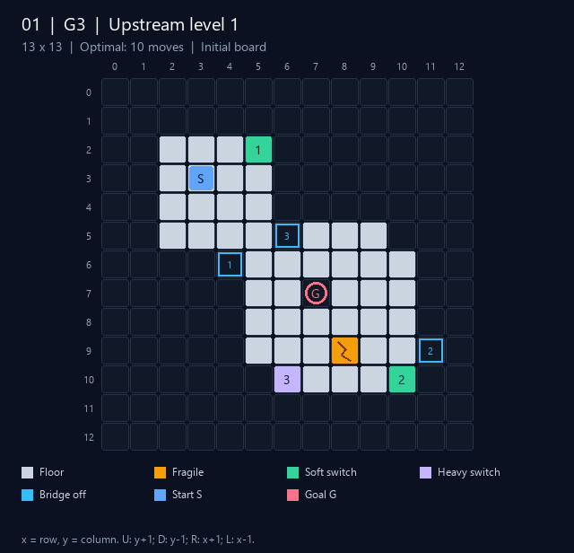

### Màn 2 — Upstream level 2

Màn gốc: công tắc, cầu và ô dễ vỡ.

Lời giải tối ưu **68 bước**: [file phát lại](solutions/2.txt).

```text
D R D L D L U R U D L D R U R D R R U R R D R R R R U D L L L L U L L L D D L U R R R R R U U R U R R R U R L U U L L L L L D L U R D L
```

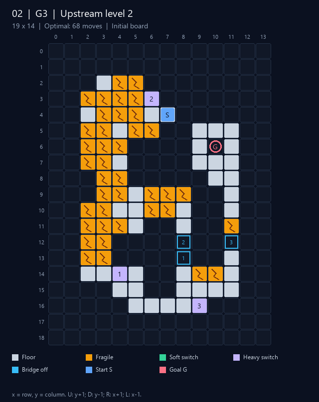

### Màn 3 — First rolls

Hành lang thẳng để học chu kỳ đứng–nằm của khối.

Lời giải tối ưu **4 bước**: [file phát lại](solutions/3.txt).

```text
U U U U
```

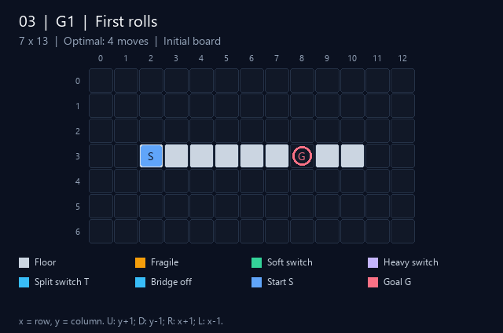

### Màn 4 — Turning courtyard

Sân có khoảng trống buộc đổi hướng và tư thế.

Lời giải tối ưu **16 bước**: [file phát lại](solutions/4.txt).

```text
U R U R D L U R D R D D D L L L
```

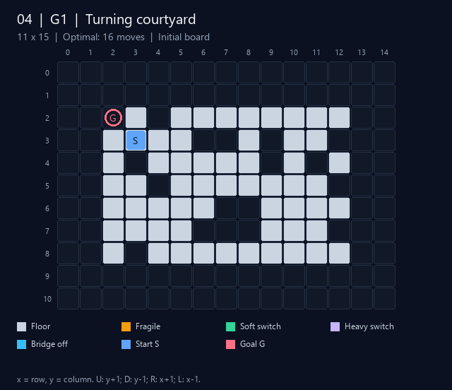

### Màn 5 — Fragile detour

Ô dễ vỡ chặn điểm dựng đứng trên đường thẳng, buộc đi vòng.

Lời giải tối ưu **6 bước**: [file phát lại](solutions/5.txt).

```text
U L U U R U
```

Kiểm chứng vai trò ô dễ vỡ: nếu thay chúng bằng sàn thường, tối ưu giảm từ 6 xuống 4 bước.

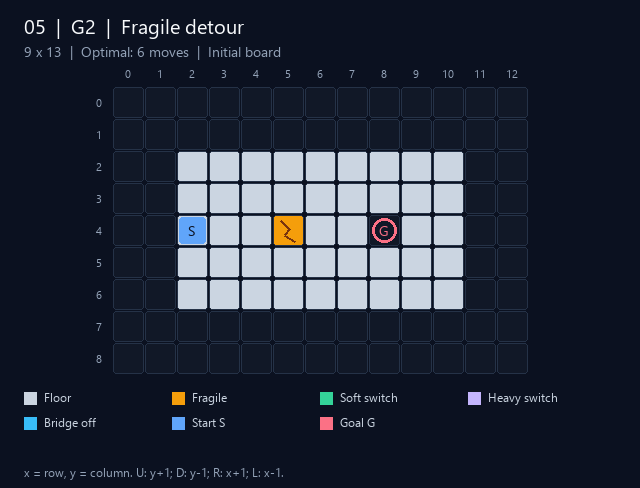

### Màn 6 — Fragile maze

Lối đi có hốc và ô dễ vỡ; phải chọn lại đường dựng đứng.

Lời giải tối ưu **20 bước**: [file phát lại](solutions/6.txt).

```text
U R U U R U L L D D R D D D D R R U U R
```

Kiểm chứng vai trò ô dễ vỡ: nếu thay chúng bằng sàn thường, tối ưu giảm từ 20 xuống 18 bước.

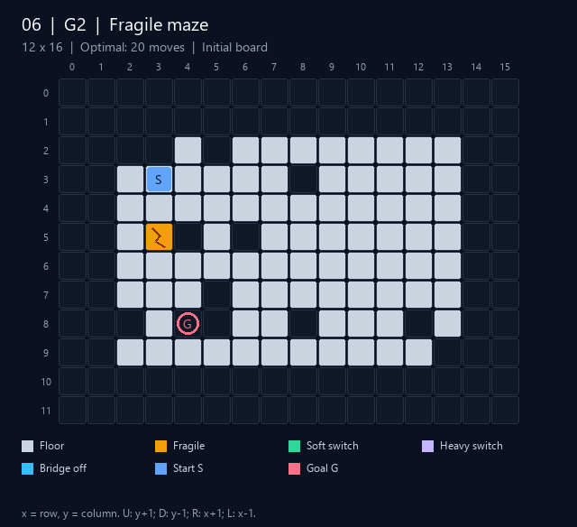

### Màn 7 — Soft switch crossing

Phải kích hoạt công tắc thường để mở cầu sang phòng đích.

Lời giải tối ưu **12 bước**: [file phát lại](solutions/7.txt).

```text
L U U U U R U U U U U U
```

Kiểm chứng vai trò cầu: bỏ riêng từng công tắc và giữ cầu của nó đóng thì màn trở thành vô nghiệm. Lời giải ghi nhận đúng việc đứng trên công tắc nặng.

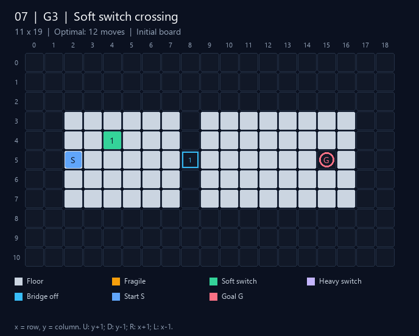

### Màn 8 — Heavy switch crossing

Phải đứng trên công tắc nặng trước khi băng qua cầu.

Lời giải tối ưu **15 bước**: [file phát lại](solutions/8.txt).

```text
U L L U U R R U U U U U L U R
```

Kiểm chứng vai trò cầu: bỏ riêng từng công tắc và giữ cầu của nó đóng thì màn trở thành vô nghiệm. Lời giải ghi nhận đúng việc đứng trên công tắc nặng.

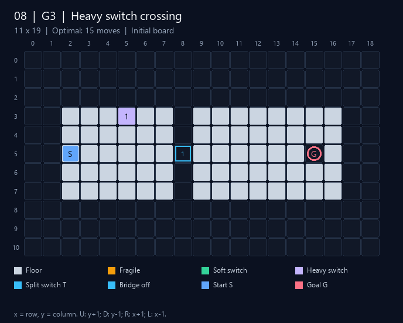

### Màn 9 — Three chambers

Màn lớn 19×25: hai khe ngăn phòng, công tắc thường/nặng và ô dễ vỡ.

Lời giải tối ưu **36 bước**: [file phát lại](solutions/9.txt).

```text
R U R R R R R R U U L L L L L U U U U L U L R U U R R R R R U U U U R R
```

Kiểm chứng vai trò cầu: bỏ riêng từng công tắc và giữ cầu của nó đóng thì màn trở thành vô nghiệm. Lời giải ghi nhận đúng việc đứng trên công tắc nặng.

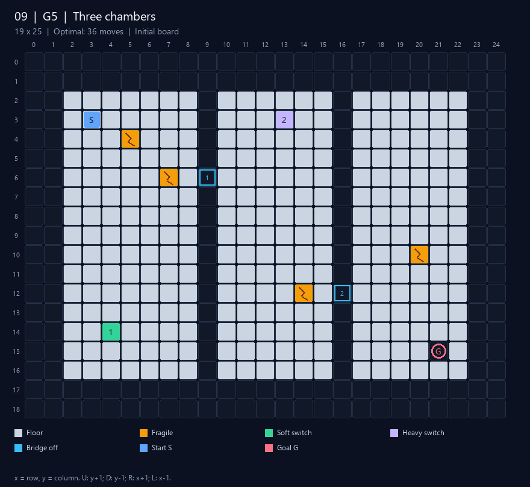

### Màn 10 — Open field

Sân trống 20×30 để so sánh lượng trạng thái và thời gian tìm kiếm.

Lời giải tối ưu **27 bước**: [file phát lại](solutions/10.txt).

```text
U U U U U U U U U U U U U U U U R U R R R R R R R R R
```

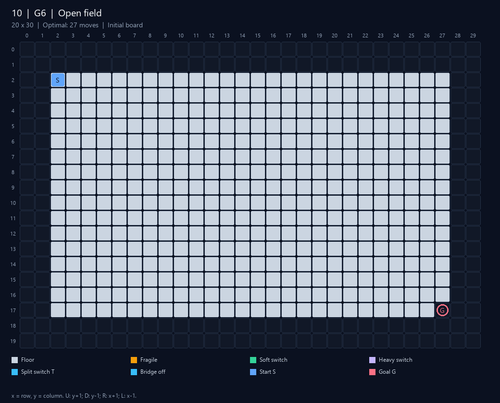

### Màn 11 — Disconnected islands

Hai đảo không có cầu; vùng xuất phát có nhiều nước đi nhưng không thể tới đích.

**Vô nghiệm**: hai đảo không nối nhau; BFS duyệt hết 113 trạng thái từ điểm đầu mà không gặp đích.

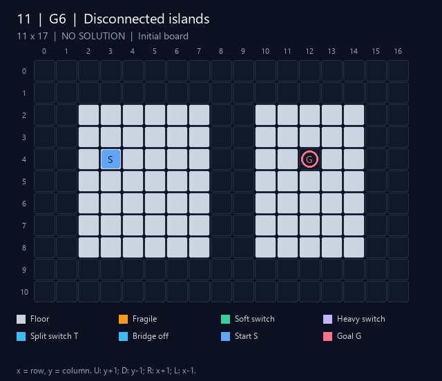

## Kiểm chứng và dựng lại hình

Từ thư mục gốc repository:

```bash
python -m pytest tests/test_levels.py -q
python -m pytest -q
python -m pip install -r scripts/requirements-previews.txt
python scripts/render_level_previews.py
```

Test kiểm tra danh mục/định dạng, lời giải thắng đúng ở bước cuối, tối ưu
theo BFS độc lập, viền 2 ô trống của màn mới, cầu bắt buộc, ảnh PNG hợp lệ
và tác dụng của ô dễ vỡ. Pillow chỉ phục vụ dựng lại hình; các file ảnh
đã được lưu sẵn, solver và pytest không cần cài Pillow.

Các lời giải mới cần được nhóm phát lại bằng game C++ khi nghiệm thu
so khớp GUI; kiểm chứng mô phỏng Python không thay cho lượt chạy game đó.

## Nguồn và phụ lục sử dụng AI

Màn 1–2 lấy từ game nền `chaitanya100100/Bloxorz`, giữ nguyên theo
[THIRD_PARTY_NOTICES](../../THIRD_PARTY_NOTICES.md). Màn 3–11 được thiết kế
cho bộ test của nhóm với hỗ trợ ChatGPT/Codex, dựa trên luật đã có trong repo.
Prompt chính: **‘Thiết kế thêm màn chơi theo phân công đầy đủ TV4’**.
Ghi thông tin này vào phụ lục sử dụng AI chung của nhóm và review lại
màn chơi, lời giải, số liệu trước khi đưa vào báo cáo chính thức.
